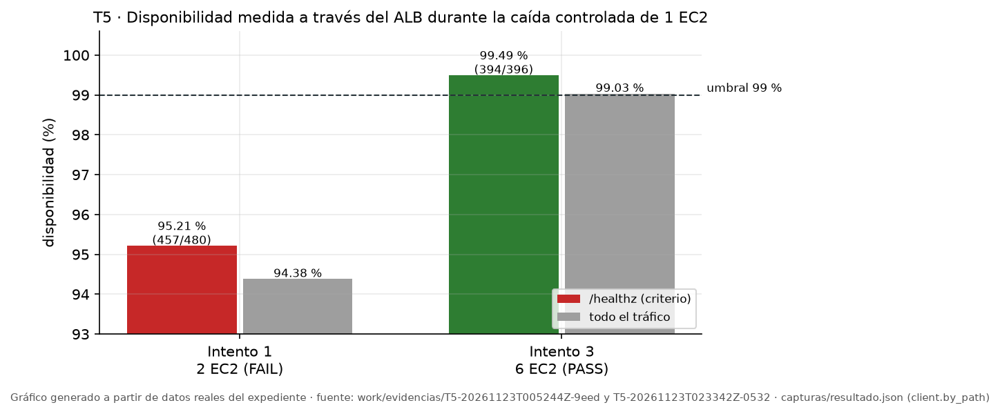

# NexoEventos

Plataforma de reservas de eventos con entradas QR, desplegada sobre una arquitectura **multicloud** (AWS · OCI · Azure). Proyecto integrador del curso de Cloud Computing (Universidad Peruana Unión). Autora: Yesenia Ramirez Medina. Docente: Fernando Asín.

> **Estado en una línea** (corte 23-nov-2026): T1 PASS 12/12 · T2 PASS 13/13 · T3 PASS 19/19 · T4 PASS 18/18 · T5 PASS 9/9 · **T6 BLOCKED** (failover AWS→OCI no ejecutado; capacidades probadas solo en local) · **T7 LOCAL** (NexoOps probado en local; despliegue en Azure **PARCIAL/INCOMPLETO**) · T8 documentación entregada. No se declara calificación; la rúbrica la aplica el docente.

## 1. Contexto y problemática
Una empresa de venta de entradas concentra aplicación y base de datos en un único servidor. Un incidente en esa sede interrumpe reservas y accesos; los picos de apertura de venta saturan CPU, memoria y conexiones; los cambios manuales no son reproducibles y las copias guardadas en el mismo sitio no protegen frente a la pérdida del sitio. La integridad es crítica: una sobreventa o una entrada duplicada es un fallo de negocio.

## 2. Objetivos
1. Eliminar los puntos únicos de falla (instancia única y base Single-AZ) y medir la tolerancia a fallos.
2. Proteger los datos: cifrado en reposo y en tránsito, respaldos cifrados con clave independiente y copia fuera del proveedor principal.
3. Demostrar la reconstrucción de la aplicación en otra nube a partir del respaldo.
4. Observar AWS desde fuera de AWS (Azure) con alertas que lleguen a una persona.
5. Validar con pruebas de criterios escritos antes de ejecutar, conservando los fallos y sus correcciones.
6. Documentar costos, límites y pendientes sin presentar diseño o estimación como resultado.

## 3. Arquitectura AWS–OCI–Azure
| Nube | Rol |
|---|---|
| **AWS** (us-east-1) | Producción: ALB + Auto Scaling + EC2 + RDS PostgreSQL Multi-AZ cifrada, S3 de respaldos |
| **OCI** (sa-saopaulo-1) | Respaldos cifrados fuera de AWS, *lease* de escritor único (Object Storage con CAS por PAR) y reconstrucción de la aplicación |
| **Azure** (centralus) | Observabilidad independiente: Zabbix, Grafana, Azure Monitor, recolector de sondas, testigo y centro de operaciones; portal **NexoOps** |


Diagramas adicionales: [red por proveedor](docs/entrega-final/diagramas/02-red-por-proveedor.png), [seguridad y recuperación](docs/entrega-final/diagramas/03-seguridad-y-recuperacion.png), [flujo T6 previsto — diseño, no ejecutado](docs/entrega-final/diagramas/04-flujo-t6-previsto.png). Rótulos del paquete: **REAL** (nube con expediente), **LOCAL**, **DISEÑO**, **ESTIMADO**.

## 4. Tecnologías
Frontend React 19 + TypeScript + Vite · Backend FastAPI + SQLAlchemy + Alembic · PostgreSQL · Terraform (AWS, OCI, Azure) · Ansible · Nginx · systemd · Zabbix 7.0 · Grafana · pytest / vitest · GitHub Actions (pruebas y Trivy).

## 5. Funcionalidades de la aplicación
Catálogo con filtros, eventos con entrada general, por zonas o con asiento numerado (plano 2D/3D), reservas idempotentes (`Idempotency-Key`), entradas con QR, validación de ingreso por operador, panel de organizador, sala de espera y fila virtual, y roles (cliente, organizador, operador). Detalle en [docs/](docs/README.md).

## 6. Alta disponibilidad (T5)
ALB + Auto Scaling Group de 6 instancias. En el intento 3 (PASS 9/9): **394 de 396** sondeos `/healthz` correctos (**99,49 %**), disponibilidad de todo el tráfico **99,03 %**, detección en **9,6 s**, capacidad completa recuperada a los **125 s** con sustitución automática por el ASG. El intento 1 (2 instancias) fue un FAIL honesto (95,21 %) y el 2 se abortó por una política de organización de AWS Academy; ambos se conservan. El 99,49 % proviene de una sola ejecución y no es un SLA.



## 7. Respaldo y recuperación
Respaldo lógico cifrado (CMS) fuera de AWS, PITR de RDS, copias externas verificadas. **T3**: reconstrucción de PostgreSQL y de la aplicación en OCI en 649 s (136 reservas y 136 entradas íntegras). **No existe RTO/RPO de failover medido**: ver [05-RTO-RPO.md](docs/entrega-final/05-RTO-RPO.md).

## 8. Monitoreo y NexoOps
Zabbix y Grafana en la VM de Azure, sondas externas cada minuto, alerta real de extremo a extremo (problema Zabbix → métrica → Azure Monitor → correo) en T4. **NexoOps** ([nexoops/](nexoops/), [docs/nexoops/](docs/nexoops/README.md)) es un portal FastAPI de solo lectura con OTP por correo, auditoría encadenada, integraciones Grafana/Zabbix, adaptadores AWS/OCI/Azure y asistente determinista que cita evidencia. **Despliegue A1 en Azure: PARCIAL/INCOMPLETO** — servicio instalado pero deshabilitado, login OTP en Azure no demostrado: [expediente A1](docs/evidencias/A1-20261123-cierre.md).

## 9. Controles de seguridad
Segmentación y SG mínimos (sin puerto 22 en la entrada web), IMDSv2 obligatorio, RDS privada y cifrada, TLS verificado, claves y estados de Terraform fuera del repositorio, OTP + Argon2id + cookies `Secure`/`SameSite` limitadas a la subruta + CSRF/Origin en NexoOps, lista blanca de acciones sin ejecución remota, bloqueo del failover y del failback (`REAL_EXECUTION_WIRED=False`, `REAL_WIRING_ENABLED=False`) y fencing del escritor único. Riesgos residuales (p. ej. sin *trail* de CloudTrail, MFA de aplicación en diseño) en el informe, cap. VII.

## 10. Infraestructura como código
`infra/aws`, `infra/aws-v2`, `infra/aws-recovery`, `infra/oci`, `infra/azure`, `infra/gcp` (módulos y variables de ejemplo; **sin** estados ni `*.tfvars` reales). Todos pasan `terraform validate`; no se ejecutó `apply` en este cierre. El software de las VM se instala con scripts, Ansible y cloud-init (`ansible/`, `deploy/`).

## 11. Pruebas y resultados
| Suite | Resultado | Entorno |
|---|---|---|
| `backend/tests` | 343 passed | local |
| `scripts/multicloud` | ver [registro de integración](docs/entrega-final/REGISTRO-CIERRE-INTEGRACION.md) | local |
| `nexoops` + `ops_center` | 333 passed | local |
| `frontend` (vitest) | 44 passed | local |
| `terraform validate` (6 módulos) | válido | local, sin aplicar |
| Batería cloud T1–T5 | PASS (expedientes con SHA-256) | nube real |

## 12. Estado real T1–T8
| Etapa | Estado | Nota |
|---|---|---|
| T1 lease y CAS en OCI | **PASS 12/12** | tras 1 FAIL corregido |
| T2 DNS | **PASS 13/13** | propagación ≈ 62 s |
| T3 recuperación en OCI | **PASS 19/19** | tras 2 FAIL corregidos |
| T4 centro de operaciones Azure | **PASS 18/18** | alerta real recibida |
| T5 alta disponibilidad | **PASS 9/9** | con 6 EC2 |
| T6 failover AWS→OCI | **BLOCKED** | anti-rollback (B-T6-1), fencing (G5), TLS (G9) y 11 proveedores reales probados **solo en local** |
| T7 NexoOps | **LOCAL / A1 PARCIAL** | ver §8 |
| T8 cierre | documentación | limpieza cloud NOT_TESTED |

## 13. Estructura del repositorio
`backend/` API y migraciones · `frontend/` aplicación web · `infra/` Terraform · `ansible/`, `deploy/` aprovisionamiento · `scripts/` operación, respaldo, multicloud y simulacros · `ops_center/` centro de operaciones · `nexoops/` portal NexoOps · `docs/` documentación y evidencias (`docs/evidencias/` expedientes, `docs/entrega-final/` informe y matriz de rúbrica, `docs/t7-t8/` documentación de T7–T8) · `perf/` pruebas de carga.

## 14. Ejecutar localmente
```bash
# Backend
cd backend && source .venv/bin/activate
alembic upgrade head
../scripts/seed-demo-catalog.py && ../scripts/dev-bootstrap.py
uvicorn app.main:app --reload --port 8000
```
```bash
# Frontend (Node 24)
cd frontend && npm ci && npm run dev      # http://localhost:5173
```
```bash
# Pruebas
cd backend && python -m pytest tests -q
PYTHONPATH=.:backend python -m pytest nexoops ops_center scripts/multicloud -q
cd frontend && npx vitest run
```
Verificación rápida del entorno: `./scripts/check-local.sh`. NexoOps local: [docs/nexoops/README.md](docs/nexoops/README.md).

## 15. Informe y evidencias
- **Informe académico (Word):** [NexoEventos_Informe_Academico_Final_Con_Evidencias.docx](docs/entrega-final/NexoEventos_Informe_Academico_Final_Con_Evidencias.docx) (14 criterios de la rúbrica; versión previa conservada como [respaldo](docs/entrega-final/NexoEventos_Informe_Final_Completo_Con_Evidencias.docx)).
- Matriz de rúbrica: [01-MATRIZ-RUBRICA.md](docs/entrega-final/01-MATRIZ-RUBRICA.md) y [MATRIZ-RUBRICA-EVIDENCIAS.xlsx](docs/entrega-final/MATRIZ-RUBRICA-EVIDENCIAS.xlsx). La hoja de la rúbrica declara TOTAL 20, pero sus puntajes suman 18,5; no se alteraron pesos ni se asigna nota.
- Inventario de evidencias: [INVENTARIO-MAESTRO-EVIDENCIAS.xlsx](docs/entrega-final/INVENTARIO-MAESTRO-EVIDENCIAS.xlsx) · índice: [08-INDICE-EVIDENCIAS.md](docs/entrega-final/08-INDICE-EVIDENCIAS.md) · capturas de consola redactadas: [docs/evidencias/capturas/](docs/evidencias/capturas/INDICE.md) · [limitaciones y pendientes](docs/entrega-final/07-LIMITACIONES-Y-PENDIENTES.md).
- Registro de la integración final: [REGISTRO-CIERRE-INTEGRACION.md](docs/entrega-final/REGISTRO-CIERRE-INTEGRACION.md).

> Las capturas publicadas tienen ocultos cuenta, ARN, IDs, IP y correos. No se incluyen secretos, estados de Terraform ni respaldos.
