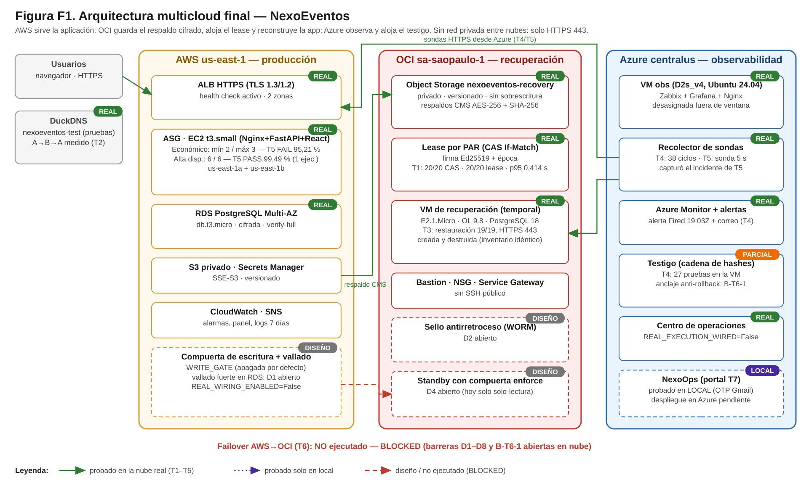

# NexoEventos

**Plataforma de gestión de eventos con reservas, entradas digitales con QR y operación multicloud (AWS · OCI · Azure).** Proyecto integrador del curso de Cloud Computing (Universidad Peruana Unión). Autora: Yesenia Ramirez Medina · Docente: Fernando Asín.

> **Nota de alcance.** NexoEventos es un **caso de estudio ficticio**: la empresa, su escenario inicial y sus riesgos son **supuestos de diseño** que justifican la arquitectura; no describen incidentes, clientes ni pérdidas reales. Las **pruebas, mediciones y evidencias** de este repositorio sí son reales y están rotuladas (REAL, LOCAL, DISEÑO, ESTIMADO).



## 1. Descripción
NexoEventos permite publicar y administrar eventos, registrar y autenticar usuarios, reservar entradas, emitir tickets digitales y validarlos en el acceso mediante QR, con un panel de operación para el equipo técnico. Su valor está en **cómo se sostiene ese servicio**: alta disponibilidad en AWS, respaldos y recuperación en OCI, y observabilidad independiente con un centro de operaciones en Azure.

## 2. Contexto de la empresa (ficticia)
NexoEventos es una empresa ficticia que organiza, promociona y gestiona eventos mediante una plataforma digital. Su operación cubre la publicación y administración de eventos, el registro y autenticación de usuarios, las reservas, la emisión de tickets digitales, la validación de entradas por QR y la administración operativa. La demanda crece de forma abrupta en lanzamientos de eventos, inscripciones y ventas de alta concurrencia.

## 3. Problemática empresarial (escenario de diseño)
**Problema general.** Como escenario inicial se asume una infraestructura tecnológica centralizada, cuya dependencia de un único servidor y de un único entorno compromete la continuidad del servicio, la integridad de la información y la capacidad de respuesta ante picos de demanda y fallas graves.

**Problemas específicos (supuestos de diseño, no hechos ocurridos):**
1. Interrupciones del servicio ante fallas de servidores.
2. Dificultad para mantener la disponibilidad durante aumentos de demanda.
3. Riesgo de indisponibilidad o pérdida de información.
4. Recuperación compleja ante incidentes graves.
5. Falta de visibilidad centralizada del estado tecnológico.
6. Dependencia operativa de un único entorno de infraestructura.

## 4. Objetivos
**General.** Diseñar, implementar y validar con evidencias una arquitectura cloud segura, disponible y recuperable para NexoEventos, usando AWS, OCI y Azure con funciones complementarias.

**Específicos.**
- Eliminar puntos únicos de falla y medir la tolerancia a fallos (problemas 1 y 2).
- Proteger los datos con cifrado y respaldos fuera del proveedor principal (3).
- Demostrar la reconstrucción de la aplicación en otra nube a partir del respaldo (4).
- Observar AWS desde fuera de AWS, con alertas que lleguen a una persona (5).
- Separar roles entre nubes y proteger la exclusividad del escritor y contra *rollback* (6).
- Validar con pruebas de criterios previos, conservando fallos y correcciones, y documentar costos y límites.

## 5. Solución propuesta e implementada
Una arquitectura multicloud con roles complementarios, descrita como código (Terraform, Ansible) y verificada con pruebas automatizadas:

| Problema empresarial | Respuesta de la solución | Evidencia | Resultado obtenido |
|---|---|---|---|
| 1. Interrupciones por falla de servidores | **AWS:** ALB + Auto Scaling Group + RDS PostgreSQL Multi-AZ | T5 · [resultado](docs/evidencias/T5-20261123-resultado.md); [failover RDS](docs/evidencias/capturas/aws/11-rds-failover-22oct.png) | T5 **PASS 9/9**; sustitución automática de EC2 |
| 2. Disponibilidad ante picos de demanda | **AWS:** autoescalado con *health checks* y alarmas | T5; [ASG en CloudWatch](docs/evidencias/capturas/aws/06-asg-escalabilidad.png) | `/healthz` **99,49 %** (394/396), detección **9,6 s**, recuperación **125 s** |
| 3. Pérdida o indisponibilidad de información | Cifrado, PITR de RDS y respaldos cifrados con copia en **OCI** | [PITR](docs/evidencias/capturas/aws/A5-RDS-Retencion-Cifrado.png); [respaldo en OCI](docs/evidencias/capturas/oci/OCI-03-Backup-Manifest-y-Archivo-23oct.png) | Retención de 7 días y copia fuera de AWS verificadas |
| 4. Recuperación compleja | Reconstrucción reproducible de PostgreSQL y de la aplicación en **OCI** | T3 · [resultado](docs/evidencias/T3-20261122-intento3-resultado.md) | **PASS 19/19**, 649 s, 136 reservas y 136 entradas íntegras |
| 5. Falta de visibilidad centralizada | **Azure:** Zabbix, Grafana, Azure Monitor y centro de operaciones **NexoOps** | T4 · [resultado](docs/evidencias/T4-20261122-resultado.md); [A1](docs/evidencias/A1-20261123-cierre.md) | T4 **PASS 18/18** con alerta real recibida; NexoOps **LOCAL** (despliegue en Azure parcial) |
| 6. Dependencia de un único entorno | Roles entre nubes, *lease* de escritor único y anclaje anti-*rollback* | T1 · T2 · [T6 local](docs/evidencias/T6-20261123-estado-local.md) | T1 **PASS 12/12**, T2 **PASS 13/13**; T6 probado **solo en local** (el failover real AWS→OCI **no se ejecutó**: BLOCKED) |

## 6. Arquitectura AWS–OCI–Azure
| Nube | Rol |
|---|---|
| **AWS** (us-east-1) | Infraestructura principal: EC2, ALB, Auto Scaling, RDS PostgreSQL Multi-AZ cifrada, S3 de respaldos |
| **OCI** (sa-saopaulo-1) | Respaldos cifrados fuera de AWS, restauración PostgreSQL, recuperación funcional de la aplicación, *lease* de escritor único (CAS por PAR) y anclaje anti-*rollback* |
| **Azure** (centralus) | Monitoreo independiente: Zabbix, Grafana, Azure Monitor, recolector de sondas, testigo y centro de operaciones NexoOps |

Más diagramas: [red por proveedor](docs/entrega-final/diagramas/02-red-por-proveedor.png), [seguridad y recuperación](docs/entrega-final/diagramas/03-seguridad-y-recuperacion.png), [flujo T6 previsto — diseño, no ejecutado](docs/entrega-final/diagramas/04-flujo-t6-previsto.png).

## 7. Funcionalidades
Catálogo con filtros; eventos con entrada general, por zonas o con asiento numerado (plano 2D/3D); reservas idempotentes (`Idempotency-Key`); entradas con QR; validación de ingreso por operador; panel de organizador; sala de espera y fila virtual; roles (cliente, organizador, operador). Detalle en [docs/](docs/README.md).

## 8. Resultados técnicos
| Etapa | Estado | Qué demuestra y bajo qué condiciones |
|---|---|---|
| T1 lease y CAS en OCI | **PASS 12/12** | Escritor único con adquisición atómica; tras 1 FAIL corregido |
| T2 DNS | **PASS 13/13** | Cambio y reversión de DNS de pruebas (≈ 62 s de propagación) |
| T3 recuperación en OCI | **PASS 19/19** | Reconstrucción funcional en 649 s; tras 2 FAIL corregidos. No es el RTO de un failover |
| T4 centro de operaciones | **PASS 18/18** | Sondas, alerta real de extremo a extremo y cierre limpio de la VM |
| T5 alta disponibilidad | **PASS 9/9** | 394/396 respuestas (99,49 %), 99,03 % del tráfico total, detección 9,6 s, recuperación 125 s con 6 EC2; **una sola ejecución**, tras un FAIL con 2 EC2 (95,21 %) y un aborto por política de AWS Academy; no es un SLA |
| T6 failover AWS→OCI | **BLOCKED** | Anti-*rollback*, exclusividad del escritor y TLS probados en local; sin RTO/RPO de failover medido |
| T7 NexoOps | **LOCAL / A1 PARCIAL** | Portal probado en local; despliegue en Azure incompleto ([expediente](docs/evidencias/A1-20261123-cierre.md)) |
| T8 cierre | documentación | Informe, matriz de rúbrica e inventario de evidencias; limpieza cloud NOT_TESTED |

Pruebas automatizadas locales: backend 343 · multicloud 704 (+66 subtests) · NexoOps y centro de operaciones 333 · frontend 44 · `terraform validate` en 6 módulos; CI de GitHub con 7 jobs. Costos: estimaciones, no facturas.


## 9. Seguridad y observabilidad
**Seguridad.** Segmentación y grupos de seguridad mínimos (sin puerto 22 en la entrada web), IMDSv2 obligatorio, RDS privada y cifrada, TLS verificado, respaldos cifrados con clave independiente, claves y estados de Terraform fuera del repositorio; en NexoOps, OTP + Argon2id, cookies `Secure`/`SameSite` limitadas a la subruta, CSRF/Origin, lista blanca de acciones sin ejecución remota y auditoría encadenada; failover y failback bloqueados (`REAL_EXECUTION_WIRED=False`, `REAL_WIRING_ENABLED=False`) y fencing del escritor único. Riesgos residuales (sin *trail* de CloudTrail, MFA de aplicación en diseño) en el informe, cap. VII.

**Observabilidad.** Zabbix y Grafana en Azure, sondas externas, alerta real (problema Zabbix → métrica → Azure Monitor → correo) y centro de operaciones NexoOps ([nexoops/](nexoops/), [docs/nexoops/](docs/nexoops/README.md)).

## 10. Tecnologías
React 19 + TypeScript + Vite · FastAPI + SQLAlchemy + Alembic · PostgreSQL · Terraform (`infra/aws`, `aws-v2`, `aws-recovery`, `oci`, `azure`, `gcp`; sin estados ni `*.tfvars` reales) · Ansible · Nginx · systemd · Zabbix 7.0 · Grafana · pytest / vitest · GitHub Actions (pruebas y Trivy).

## 11. Evidencias y documentación
- **Informe académico definitivo (Word, 71 páginas):** [NexoEventos_Informe_Academico_Definitivo.docx](docs/entrega-final/NexoEventos_Informe_Academico_Definitivo.docx) — la versión anterior, [Final_Con_Evidencias](docs/entrega-final/NexoEventos_Informe_Academico_Final_Con_Evidencias.docx), se conserva como respaldo. 14 criterios de la rúbrica, matriz problema–solución, figuras y capturas redactadas.
- Matriz de rúbrica: [01-MATRIZ-RUBRICA.md](docs/entrega-final/01-MATRIZ-RUBRICA.md), [MATRIZ-RUBRICA-EVIDENCIAS.xlsx](docs/entrega-final/MATRIZ-RUBRICA-EVIDENCIAS.xlsx) (la hoja declara total 20 pero sus puntajes suman 18,5; no se alteraron pesos ni se asigna nota).
- Inventario: [INVENTARIO-MAESTRO-EVIDENCIAS.xlsx](docs/entrega-final/INVENTARIO-MAESTRO-EVIDENCIAS.xlsx) · [índice](docs/entrega-final/08-INDICE-EVIDENCIAS.md) · [capturas de consola](docs/evidencias/capturas/INDICE.md) · [RTO/RPO medidos](docs/entrega-final/05-RTO-RPO.md) · [limitaciones y pendientes](docs/entrega-final/07-LIMITACIONES-Y-PENDIENTES.md) · [registro de integración](docs/entrega-final/REGISTRO-CIERRE-INTEGRACION.md).
- Estructura: `backend/` · `frontend/` · `infra/` · `ansible/`, `deploy/` · `scripts/` · `ops_center/` · `nexoops/` · `docs/` · `perf/`.

> Las capturas publicadas tienen ocultos cuenta, ARN, IDs, IP y correos. No se incluyen secretos, estados de Terraform ni respaldos.

## 12. Instalación y ejecución
```bash
# Backend
cd backend && source .venv/bin/activate
alembic upgrade head
../scripts/seed-demo-catalog.py && ../scripts/dev-bootstrap.py
uvicorn app.main:app --reload --port 8000
```
```bash
# Frontend (Node 24)
cd frontend && npm ci && npm run dev      # http://localhost:5173
```
```bash
# Pruebas
cd backend && python -m pytest tests -q
PYTHONPATH=.:backend python -m pytest nexoops ops_center scripts/multicloud -q
cd frontend && npx vitest run
```
Verificación rápida del entorno: `./scripts/check-local.sh`. NexoOps local: [docs/nexoops/README.md](docs/nexoops/README.md).
