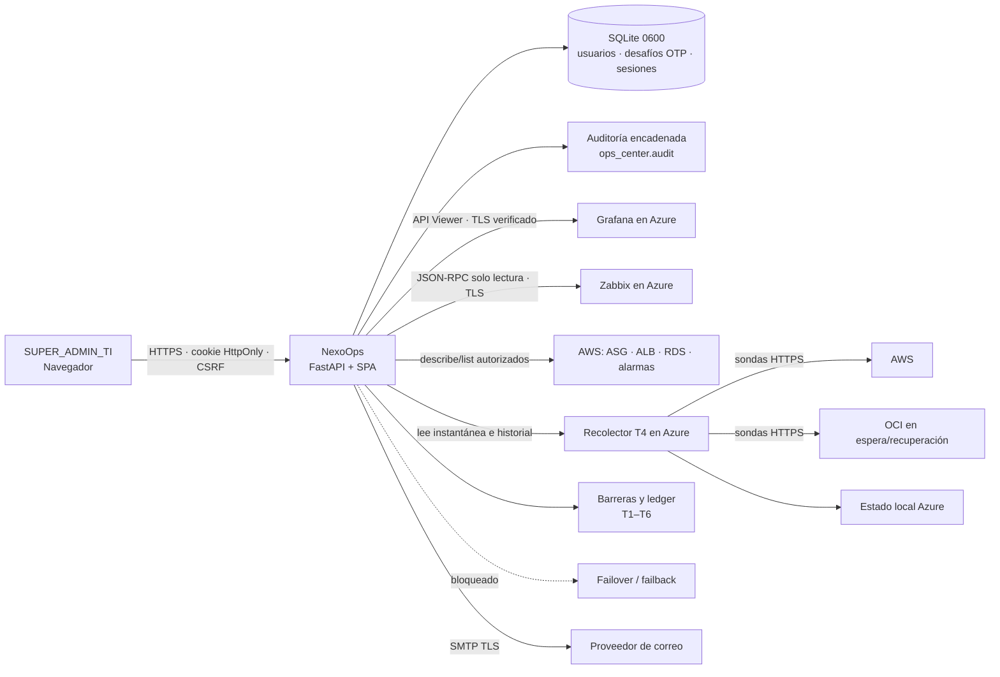
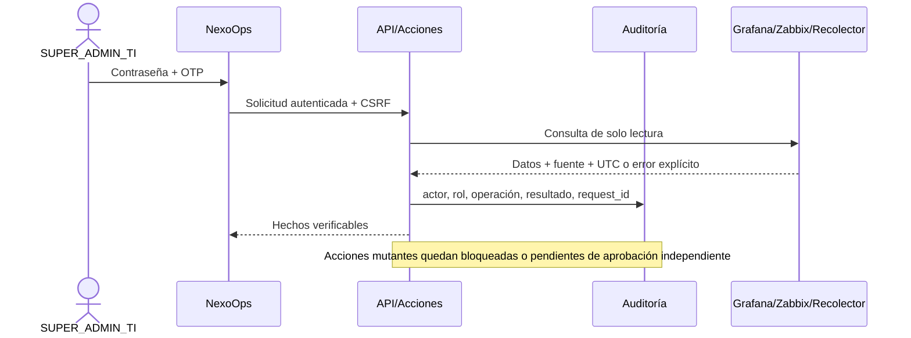

# Arquitectura operativa de T7

## Fronteras de confianza

- El navegador nunca recibe credenciales de Grafana, Zabbix, AWS ni SMTP.
- Grafana y Zabbix usan permisos de solo lectura y TLS verificado; una fuente no disponible se muestra como tal.
- Las acciones de NexoOps son una lista blanca. No existe ejecución arbitraria de comandos.
- Failover y failback siguen bloqueados hasta T6 y aprobación independiente.
- El recolector conserva fuente y hora UTC; una instantánea obsoleta no se presenta como estado actual.

## Flujo operativo permitido

