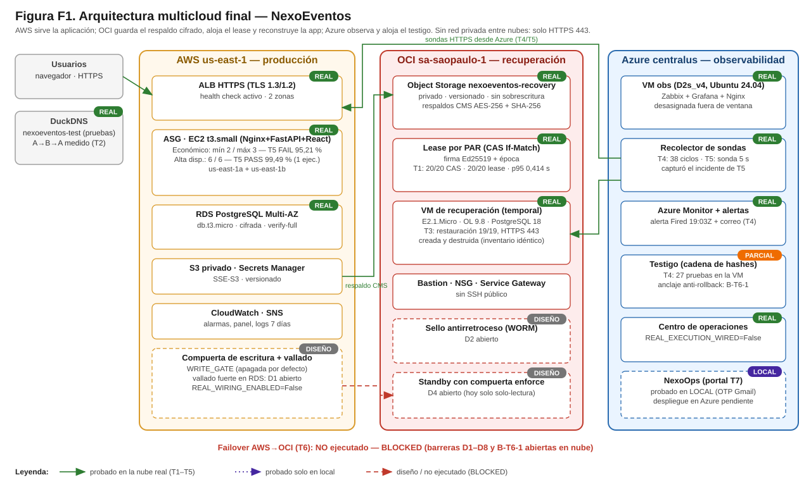
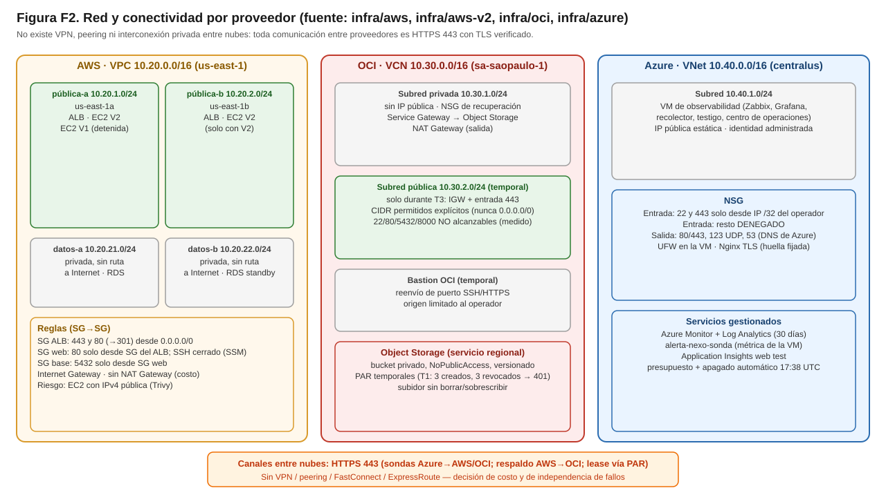
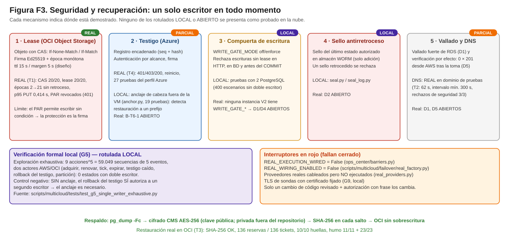
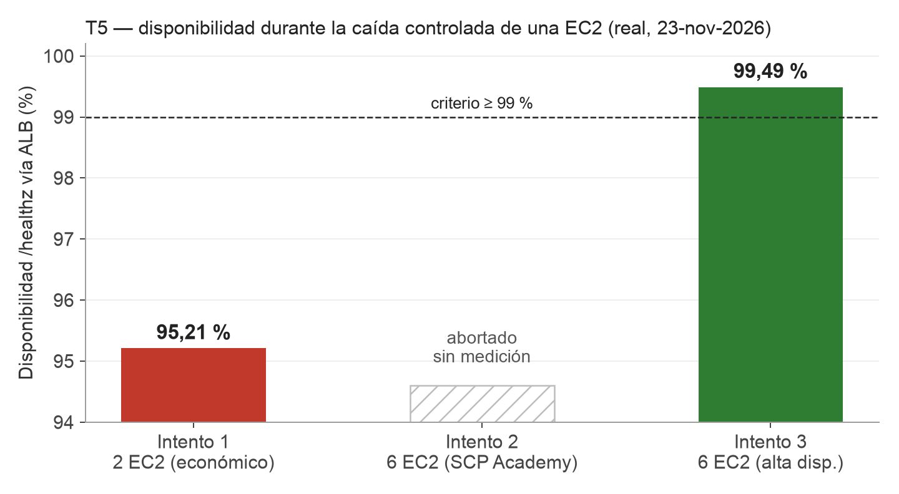
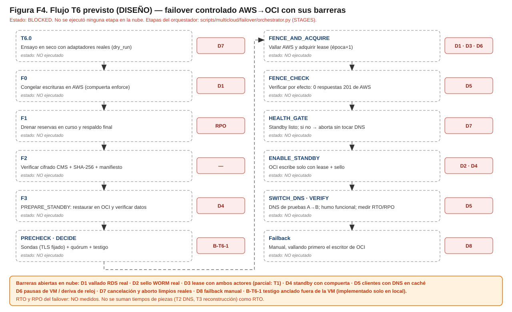
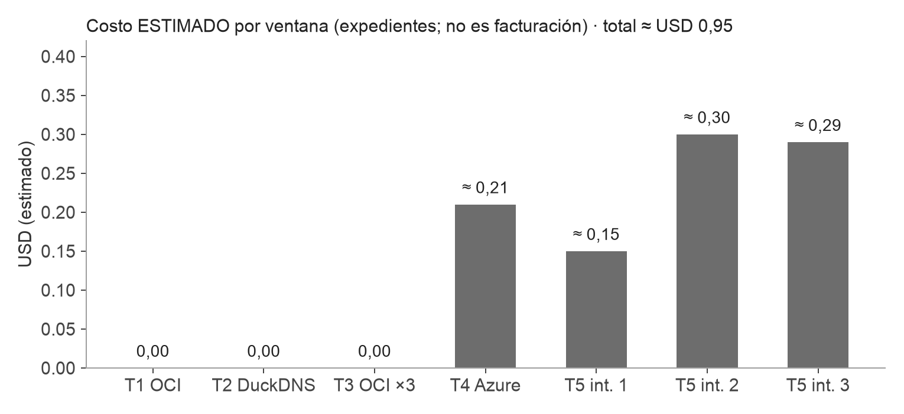
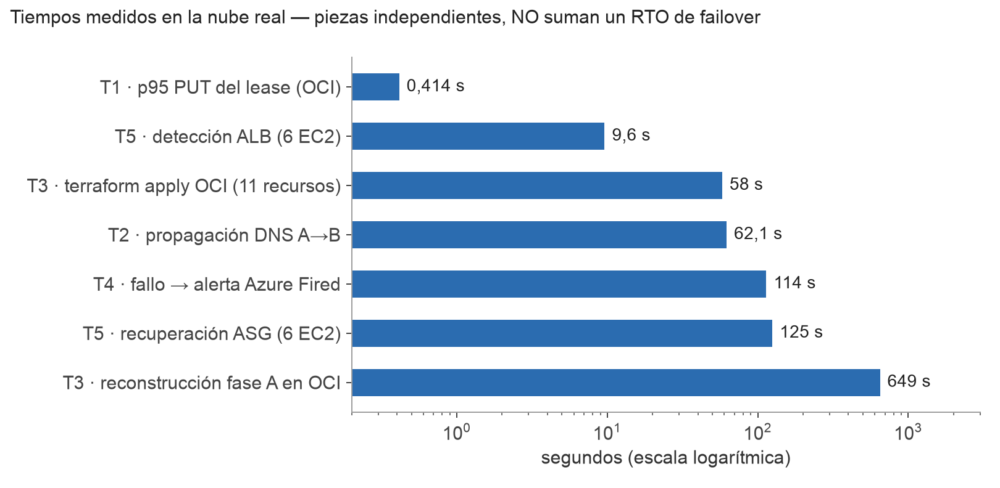

# NexoEventos — Informe técnico final (entrega académica)

**Proyecto:** NexoEventos, plataforma de reservas de eventos con entradas QR (React + FastAPI + PostgreSQL), desplegada en AWS con recuperación en OCI y observabilidad en Azure.
**Fecha de corte:** 23-nov-2026 (UTC). **Versión:** final para revisión de la propietaria.
**Convención obligatoria del informe:** cada afirmación técnica lleva el lugar donde se demostró: **[REAL]** nube real con expediente · **[LOCAL]** equipo de desarrollo, sin nube · **[DISEÑO]** documentado y no ejecutado · **[ESTIMADO]** cálculo, no medición. Los estados de las pruebas son **PASS / FAIL / BLOCKED / NOT_TESTED**.

---

## Resumen ejecutivo

NexoEventos pasó de una instancia única (V1) a una arquitectura multicloud con funciones separadas: **AWS sirve** la aplicación (ALB + Auto Scaling + RDS Multi-AZ), **OCI conserva y restaura** los respaldos cifrados y aloja el *lease* de escritor único, y **Azure observa** desde fuera de AWS (Zabbix, Grafana, Azure Monitor, recolector de sondas y testigo).

Entre el 22 y el 23-nov-2026 se ejecutaron en la nube real cinco pruebas obligatorias, cada una con criterios escritos antes y expediente con manifiesto SHA-256:

| Prueba | Qué demuestra | Resultado final | Intentos fallidos conservados |
|---|---|---|---|
| T1 | Lease y CAS atómico en OCI Object Storage | **PASS 12/12** [REAL] | 1 FAIL (`NameError`) |
| T2 | Cambio de DNS A→B→A en el dominio de pruebas | **PASS 13/13** [REAL] | 1 FAIL (almacén de CA ausente) |
| T3 | Reconstrucción de PostgreSQL + app en OCI | **PASS 19/19** [REAL] | 2 FAIL (dnf sin límites; OOM) |
| T4 | Centro de observación en Azure | **PASS 18/18** [REAL] | — (incidentes resueltos dentro de la ventana) |
| T5 | Alta disponibilidad AWS (caída de una EC2) | **PASS 9/9** [REAL] con 6 EC2 | 1 FAIL (95,21 % con 2 EC2) + 1 abortado (SCP) |
| T6 | Failover real AWS→OCI | **BLOCKED** (no ejecutado) | — |
| T7 | Portal NexoOps | Implementado y probado **[LOCAL]**; no desplegado en Azure | — |
| T8 | Cierre y entrega | Este paquete; limpieza final por verificar | — |

**Lo que no se afirma:** no hubo failover AWS→OCI; **no se midieron RTO ni RPO del failover**; el 99,49 % de T5 es **una sola ejecución** y no un SLA; los costos son estimaciones de los expedientes, no facturación.

---

## 1. Problema y requerimientos (criterio 1)

**Problema.** El caso parte de una aplicación y su PostgreSQL en un único servidor: un incidente local detiene reservas y validaciones de acceso, los picos de apertura compiten por CPU y conexiones, los respaldos en el mismo lugar no cubren la pérdida del sitio y los cambios manuales no son reproducibles (`docs/entregable2/informe-entregable2.md` §02).

**Requisitos funcionales.** Catálogo de eventos; reserva con control de aforo por zona/asiento; entradas con QR cifrado; roles cliente, organizador y operador; validación en puerta.

**Requisitos no funcionales.**

| Requisito | Meta del proyecto | Estado |
|---|---|---|
| Integridad (sin sobreventa ni reserva duplicada) | 0 sobreventas | Probado: 12 clientes concurrentes sobre 4 cupos → 4 × 201, 8 × 409 [LOCAL, `PROJECT_STATUS.md` §2]; 4 reservas concurrentes en OCI, cupos 178→173 [REAL, T3] |
| Confidencialidad | cifrado en reposo y en tránsito | Cumplido [REAL] (§5) |
| Disponibilidad ante caída de una EC2 | ≥ 99 % en la ventana de prueba | 99,49 % con 6 EC2 (una ejecución) [REAL, T5]; 95,21 % con 2 EC2 |
| Recuperación fuera de AWS | RTO ≤ 3600 s, RPO ≤ 5400 s (criterios de T6) | **NO medidos** (T6 BLOCKED) |
| Costo | dentro del crédito de AWS Academy y techo de USD 1,5 por ventana | Cumplido según estimaciones [ESTIMADO] |

**Restricciones reales:** AWS Academy (rol `LabRole` impuesto, sesiones de 4 h, SCP que deniega ciertos tamaños de ASG, expiración ≈ 26-nov-2026), Azure for Students, OCI Free Tier, una sola operadora.

---

## 2. Arquitectura multicloud (criterio 2)

*Figura F1 — `docs/entrega-final/diagramas/01-arquitectura-multicloud.svg`. Las cajas con borde discontinuo son [DISEÑO].*

| Nube | Rol | Componentes principales | Evidencia |
|---|---|---|---|
| AWS us-east-1 | Producción | ALB HTTPS, ASG con EC2 `t3.small` en 2 zonas, RDS PostgreSQL Multi-AZ cifrada, S3, Secrets Manager, CloudWatch/SNS | `infra/aws`, `infra/aws-v2`; T5 [REAL] |
| OCI sa-saopaulo-1 | Recuperación y autoridad de escritura | Bucket privado versionado `nexoeventos-recovery`, PAR temporales para el lease, VM de recuperación temporal, Bastion | `infra/oci`; T1 y T3 [REAL] |
| Azure centralus | Observabilidad y testigo | VM con Zabbix, Grafana, recolector de sondas, testigo y centro de operaciones; Azure Monitor y alertas | `infra/azure`; T4 [REAL] |
| DuckDNS | DNS del dominio de pruebas | `nexoeventos-test` (el dominio de demostración no se toca) | T2 [REAL] |

**Decisiones clave.**
1. **Sin replicación síncrona entre nubes.** Cada COMMIT esperaría el viaje de ida y vuelta a São Paulo; se eligió recuperación con respaldos cifrados y conmutación controlada con escritor único (`docs/entregable3/06-informe-estrategia-sincrona.md`).
2. **Un solo escritor en todo momento.** El lease en OCI (CAS + firma Ed25519 + época), el testigo en Azure, la compuerta de escritura y el sello antirretroceso impiden dos escritores (Figura F3).
3. **Dos puntos de operación en AWS** (resultado de T5):

| | Económico | Alta disponibilidad |
|---|---|---|
| ASG | mín 2 / deseada 2 / máx 3 | mín 6 / deseada 6 / máx 6 |
| Health check ALB | 10 s / 5 s, umbrales 2/2, `least_outstanding_requests` | 5 s / 3 s, umbrales 2/2, `weighted_random` + mitigación de anomalías; pool de BD 3+2 |
| Costo AWS aproximado | ≈ 0,13 USD/h [ESTIMADO] | ≈ 0,26 USD/h [ESTIMADO] |
| Resultado T5 (parada controlada) | **FAIL 95,21 %**, detección 24,9 s, recuperación 159,8 s | **PASS 99,49 %**, detección 9,6 s, recuperación 125,0 s |

Fuente: `docs/evidencias/T5-20261123-resultado.md` («Modos operativos de la V2»). La SCP de Academy denegó un máximo de 7 instancias (`docs/evidencias/T5-20261123-intento2-abortado.md`).

---

## 3. Redes (criterio 3)

| Proveedor | Red | Segmentación y reglas |
|---|---|---|
| AWS | VPC `10.20.0.0/16`: públicas `10.20.1.0/24`, `10.20.2.0/24`; datos `10.20.21.0/24`, `10.20.22.0/24` sin ruta a Internet | SG ALB 443/80 (80 → 301); SG web 80 solo desde el SG del ALB, SSH cerrado (SSM); SG base 5432 solo desde el SG web |
| OCI | VCN `10.30.0.0/16`: privada `10.30.1.0/24` (sin IP pública, Service Gateway, NAT); pública `10.30.2.0/24` **temporal** (solo durante T3) | NSG; CIDR de entrada explícitos (la variable rechaza `0.0.0.0/0`); Bastion con origen limitado; en T3 solo 443 alcanzable (22, 80, 3000, 5432, 8000, 8443 no) [REAL] |
| Azure | VNet `10.40.0.0/16`, subred `10.40.1.0/24` | NSG: 22 y 443 solo desde la IP /32 de la operadora, resto denegado; UFW; Nginx con certificado de huella fijada |

**Entre nubes no hay VPN ni peering.** Todo el tráfico entre proveedores es HTTPS 443 con TLS verificado (sondas Azure→AWS/OCI, respaldo AWS→OCI, lease vía PAR). Es una decisión de costo y de independencia de fallos, y un límite declarado. Riesgo residual: las EC2 de V2 tienen IPv4 pública (sin NAT Gateway, por costo).

---

## 4. Cómputo, almacenamiento y base de datos (criterio 4)

| Recurso | Configuración | Evidencia |
|---|---|---|
| EC2 (V2) | `t3.small`, AMI propia con `/livez`, IMDSv2, EBS gp3 cifrado | `infra/aws-v2`; T5 |
| RDS | PostgreSQL Multi-AZ `db.t3.micro`, 20 GiB cifrada, `verify-full`, backups 7 días; detenida entre ventanas | `docs/evidencias/20261104-fase-c-d-v2/`; failover Multi-AZ ≈ 14 s (`docs/evidencias/multicloud/aws/20261023-rds-multiaz/`) |
| S3 | privado, versionado, SSE-S3, ciclo de vida 365 días | `docs/evidencias/20261104-fase-a1-lifecycle-s3/` |
| OCI Object Storage | bucket privado versionado, sin acceso público; 21 objetos / 471 979 B intactos tras T1 | T1 [REAL] |
| VM OCI | `E2.1.Micro`, Oracle Linux 9.8, 945 MB RAM, swap 2 GB, PostgreSQL 18 | T3 [REAL] |
| VM Azure | `D2s_v4`, Ubuntu 24.04, desasignada fuera de ventana con apagado automático | T4 [REAL] |

**Aprendizaje de T3 (conservado):** la forma Micro necesitó tres intentos — `dnf` sin límites saturó la VM (intento 1), el temporizador `dnf-makecache` provocó un OOM (intento 2) y la reserva de 448 MiB de kdump redujo la memoria útil (corregida en caliente en el intento 3). Las correcciones (`safe-dnf.sh`, `ensure-swap.sh`, `quiesce-vm.sh`) quedaron con pruebas.

---

## 5. Seguridad (criterio 5)

| Dimensión | Control | Dónde está demostrado |
|---|---|---|
| Cifrado en reposo | EBS, RDS, S3 SSE; respaldo `pg_dump -Fc` cifrado con CMS AES-256 (clave pública; privada fuera del repositorio, 0600) | [REAL] `docs/entregable3/13-respaldo-rds-a-oci-cierre.md`; T3 usó la clave C-04 |
| Cifrado en tránsito | TLS 1.3/1.2 en ALB; `verify-full` a RDS con CA fijada; TLS verificado en todos los clientes del failover (`backend/app/failover/tlsctx.py`) | [REAL] T2 (la causa del FAIL fue precisamente rechazar un certificado sin CA cargada) |
| Integridad | SHA-256 en cada salto; manifiestos de expediente; huella de datos 10/10 | [REAL] T3 |
| Mínimo privilegio | Usuario de carga en OCI sin borrar/sobrescribir; identidad administrada de Azure *Monitoring Reader*; roles PostgreSQL separados; PAR de alcance mínimo (hermanos/`backups/`/`secrets/` → 401) | [REAL] T1, `docs/entregable2/informe-entregable2.md` §09 |
| Revocación | 3 PAR creados y revocados (401 tras revocar); tokens del centro destruidos tras T4 | [REAL] T1, T4 |
| Autorización operativa | Centro de operaciones con roles (anónimo 401, viewer/requester 403, aprobador distinto, failover RECHAZADO) | [REAL] T4 (18 pruebas) |
| Fallo cerrado | `REAL_EXECUTION_WIRED=False` (`ops_center/barriers.py`), `REAL_WIRING_ENABLED=False` (`scripts/multicloud/failover/real_factory.py`) | [LOCAL] código |
| Portal NexoOps | Argon2id, OTP de 6 dígitos por correo (5 min, un solo uso), límite de intentos, CSRF, cookies HttpOnly/SameSite=Strict/Secure, rol `SUPER_ADMIN_TI`, auditoría encadenada, lista blanca de acciones | [LOCAL] — login real con OTP recibido por Gmail y acceso al Overview, confirmado por la propietaria; **no desplegado** en Azure |

**Límites:** `LabRole` de Academy es más amplio de lo necesario y no se puede reducir; CloudTrail sin *trail* propio; la aplicación de reservas no tiene MFA; el token de DuckDNS es de la cuenta (se recomienda regenerarlo al cerrar T8).

---

## 6. Alta disponibilidad y escalabilidad (criterio 6)

**T5 (real, 23-nov-2026).** Tráfico constante de 5 req/s con 4 clientes; fallo inyectado: parada controlada de la API en **una** EC2; el ASG debe sustituirla sin intervención manual.

| Criterio | Regla | Intento 1 (2 EC2) | Intento 3 (6 EC2) |
|---|---|---|---|
| Disponibilidad `/healthz` vía ALB | ≥ 99 % | **95,21 %** (23 fallos / 480) ✗ | **99,49 %** (2 fallos / 396) ✓ |
| Detección | ≤ 30 s | 24,9 s ✓ | 9,6 s ✓ |
| Sustitución sana | ≤ 300 s | 159,8 s ✓ | 125,0 s ✓ |
| Sustitución por el ASG | sí | ✓ | ✓ |
| Dos zonas y reparto | sí | ✓ 50/50 | ✓ 3+3 |
| Sin pérdida de datos (solo lectura) | sí | ✓ | ✓ |
| Azure observa | sí | ✓ (sonda 60 s no capturó el episodio) | ✓ sonda de 5 s **capturó** el incidente |
| Limpieza | sí | ✓ | ✓ |
| Costo ≤ USD 1,5 | sí | ≈ 0,15 | ≈ 0,29 |
| **Veredicto** | | **FAIL 8/9** | **PASS 9/9** |

El intento 2 (01:34–01:53 UTC) **se abortó sin medición**: la SCP de Academy denegó `UpdateAutoScalingGroup` con máximo 7.

**Por qué falló con 2 EC2 (causa medida):** durante los 24,9 s de detección el ALB siguió enviando ≈ 50 % del tráfico a la instancia caída (56 respuestas 502, confirmadas por `HTTPCode_Target_5XX`). Con 6 EC2 y health check de 5 s, el fallo afectó a 1/6 del tráfico durante 9,6 s.

**Lo que NO demuestra:** caída abrupta de la instancia, tráfico de escritura durante la sustitución, ni repetibilidad (una ejecución; el modelo previo daba ≈ 45–60 % de probabilidad de PASS). **No se afirma un SLA.**

**Escalabilidad (histórica, [REAL]):** escalado 2→3→2 con alarma de CPU (`docs/evidencias/escalado-v2-20261022/`); carga medida hasta 50 usuarios simultáneos (78 req/s, 0 errores 5xx). De 100 a 5 000 usuarios es **proyección** (`docs/entregable2/informe-entregable2.md` §11).

---

## 7. Monitoreo y observabilidad (criterio 7)

**T4 (real, 22-nov-2026, PASS 18/18):** 38 ciclos de sondas en 2315 s (hueco máximo 67 s) desde la VM de Azure; AWS = ERROR real (demo apagado), OCI = ADVERTENCIA «en espera», Azure = OK. Alerta real: problema de Zabbix 19:01:25Z → métrica publicada con identidad administrada → `alerta-nexo-sonda` **Fired 19:03:19Z** (resuelta 19:10:19Z) → correo recibido (cabecera no verificada). Control positivo de Grafana/Zabbix: latencia 0,61 s, TLS 74 días. Huellas de Grafana, Zabbix, UFW y NSG idénticas antes/después.

**T5:** sonda rápida de 5 s desde Azure con 372,9 s de línea base que **capturó** la muestra fallida (02:14:37,412Z) dentro de la ventana del incidente, sin fallos inexplicados.

**T7 — NexoOps [LOCAL]:** portal que integra Grafana y Zabbix (solo lectura, TLS verificado), la instantánea del recolector T4 con fuente/UTC/frescura, barreras y ledger, auditoría encadenada y un asistente **basado en reglas** (hechos, hipótesis y recomendaciones con evidencia; no es IA generativa). Código y docs: `nexoops/`, `docs/nexoops/README.md`, rama de trabajo de T7–T8, commit `040f116` (59 pruebas en ese commit; hoy la copia de trabajo, con cambios sin confirmar de otro frente, da **66 passed**). Integraciones contra Grafana/Zabbix reales: **NOT_TESTED** (probadas con clientes simulados).

---

## 8. Infrastructure as Code (criterio 8)

| Raíz Terraform | Contenido | Uso real |
|---|---|---|
| `infra/aws` | VPC, subredes, SG, EC2 V1, RDS, S3, CloudWatch, SNS, CloudTrail | V1 desde 3-oct |
| `infra/aws-v2` | ALB, listeners, target group, launch template, ASG, políticas, alarmas, panel | T5 (planes revisados por escenario `resume`/`t5b`/`t5c`) |
| `infra/aws-recovery` | EC2 + RDS de recuperación en AWS | diseño de contingencia |
| `infra/oci` | módulos `network`, `iam`, `storage`, `public_entry`, `recovery`, `lease` | T1, T3 (apply 11 / destroy 11 con guarda `teardown-public` e inventario idéntico) |
| `infra/azure` | RG, VNet, NSG, VM, Log Analytics, Monitor, alertas, presupuesto, apagado automático | T4, T5 |
| `infra/gcp` | solo `versions.tf` (no usado) | — |

**Prácticas:** plan guardado y revisado antes de cada apply; revisor estricto que solo acepta los cambios del escenario autorizado (`backend/tests/test_v2_plan_review.py`); destrucción con guarda; Trivy en CI. **Límite:** la limpieza de T5 elimina el ALB por API, por lo que el siguiente plan recrea 3 recursos (documentado y aceptado por el revisor `resume`).

---

## 9. Backup, RTO/RPO y recuperación (criterio 9)

Detalle en `05-RTO-RPO.md`. Resumen:

- **Respaldo:** `pg_dump -Fc` de RDS → cifrado CMS → SHA-256 → OCI sin sobrescritura (prueba negativa: re-subir el mismo objeto es rechazado) [REAL, 23-oct y 11-nov].
- **Reconstrucción en OCI (T3, real):** fase A en **649 s** (descarga, verificación, PostgreSQL, restauración, humo 11/11) y fase B funcional 23/23. **Es reconstrucción, no RTO de failover.**
- **RTO/RPO del failover AWS→OCI: NO medidos** (T6 BLOCKED). Hoy el respaldo más reciente tiene ≈ 93 h, por lo que el RPO de T6 (≤ 5400 s) **fallaría** sin un respaldo fresco; el procedimiento está en `04-PROCEDIMIENTOS.md` §3.

---

## 10. Arquitectura AWS–OCI y estado de T6 (criterio 10)

**T6 — failover real AWS→OCI: BLOCKED (no ejecutado).** Requiere autorización específica y ventana en nube; las barreras están en `docs/evidencias/T6-BLOQUEOS-OBLIGATORIOS.md` y la preparación en `docs/evidencias/T6-PREPARACION-SOLO-LECTURA.md`. Los 12 criterios de `ops_center/criterios/T6.json` (0 × 201 de AWS tras la toma, un solo escritor, DNS solo de pruebas y solo tras lease + datos + standby, cierre de AWS por efecto, RTO ≤ 3600 s, RPO ≤ 5400 s, sin pérdida de reservas, limpieza, ensayo T6.0, cancelación limpia y aborto por standby no listo) están **NOT_TESTED**.

**Piezas reales ya demostradas:** lease y CAS en OCI (T1), DNS de pruebas (T2), reconstrucción en OCI (T3), observación y testigo en Azure (T4).

**Capacidades demostradas SOLO EN LOCAL** (estado documentado por el frente T6 en `docs/evidencias/T6-20261123-estado-local.md`):

| Capacidad [LOCAL] | Fuente |
|---|---|
| Anclaje anti-rollback del testigo (B-T6-1): la cabeza de la cadena se ancla fuera de la VM y una restauración a un prefijo se detecta | `backend/app/failover/anchor.py`; 19 pruebas en `scripts/multicloud/tests/test_witness_anchor.py` (re-ejecutadas el 23-nov: 19 passed) |
| Exploración exhaustiva G5: 59.049 secuencias de 5 eventos (9 acciones) con dos actores AWS/OCI → 0 estados con doble escritor; control negativo: sin anclaje, el rollback del testigo **sí** autoriza a un segundo escritor | `scripts/multicloud/tests/test_g5_single_writer_exhaustive.py`; `docs/evidencias/T6-local/g5-exhaustivo-len5.txt` |
| Once proveedores reales cableados pero **no ejecutados** | `scripts/multicloud/failover/real_providers.py` |
| TLS de sondas con certificado fijado (G9) | `scripts/multicloud/failover/adapters_probes.py`; `scripts/multicloud/tests/test_tls_policy_probes.py` |
| Regresión `scripts/multicloud`: 704 passed + 66 subtests, exit 0 (683 antes de los últimos cambios); `backend/tests` 343 passed | `docs/evidencias/T6-local/regresion-final.txt` (UTC 2026-11-23T04:19:10Z; no re-ejecutada en este paquete) |
| Interruptores en rojo | `REAL_EXECUTION_WIRED=False`, `REAL_WIRING_ENABLED=False` |

**Barreras abiertas en nube:** D1 vallado en RDS real · D2 sello WORM real · D3 lease con ambos actores (parcial por T1) · D4 standby de OCI con compuerta · D5 clientes con DNS en caché · D6 pausas de VM y deriva de reloj · D7 cancelación/aborto reales · D8 failback manual · B-T6-1 en nube.

---

## 11. Costos y optimización (criterio 11)

Todas las cifras son **estimadas** por los expedientes; no hay facturación versionada. Suma de ventanas T1–T5 (incluidos intentos fallidos): **≈ USD 0,95** [ESTIMADO]. Detalle, dimensionamiento y propuestas en `06-COSTOS.md`. Optimizaciones aplicadas: trabajo por ventanas cortas con limpieza verificada, RDS detenida entre ventanas, ALB eliminado fuera de prueba, Always Free en OCI, VM de Azure desasignada con apagado automático, sin NAT Gateway.

---

## 12. Pruebas técnicas (criterio 12)

| Prueba | Expediente / informe | Intentos | Resultado |
|---|---|---|---|
| T1 lease OCI | `docs/evidencias/T1-20261122-resultado.md` | FAIL → PASS | 12/12; CAS 20/20, lease 20/20, épocas 2→21, p95 PUT 0,414 s, 0 residuos |
| T2 DNS | `docs/evidencias/T2-20261122-resultado.md` | FAIL → PASS | 13/13; propagación 62,1 s y 62,0 s; segundo cambio rechazado por intervalo mínimo de 300 s |
| T3 OCI | `docs/evidencias/T3-20261122-intento{1,2,3}-resultado.md` | FAIL, FAIL, PASS | 19/19; 136/136, 10/10, humo 11/11 y 23/23, solo 443 |
| T4 Azure | `docs/evidencias/T4-20261122-resultado.md` | PASS | 18/18 |
| T5 AWS HA | `docs/evidencias/T5-20261123-*` | FAIL, abortado, PASS | 9/9 |
| T6 failover | `docs/evidencias/T6-*.md` | — | BLOCKED |
| Locales | anclaje 19, G5, NexoOps 66, regresión multicloud 704+66, backend 343 | — | PASS [LOCAL] |

La conservación de los fallos es deliberada: cada uno tiene causa raíz, corrección con prueba de regresión y nueva autorización antes de repetir.

---

## 13. Estado T1–T8

| Etapa | Estado | Nota |
|---|---|---|
| T1 | PASS | real |
| T2 | PASS | real |
| T3 | PASS | real (tras dos FAIL) |
| T4 | PASS | real |
| T5 | PASS | real, una ejecución con 6 EC2 (tras un FAIL con 2 EC2 y un aborto) |
| T6 | **BLOCKED** | preparación local; requiere autorización y nube |
| T7 | **LOCAL** | NexoOps funcionando en local; criterios de `ops_center/criterios/T7.json` (flujo en Azure, capturas con URL y fecha, verify-audit) **NOT_TESTED** en nube |
| T8 | **EN CURSO** | paquete documental listo; los 5 criterios de cierre de `ops_center/criterios/T8.json` (limpieza AWS/OCI/Azure, revocación de tokens, paquete cifrado nuevo) **NOT_TESTED** en una sesión final |

---

## 14. Limitaciones

Ver `07-LIMITACIONES-Y-PENDIENTES.md`. Las principales: sin failover real AWS→OCI; sin RTO/RPO de failover; HA demostrada en una ejecución y con parada controlada; sin red privada entre nubes; IAM de AWS impuesto por Academy; costos estimados; NexoOps solo local; expedientes completos fuera de Git (custodia con manifiesto).

## 15. Conclusiones

1. La arquitectura separa funciones por nube y cada función clave tiene una prueba real con criterio previo (T1–T5).
2. La alta disponibilidad dentro de AWS depende del punto de operación: con 2 EC2 el mecanismo del ALB no alcanza 99 % ante este fallo; con 6 EC2 sí lo alcanzó una vez. Se documentan ambos puntos y su costo.
3. La recuperación entre nubes está construida por piezas reales (respaldo cifrado, lease, DNS, reconstrucción) y una lógica de escritor único verificada **en local** de forma exhaustiva; el **failover integrado no se ejecutó** y por eso no se reportan RTO/RPO.
4. La metodología —criterios antes, expediente con manifiesto, FAIL conservado, fallo cerrado por defecto— es el principal resultado defendible.
