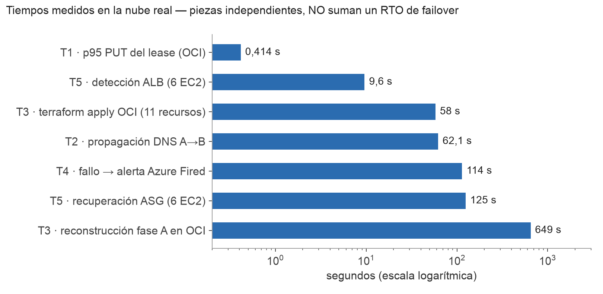

# 05 · RTO y RPO — solo lo medido

**Regla de este documento:** solo cifras medidas con expediente. Se separan tres cosas que no deben mezclarse:
(A) **recuperación dentro de AWS** (HA), (B) **reconstrucción en OCI** (restaurar desde respaldo en una VM nueva), (C) **failover AWS→OCI** (cambio de escritor con lease, vallado y DNS).
**Los tiempos de A y B no son el RTO de C, y no se suman para estimarlo.**

## Definiciones (criterios de T6, `ops_center/criterios/T6.json`)

- **RTO** = desde la inyección del fallo hasta la verificación del nuevo escritor. Umbral del proyecto: ≤ 3600 s.
- **RPO** = edad del respaldo usado en el momento de la conmutación. Umbral: ≤ 5400 s. Además: ninguna reserva confirmada perdida.

## (A) Recuperación dentro de AWS — MEDIDO [REAL]

| Evento | Detección | Recuperación | Pérdida de datos | Fuente |
|---|---|---|---|---|
| Caída controlada de 1 EC2, 6 EC2 (T5 intento 3) | 9,6 s | 125,0 s hasta 6 destinos sanos | ninguna (tráfico solo lectura) | `docs/evidencias/T5-20261123-resultado.md` |
| Caída controlada de 1 EC2, 2 EC2 (T5 intento 1) | 24,9 s | 159,8 s | ninguna (solo lectura) | `docs/evidencias/T5-20261123-intento1-resultado.md` |
| Autohealing del ASG (4-nov) | 22,6 s | — | — | `docs/evidencias/20261104-b2-autohealing-v2/` |
| Failover RDS Multi-AZ forzado (23-oct) | — | ≈ 14 s | huella idéntica | `docs/evidencias/multicloud/aws/20261023-rds-multiaz/` |
| Restauración PITR de RDS a instancia temporal | — | datos a 21 min 4 s | RPO 3 min 32 s (PITR) | `docs/evidencias/EV07/` |

## (B) Reconstrucción en OCI desde respaldo — MEDIDO [REAL]

| Evento | Tiempo | Qué incluye | Fuente |
|---|---|---|---|
| T3 intento 3 — `terraform apply` | 58 s (16:52:38 → 16:53:36) | 11 recursos | `docs/evidencias/T3-20261122-intento3-resultado.md` |
| T3 intento 3 — fase A (T0 → fin) | **649 s** | descarga, SHA-256, PostgreSQL, descifrado, restauración, humo 11/11 | idem |
| T3 intento 3 — destrucción con guarda | ≈ 128 s (17:23:29 → 17:25:37) | 11 recursos, inventario idéntico | idem |
| T3 intento 2 — fase A | 1670,6 s (incluye ≈ 18 min de incidente de frase; suma neta ≈ 583 s) | — | `docs/evidencias/T3-20261122-intento2-resultado.md` |
| Recuperación completa en OCI del 23-oct | 32 min 42 s | instalación + restauración + 14/14 | `docs/evidencias/multicloud/oci/20261023-recuperacion-aplicacion/` |
| Restauración local del respaldo del 11-nov | 6,7 s | solo datos, PostgreSQL local | `docs/evidencias/c04-20261119/` [LOCAL] |

**RPO en (B):** igual a la antigüedad del respaldo restaurado (respaldo puntual). T3 restauró el paquete C-04; no se midió un RPO frente a una base viva.

## (C) Failover AWS→OCI — NO MEDIDO (T6 BLOCKED)

| Magnitud | Estado | Motivo |
|---|---|---|
| RTO del failover | **NOT_TESTED** | T6 no ejecutado (barreras D1–D8, B-T6-1) |
| RPO del failover | **NOT_TESTED** | sin respaldo fresco ni conmutación; hoy la edad del respaldo sería ≈ 335 000 s (≈ 93 h) ⇒ **fallaría** |
| Sin pérdida de reservas confirmadas | **NOT_TESTED** | requiere la secuencia congelar → drenar → respaldo final (`04-PROCEDIMIENTOS.md` §3) |

**Piezas medidas que intervendrán en T6 (no son un RTO):** propagación de DNS 62,1 s / 62,0 s con intervalo mínimo de 300 s entre cambios (T2); adquisición de lease 20/20 con p95 de PUT 0,414 s desde el Mac (T1; falta medir desde AWS y OCI); reconstrucción 649 s (T3). **No medidas:** decisión por quórum, espera del TTL del lease, habilitación del standby, verificación por efecto.

> No se presenta ningún RTO estimado como resultado. Si el standby se construye antes de la ventana, su construcción no entra en el RTO; si se construye durante, sí. Esta decisión se registrará en el criterio antes de ejecutar T6.

