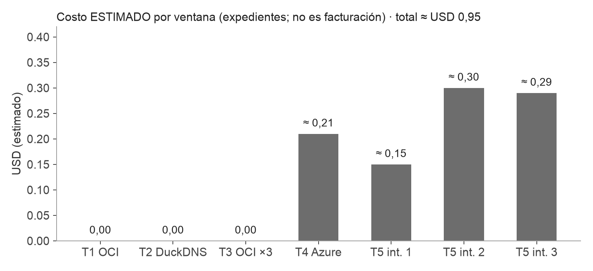

# 06 · Costos: observado frente a estimado

**Aclaración:** ningún costo de este documento es un extracto de facturación. AWS Academy no ofrece Cost Explorer y no hay capturas de Cost Management versionadas. Todas las cifras son **[ESTIMADO]** con tarifas públicas o declaradas en los expedientes.

## 1. Costo por ventana de prueba

| Ventana | Nube | Duración | Estimación del expediente | Observado (factura) | Fuente |
|---|---|---|---|---|---|
| T1 (2 ejecuciones) | OCI | ≈ 20 s + ≈ 3 min | USD 0 | no consultado | `docs/evidencias/T1-20261122-resultado.md` |
| T2 (2 ejecuciones) | DuckDNS | ≈ 2 min | USD 0 | no aplica | `docs/evidencias/T2-20261122-resultado.md` |
| T3 (3 intentos) | OCI Always Free | ≈ 40 + 48 + 34 min | USD 0 | no consultado | `docs/evidencias/T3-20261122-intento1-resultado.md` |
| T4 | Azure | 55 min | ≈ USD 0,21 | no consultado | `docs/evidencias/T4-20261122-resultado.md` |
| T5 intento 1 (2 EC2) | AWS + Azure | ≈ 42 min | ≈ USD 0,15 | no consultado | `docs/evidencias/T5-20261123-intento1-resultado.md` |
| T5 intento 2 (abortado) | AWS + Azure | ≈ 19 min | ≈ USD 0,1 (AWS) + ≈ 0,2 (Azure) | no consultado | `docs/evidencias/T5-20261123-intento2-abortado.md` |
| T5 intento 3 (6 EC2) | AWS + Azure | ≈ 80 min | ≈ USD 0,29 (AWS ≈ 0,20 cota alta + Azure ≈ 0,10) | no consultado | `docs/evidencias/T5-20261123-resultado.md` |
| **Total T1–T5** | | | **≈ USD 0,95** | **no disponible** | suma de estimaciones |

> Nota de coherencia: `docs/t7-t8/RESULTADOS-Y-COSTOS.md` cita «≈ USD 0,50», que solo suma T4 y el PASS de T5; aquí se incluyen también los intentos fallidos.

## 2. Dimensionamiento y costo horario [ESTIMADO]

| Escenario | Componentes | Costo aproximado | Resultado medido asociado |
|---|---|---|---|
| AWS económico | 2 × `t3.small` + ALB + RDS Multi-AZ `db.t3.micro` + IPv4 | ≈ 0,13 USD/h | T5: 95,21 % (FAIL del criterio 99 %) |
| AWS alta disponibilidad | 6 × `t3.small` + ALB + RDS + IPv4 | ≈ 0,26 USD/h (peor caso) | T5: 99,49 % (PASS, una ejecución) |
| AWS 24×7 de referencia | V2 completa todo el mes | ≈ USD 101,7/mes | `docs/entregable2/informe-entregable2.md` §18 (no viable con el crédito) |
| OCI | Always Free (E2.1.Micro, Object Storage ≈ 0,5 MB) | ≈ 0 | T1, T3 |
| Azure | VM `D2s_v4` encendida solo en ventanas; desasignada con disco + IP | ≈ 0,2–0,3 USD por ventana; ≈ 0,30 USD/día desasignada | T4, T5 |

**Lectura del dimensionamiento:** pasar de 2 a 6 instancias duplica el costo horario (×2, no ×3, porque ALB y RDS son fijos) y fue lo que permitió alcanzar el 99 % en la prueba. Para un evento real, la configuración de alta disponibilidad solo se justifica en ventanas de apertura de venta.

## 3. Optimizaciones aplicadas

1. Operación por **ventanas cortas** con limpieza verificada (ASG a 0, ALB eliminado, RDS detenida, VM de Azure desasignada con apagado automático).
2. **Sin NAT Gateway** (alto costo fijo); EC2 en subred pública con SG cerrado al ALB (riesgo declarado).
3. **OCI Always Free** para la recuperación (la forma Micro bastó tras corregir dnf/OOM/kdump).
4. **Watchdog de RDS** para que no quede encendida si falla la ventana.
5. Techo de USD 1,5 por ventana y regla de aborto en cada tarjeta.

## 4. Propuestas de optimización (DISEÑO, no aplicadas)

| Propuesta | Ahorro esperado | Riesgo / condición |
|---|---|---|
| Escalado programado: 6 instancias solo en aperturas de venta, 2 el resto | ≈ 50 % del costo de cómputo fuera de picos | requiere calendario de eventos |
| Instancias Spot para parte del ASG | hasta ≈ 60–70 % en cómputo (tarifa pública) | interrupciones; no permitido o no probado en Academy |
| Graviton (`t4g`) | ≈ 20 % por instancia | recompilar AMI ARM; no probado |
| Ahorro en IPv4 pública: NAT compartido o IPv6 | depende del número de instancias | NAT tiene costo fijo alto |
| Reservas/Savings Plans en un entorno real | 30–40 % | compromiso de 1–3 años; no aplica a Academy |
| Azure: B-series o apagar Zabbix fuera de eventos | ≈ 50 % de la VM | menor capacidad de observación |

## 5. Pendiente

Captura del saldo de AWS Academy y de Cost Management de Azure para convertir estimaciones en observaciones (**NOT_TESTED**).
