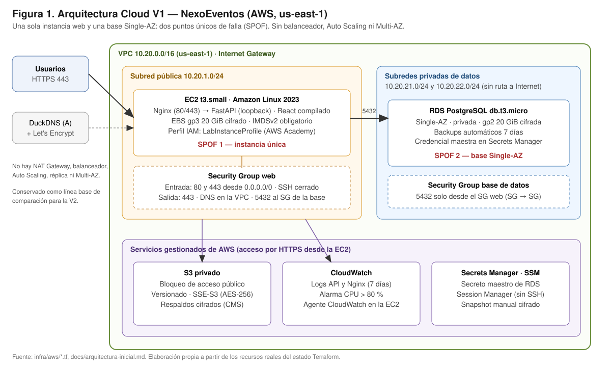
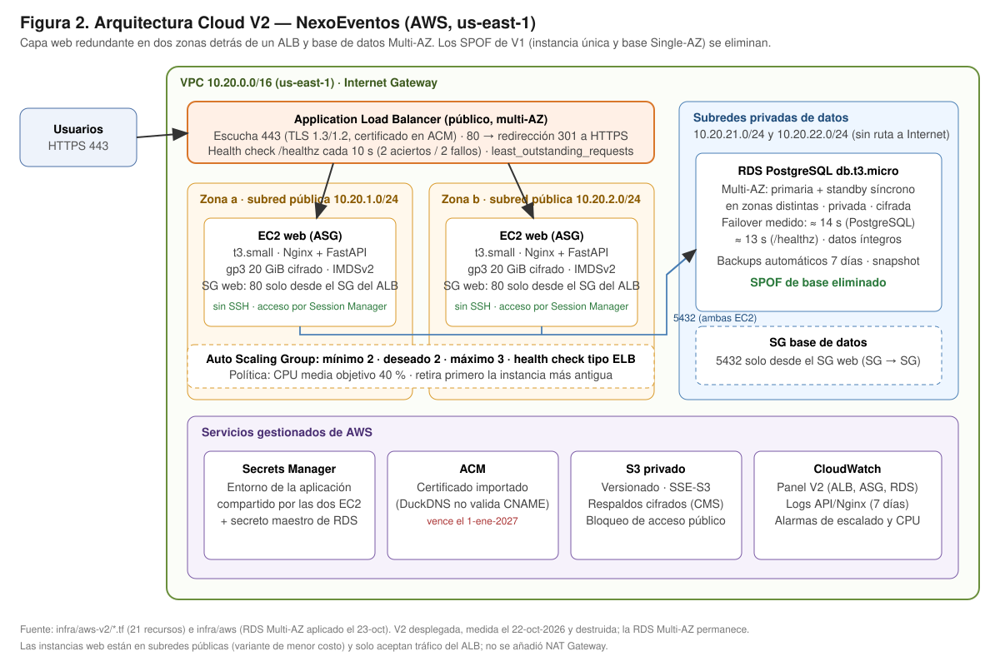
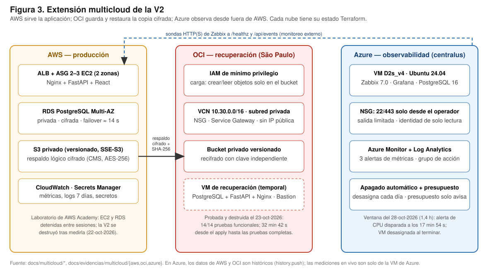
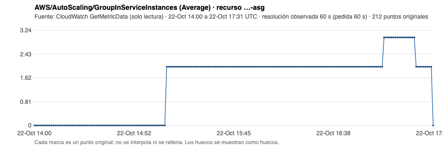
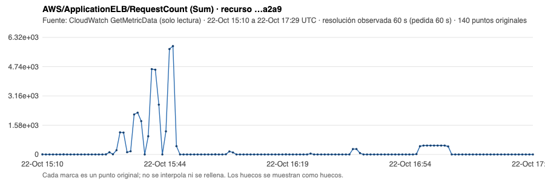
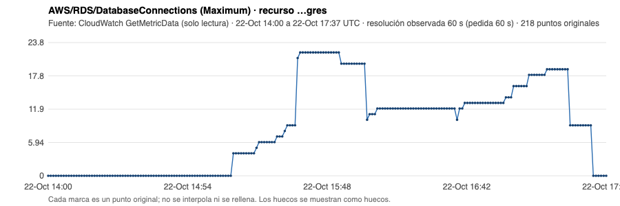
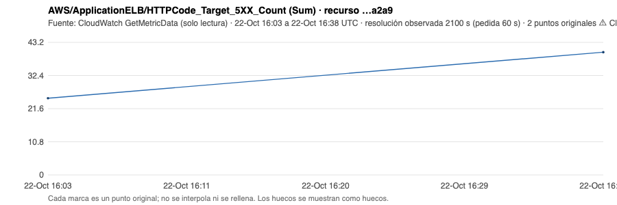
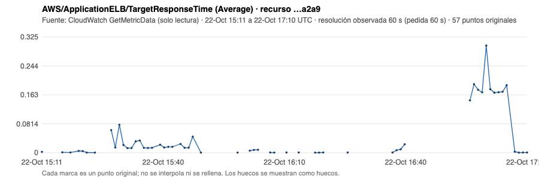

# Entregable 2 — Seguridad, optimización, escalabilidad y resiliencia de la solución
**Arquitectura V1 → Arquitectura V2 · NexoEventos**

| Campo | Valor |
|---|---|
| Curso | Cloud Computing · Proyecto Integrador (UPeU, E.P. Ingeniería de Sistemas) |
| Proyecto | NexoEventos (reservas de entradas con QR) |
| Integrante | Yesenia — **[PENDIENTE: apellidos y código]** |
| Equipo | **[PENDIENTE: identificador `Equipo XX` que confirme el docente]** (el proyecto es individual) |
| Docente | **[PENDIENTE: nombre]** |
| Fecha | **[PENDIENTE: dd/mm/aaaa de entrega]** |
| Estado del documento | **Borrador técnico verificable**: cada cifra cita su evidencia; lo que no existe se marca `[PENDIENTE]` o `[NO MEDIDO]`. Última revisión: 28-oct-2026 |

**Convención de honestidad.** *Medido* = hay un archivo de evidencia en `docs/evidencias/`. *Diseño* = decisión de arquitectura sin medición. *Supuesto* = cifra del caso empresarial o proyección. Nada de lo marcado `[PENDIENTE]` se presenta como logrado. Matriz requisito → archivo: [`matriz-requisitos-evidencias.md`](matriz-requisitos-evidencias.md).

---

## 01 · Introducción y alcance
Este entregable parte de la arquitectura V1 del Entregable 1 (una instancia web y una base de datos en AWS), la analiza, la mejora y presenta la V2. Cubre: evolución V1 → V2, amenazas y vulnerabilidades, controles de seguridad (IAM, red, cifrado, monitoreo), escalabilidad y alta disponibilidad, respaldo y recuperación, pruebas reales, costos y riesgos residuales.

Alcance real de lo implementado y medido hasta el 28-oct-2026:

| Capa | Qué existe | Estado actual |
|---|---|---|
| AWS V1 | EC2 + RDS + S3 + CloudWatch (`infra/aws`) | Desplegada el 3-oct; detenida entre sesiones |
| AWS V2 | ALB + Auto Scaling (2–3 EC2, 2 zonas) (`infra/aws-v2`, 21 recursos) | Desplegada, medida el 22-oct y **destruida**; solo permanece como IaC y evidencias |
| AWS RDS Multi-AZ | Conversión de la base de V1 (23-oct) y un failover medido | **Aplicada y conservada** (RDS detenida entre sesiones) |
| OCI | Copia cifrada, simulacro de restauración y recuperación completa de la aplicación (23-oct) | Red, IAM y bucket conservados; VM de recuperación destruida |
| Azure | VM con Zabbix + Grafana + Azure Monitor (28-oct) | Base de 9 recursos y VM con sus recursos asociados conservadas; VM **desasignada** tras 1,4 h de ventana |

Las cifras de negocio (aforo, usuarios, volumen) del caso son **supuestos**; los objetivos (p95 < 2 s, errores < 1 %, RTO ≤ 60 min, RPO ≤ 24 h) son metas hasta que se miden (ver sección 16).

## 02 · Resumen del Entregable 1
*(Fuente: Entregable 1, `work/docx-review/NexoEventos_Entregable1_Documentacion.pdf`; hechos de V1 verificados en `docs/arquitectura-inicial.md`.)*

| Elemento | Resumen |
|---|---|
| **Problema** | El caso sitúa aplicación y PostgreSQL en un único servidor de la sede de Lima. Un incidente en esa ubicación interrumpe reservas y accesos; los picos de apertura compiten por CPU, memoria y conexiones; los cambios manuales no son reproducibles; las copias en la misma sede no cubren la pérdida del lugar. La integridad transaccional (no sobrevender cupos) debe mantenerse. |
| **Solución planteada** | Llevar la aplicación a nube pública con infraestructura como código, segmentación de red, permisos controlados y respaldos, con una evolución verificable hacia alta disponibilidad, recuperación entre nubes y observabilidad. |
| **Proveedor utilizado** | AWS (`us-east-1`, AWS Academy Learner Lab) como proveedor principal. OCI y Azure se incorporaron después como recuperación y observabilidad (no eran el proveedor de V1). |
| **Arquitectura implementada** | React/TypeScript + FastAPI + PostgreSQL. En AWS: una EC2 `t3.small` (Nginx + FastAPI) en subred pública, RDS PostgreSQL `db.t3.micro` privada Single-AZ, S3 privado y CloudWatch; HTTPS con Let's Encrypt (DuckDNS). 30 recursos desplegados. |
| **Principales problemas encontrados** | (1) Instancia única (SPOF). (2) RDS Single-AZ (SPOF). (3) Sin balanceo ni escalado. (4) Respaldos solo en la misma cuenta. (5) Observabilidad solo con la telemetría nativa de la misma nube. (6) Dependencia de credenciales temporales de Academy y de un perfil IAM predefinido. (7) Evidencias de carga y de restauración aún por obtener. |

## 03 · Arquitectura V1

*Figura 1. Arquitectura Cloud V1 — NexoEventos. Fuente: `infra/aws/*.tf`; fichero editable: [`diagramas/v1-arquitectura.svg`](diagramas/v1-arquitectura.svg).*

Inventario verificable (Terraform `infra/aws`): VPC `10.20.0.0/16`; subred pública `10.20.1.0/24`; subredes privadas de datos `10.20.21.0/24` y `10.20.22.0/24`; Internet Gateway; SG web (80/443 desde Internet, SSH cerrado) y SG de base (5432 solo desde el SG web); EC2 `t3.small` AL2023, EBS gp3 20 GiB cifrado, IMDSv2 obligatorio, perfil `LabInstanceProfile`; RDS `db.t3.micro` privada, cifrada, backups 7 días, credencial maestra gestionada por Secrets Manager; S3 privado (bloqueo público, versionado, SSE-S3); logs de API y Nginx a 7 días y alarma de CPU > 80 %. No hay NAT, balanceador, Auto Scaling ni Multi-AZ.

## 04 · Retroalimentación recibida
**No existe en el repositorio una retroalimentación escrita del docente sobre el Entregable 1.** `[PENDIENTE: registrar aquí las observaciones docentes literales cuando se reciban]`. Mientras tanto, la tabla recoge las **observaciones propias de la autoauditoría de V1** (no son del docente) y la acción realizada para cada una, con su evidencia:

**Estado de esta sección:** el docente no ha entregado observaciones por escrito que consten en el proyecto; por eso **no se transcribe ninguna como si fuera suya**. Para no dejar la sección vacía, cada observación propia de la autoauditoría se vincula al criterio de la rúbrica que atiende y a su evidencia. Cuando se reciba la retroalimentación literal, se añade una fila por observación con el mismo formato (observación → acción → evidencia).

| Observación (origen) | Problema encontrado | Acción realizada | Evidencia |
|---|---|---|---|
| Autoauditoría V1 | La capa web era una instancia única | V2 con ALB y Auto Scaling 2–3 EC2 en dos zonas (22-oct) | [validación V2](../evidencias/validacion-v2-20261022/resultado.md), [medición](../evidencias/medicion-v2-20261022/resultado.md) |
| Autoauditoría V1 | RDS Single-AZ | Conversión a Multi-AZ y failover medido (23-oct) | [RDS Multi-AZ](../evidencias/multicloud/aws/20261023-rds-multiaz/resultado.md), [failover](../evidencias/multicloud/aws/20261023-rds-multiaz/failover/resultado.md) |
| Autoauditoría V1 | Sin prueba de carga | Escenario E01 (20 usuarios × 5 min) y escalera V1 vs V2 | [EV11](../evidencias/EV11/resultado-2026-10-09.md), [V1 vs V2](../evidencias/medicion-v2-20261022/resultado.md) |
| Autoauditoría V1 | Ráfagas de login agotaban memoria (Argon2) | Semáforo de concurrencia y devolución de conexión; antes/después medido en local | `PROJECT_STATUS.md` §22; `perf/results/login-burst-*`, `login-starvation-*` |
| Autoauditoría V1 | Restauración no probada | R01 (PITR en AWS), simulacro y recuperación de la aplicación en OCI | [R01](../evidencias/EV07/resultado-restauracion-2026-10-10.md), [OCI](../evidencias/multicloud/oci/20261023-recuperacion-aplicacion/resultado.md) |
| Autoauditoría V1 | Respaldos solo en la misma cuenta | Copia cifrada con clave independiente en OCI y verificación de hash | [transferencia](../evidencias/multicloud/oci/20261023-transferencia-0008/resultado.md) |
| Autoauditoría V1 | Observabilidad solo nativa de AWS | Zabbix + Grafana + Azure Monitor en Azure | [ventana Azure](../evidencias/multicloud/azure/20261028-vm/resultado.md) |
| Autoauditoría V1 | Vulnerabilidad en dependencia | Trivy detectó `cryptography` 49.0.0 (CVE-2026-69247, alta) → actualizada a 50.0.0 | `PROJECT_STATUS.md` §18 |
| Autoauditoría V1 | Sin trazabilidad de la API de AWS | Se **comprobó** (28-oct) que no hay ningún *trail* de CloudTrail configurado; solo el historial de eventos por defecto. Queda como riesgo residual, no como mejora lograda | [auditoría de solo lectura](../evidencias/multicloud/aws/20261028-auditoria-solo-lectura/resultado.md) |

**Correspondencia con la rúbrica:** filas 1–2 y 5–6 → criterio 4 (disponibilidad); fila 3 → criterio 5 (pruebas); fila 4 → criterios 3 y 4; filas 7 y 9 → criterios 3 y 5; fila 8 → criterio 2 (vulnerabilidades).

## 05 · Comparación V1 versus V2
| Aspecto | V1 | V2 | Mejora (medida o diseño) |
|---|---|---|---|
| **Cómputo** | 1 EC2 `t3.small` | ASG 2–3 EC2 `t3.small` en 2 zonas detrás de un ALB | *Medido*: con la misma carga, CPU máx. por instancia a 50 usuarios: 39,4 % (V1) → 20,4 % / 19,8 % (V2); [medición](../evidencias/medicion-v2-20261022/resultado.md) |
| **Red** | 1 subred pública; EC2 con SG abierto a 80/443 | ALB en 2 subredes públicas (`10.20.1.0/24`, `10.20.2.0/24`); EC2 solo aceptan 80 desde el SG del ALB | *Diseño verificado en Terraform* (`infra/aws-v2/network.tf`) |
| **Seguridad** | TLS en la EC2 (Let's Encrypt); SG→SG a la base | TLS 1.3/1.2 en el ALB (ACM), redirección 80→443, `drop_invalid_header_fields`; secreto de la aplicación en Secrets Manager | *Diseño verificado*; certificado de V2 **importado** (vence el 1-ene-2027) |
| **Escalabilidad** | Fija | Política de CPU objetivo 40 %: 2 → 3 instancias en ≈ 9 min desde el inicio de la carga y regreso a 2 | *Medido* el 22-oct: [escalado](../evidencias/escalado-v2-20261022/resultado.md) |
| **Disponibilidad** | Caída de la EC2 = sitio caído; base Single-AZ | ALB retira un destino no sano (20,0 s) y el ASG lo reemplaza (≈ 2,5 min); RDS Multi-AZ con failover ≈ 14 s | *Medido*: [tolerancia a fallos](../evidencias/tolerancia-fallos-v2-20261022/resultado.md), [autohealing](../evidencias/tolerancia-fallos-v2-20261022-b/resultado.md), [failover RDS](../evidencias/multicloud/aws/20261023-rds-multiaz/failover/resultado.md) |
| **Monitoreo** | CloudWatch (logs 7 días, alarma CPU > 80 %) | + panel V2 de CloudWatch y, fuera de AWS, Zabbix + Grafana + Azure Monitor con 3 alertas | *Medido*: [Azure](../evidencias/multicloud/azure/20261028-vm/resultado.md) |
| **Backup** | Backups RDS 7 días, dump CMS en S3 y snapshot | + copia cifrada con clave independiente en OCI y restauración probada en otra nube | *Medido*: [simulacro OCI](../evidencias/multicloud/oci/20261023-simulacro-restauracion/resultado.md) |

Latencia y rendimiento con el mismo generador (perfil mixto k6, hasta 50 usuarios): p95 V1 → V2 a 50 usuarios: 288 → 190 ms; 71,6 → 78,0 req/s; 0 errores 5xx en 35 366 solicitudes de V2. Limitación declarada: 50 usuarios no saturan ni V1 ni V2, así que la tabla demuestra **menor carga por instancia y ausencia de degradación**, no el techo de capacidad.

## 06 · Arquitectura Cloud V2

*Figura 2. Arquitectura Cloud V2 — NexoEventos (AWS). Fuente: `infra/aws-v2/*.tf` e `infra/aws` (RDS Multi-AZ); fichero editable: [`diagramas/v2-arquitectura.svg`](diagramas/v2-arquitectura.svg).*

*Figura 3. Extensión multicloud (AWS producción, OCI recuperación, Azure observabilidad). Fuente: `docs/multicloud/*`; fichero editable: [`diagramas/v2-multicloud.svg`](diagramas/v2-multicloud.svg).*

**Decisiones y justificación**
- **ALB + 2 EC2 en vez de EKS**: EKS cuesta USD 0,10 por clúster-hora (≈ 72 USD/mes) antes de nodos y añade imágenes, manifiestos y permisos probablemente restringidos en Academy; para una aplicación única no aporta valor proporcional ([comparación](../arquitectura-v2.md)).
- **Instancias en subredes públicas con SG cerrado al ALB**: variante de menor costo; se evitó NAT Gateway (alto costo fijo). Riesgo residual: cada instancia tiene IPv4 pública (sección 19).
- **Sesiones en PostgreSQL y frontend sin estado**: cualquier instancia atiende cualquier petición; el reparto medido fue 50 % / 50 %.
- **RDS Multi-AZ**: dos EC2 no eliminan el SPOF de la base; se aplicó sobre la RDS de V1.
- **Multicloud con roles distintos y sin duplicar herramientas**: AWS sirve; OCI conserva y restaura la copia (independencia de cuenta y proveedor); Azure observa desde fuera de AWS. Cada nube con su estado Terraform y sin credenciales cruzadas.
- **Límite honesto**: la V2 se desplegó, midió y **destruyó**; hoy está definida como IaC reproducible (`infra/aws-v2`) con evidencias, no en ejecución. Nunca se midió V2 con RDS Multi-AZ **y** carga a la vez, ni un fallo de zona completa.

## 07 · Seguridad
| Dimensión | Control implementado | Servicio / herramienta | Evidencia / límite |
|---|---|---|---|
| **Identidad** | AWS: rol de laboratorio `LabRole` y perfil `LabInstanceProfile` (Academy no permite crear usuarios/roles propios). OCI: usuario y grupo de carga dedicados, sin consola. Azure: identidad administrada de la VM (sin secretos) | IAM (AWS/OCI), Microsoft Entra / identidad administrada | [OCI IAM](../evidencias/multicloud/oci/20261023-iam-carga/resultado.md), [identidad Azure](../evidencias/multicloud/azure/20261028-vm/identidad-administrada.txt) |
| **Autenticación** | Sesiones opacas en PostgreSQL (cookie `HttpOnly`, `SameSite=Lax`, `Secure` en producción; en la base solo el hash SHA-256; 8 h); contraseñas con Argon2id; límite de intentos (5 fallos en 15 min, HMAC de correo+IP); SSH solo con clave (Azure) o Session Manager (AWS). **No hay MFA** | FastAPI + PostgreSQL, `pwdlib`, OpenSSH, SSM | [`docs/autenticacion-y-entradas.md`](../autenticacion-y-entradas.md); MFA: `[NO IMPLEMENTADO]` |
| **Autorización** | Roles `client` / `organizer` / `operator`; el cliente solo ve sus entradas; el operador valida solo en eventos asignados; CSRF por cookie+cabecera y orígenes permitidos | FastAPI | Pruebas: `test_client_cannot_read_another_clients_ticket`, `test_public_registration_cannot_assign_privileged_role` (`PROJECT_STATUS.md` §2) |
| **Mínimo privilegio** | PostgreSQL con roles separados (`nexoeventos_owner` sin login, `nexoeventos_migrator`, `nexoeventos_app` sin `DELETE` sobre `users`); OCI: crear/leer objetos solo en un bucket; Azure: *Monitoring Reader* solo sobre el grupo de recursos (1 asignación visible, escritura → 403) | PostgreSQL, OCI IAM, Azure RBAC | [identidad Azure](../evidencias/multicloud/azure/20261028-vm/identidad-administrada.txt); `scripts/provision-database-roles.py` |
| **Firewall / security groups** | AWS: SG web y SG de base (5432 solo SG→SG), V2: web solo desde el SG del ALB. Azure: NSG con 22/443 únicamente desde la IP /32 del operador y denegación explícita del resto. OCI: NSG + subred privada | SG, NSG, UFW | [Azure NSG](../evidencias/multicloud/azure/20261028-vm/nsg-reglas.txt), [puertos](../evidencias/multicloud/azure/20261028-vm/acceso-https-y-puertos.txt) |
| **Segmentación** | Subredes públicas (ALB/web) y privadas de datos sin ruta a Internet; VCN privada en OCI sin IP pública; subred dedicada en Azure | VPC, VCN, VNet | `infra/aws*/network.tf`; [lectura API 9-oct](../evidencias/lectura-aws-2026-10-09.md) |
| **Cifrado** | En reposo: EBS y RDS **cifrados (verificado por API el 28-oct)**, S3 con SSE-S3 (AES256), respaldos con CMS AES-256 (clave pública; clave privada independiente), QR cifrados (Fernet) con hash para validar. En tránsito: TLS 1.3/1.2 (ALB `ELBSecurityPolicy-TLS13-1-2-2021-06`), HSTS; TLS 1.3 y HSTS medidos en Azure. Azure con Trusted Launch (arranque seguro + vTPM) | EBS/RDS/S3, OpenSSL CMS, ACM, Nginx | [respaldo CMS](../evidencias/multicloud/aws/20261023-respaldo-0008/resultado.md), [HTTPS Azure](../evidencias/multicloud/azure/20261028-vm/acceso-https-y-puertos.txt) |
| **Respaldo** | RDS (backups 7 días, snapshot manual, PITR), dump lógico cifrado en S3 y copia en OCI con SHA-256 | RDS, S3, OCI Object Storage | [R01](../evidencias/EV07/resultado-restauracion-2026-10-10.md), [OCI](../evidencias/multicloud/oci/20261023-simulacro-restauracion/resultado.md) |
| **Registros** | CloudWatch Logs de API y Nginx (7 días); auditoría de validaciones de entradas (sin token completo); Azure: registro de actividad de la suscripción → Log Analytics (30 días) | CloudWatch, Log Analytics | [EV08](../evidencias/EV08/recepcion-real-2026-10-10.md); **CloudTrail: comprobado el 28-oct que NO hay ningún *trail* configurado** (solo el historial de eventos por defecto, que responde a consultas); no se afirma auditoría de la API más allá de ese historial — ver 07.1 |
| **Monitoreo** | Alarma de CPU (V1), política de escalado por CPU (V2), panel de CloudWatch; Zabbix + Grafana + Azure Monitor con tres alertas | CloudWatch, Zabbix, Grafana, Azure Monitor | Sección 14 |

### 07.1 Verificación de solo lectura en AWS (28-oct-2026)
Se consultó la cuenta de laboratorio con un script cuya guarda solo admite operaciones `describe/get/list`, sin Cost Explorer ni lectura de secretos u objetos ([resultado](../evidencias/multicloud/aws/20261028-auditoria-solo-lectura/resultado.md), [datos](../evidencias/multicloud/aws/20261028-auditoria-solo-lectura/resumen-solo-lectura.json), [red y CloudTrail](../evidencias/multicloud/aws/20261028-auditoria-solo-lectura/red-y-cloudtrail.json)). Estado real, distinguido de lo que solo es diseño:

| Control | Hallazgo verificado (28-oct) | Qué NO se pudo comprobar |
|---|---|---|
| Cifrado de la RDS | `StorageEncrypted = true` con clave KMS; no es pública; copias automáticas 7 días; Multi-AZ activo; **TLS obligatorio** (`rds.force_ssl = 1`, valor por defecto del sistema en PostgreSQL 18, grupo `default.postgres18`); **protección contra borrado, autenticación IAM, Performance Insights y monitoreo mejorado desactivados**; gp2 de 20 GiB con **máximo de autoescalado también de 20 GiB** (sin margen real) ([detalle](../evidencias/multicloud/aws/20261028-auditoria-solo-lectura/detalle-seguridad.json)) | Administración de la clave KMS (la de Academy) |
| Cifrado de EBS | 1 volumen de 20 GiB, cifrado | — |
| IMDSv2 | **Obligatorio** en la EC2 de V1 (`HttpTokens = required`); límite de saltos 2; monitoreo detallado desactivado (EC2 a 300 s); sin IP pública asignada mientras está detenida | — |
| S3 de datos | Bloqueo de acceso público total; SSE AES256; versionado habilitado; **sin política de bucket** (no hay regla que exija TLS); 1 regla de ciclo de vida que expira a 7 días **solo el prefijo `database-backups/`** | Contenido de los objetos (no se leyó) |
| Red (V1) | VPC `10.20.0.0/16`; subred pública `10.20.1.0/24` con ruta a Internet Gateway; **subredes de datos `10.20.21.0/24` y `10.20.22.0/24` sin ruta `0.0.0.0/0` y sin IP pública automática**, en dos zonas; sin NAT Gateway, sin VPC endpoints, sin ALB ni Auto Scaling (V2 destruida) | Los SG y subredes de V2 ya no existen: sus reglas se citan desde la evidencia del 22-oct, no de esta consulta |
| Security groups (V1) | Web: entrada solo TCP 80 y 443 desde `0.0.0.0/0` (**sin SSH**); salida 443 a Internet, 53 a la VPC y 5432 solo al SG de la base. Base: entrada solo 5432 desde el SG web | — |
| IAM | `LabRole` es el único rol del perfil de instancia; **0 usuarios y 0 grupos IAM** en la cuenta; sin políticas en línea ni límite de permisos; sesión máxima 3 600 s; confía en sí mismo y en ≈ 50 servicios de AWS. 7 políticas adjuntas: SSM (3 sentencias, 25 acciones, sin comodín total), EKS clúster (63 acciones), ECR solo lectura (12) y EKS nodo (10), todas con recurso `*` pero **sin `Action: *`** | **Las 3 políticas `VocLabPolicy1–3` de Academy no son legibles** (documento denegado): no se afirma qué permiten. Las de EKS/ECR no las usa la aplicación y no son modificables |
| CloudTrail | **0 trails configurados**; el historial de eventos (90 días) responde (p. ej. `AssumeRole`, `Describe*`) | Registro duradero en S3 o alertas sobre la API: **no existen** |
| Alarmas y paneles | 1 alarma de CPU de la EC2 de V1 (media de 5 min, 2 periodos, > 80 %, datos faltantes = `missing`), **0 acciones**; **0 paneles** de CloudWatch hoy | El panel de V2 se destruyó con V2 |
| Logs | Grupos de API y Nginx con retención de 7 días | — |
| Secretos | 2 secretos (solo metadatos; los valores no se leyeron) | Su política de rotación |
| ACM | 0 certificados hoy (el importado era de V2) | — |

### 07.2 Controles implementados, ausentes y riesgos residuales
| Estado | Control | Fuente de la afirmación |
|---|---|---|
| **Implementado y verificado por API (28-oct)** | RDS cifrada, no pública, Multi-AZ, copias 7 días; EBS cifrado; IMDSv2 obligatorio; S3 con bloqueo público, SSE AES256 y versionado; SG web sin SSH y SG de base solo desde el SG web; subredes de datos sin ruta a Internet | [auditoría](../evidencias/multicloud/aws/20261028-auditoria-solo-lectura/resultado.md) |
| **Implementado y medido en pruebas** | ALB + Auto Scaling 2–3 EC2 en dos zonas (V2, ya destruida), failover Multi-AZ ≈ 14 s, respaldo CMS con hash, recuperación de la aplicación en OCI (14/14) | secciones 12, 15 y 16 |
| **Implementado y verificado en Azure/OCI/aplicación** | NSG con 22/443 solo desde el operador; identidad administrada de solo lectura; TLS 1.3 y HSTS; usuario de OCI solo con subida; Argon2id, sesiones, CSRF y roles de PostgreSQL | [Azure](../evidencias/multicloud/azure/20261028-vm/resultado.md), [OCI](../evidencias/multicloud/oci/20261023-iam-carga/resultado.md), pruebas 44/44 |
| **Ausente (comprobado)** | *Trail* de CloudTrail; política de bucket que exija TLS; máximo de autoescalado de la RDS mayor que el almacenamiento actual; acciones de notificación en la alarma de AWS; protección contra borrado de la RDS; panel de CloudWatch vigente; MFA en la aplicación; respaldo programado | auditoría 28-oct; secciones 07 y 15 |
| **Sin comprobar** | Documentos de `VocLabPolicy1–3` (acceso denegado), administración de la clave KMS, rotación de secretos, contenido de S3 | [detalle](../evidencias/multicloud/aws/20261028-auditoria-solo-lectura/detalle-seguridad.json) |
| **Riesgo residual** | Región única, zona completa no probada, certificado importado que vence el 1-ene-2027, `LabRole` amplio no modificable, presupuestos que solo avisan | sección 19 |

Controles de desarrollo seguro: CI con pruebas, imagen sin root y Trivy (**31 ejecuciones reales en GitHub Actions entre el 19 y el 23-oct, 30 exitosas**; [evidencia](../evidencias/ci-github-actions-20261029/resultado.md)) (bloquea HIGH/CRITICAL corregibles y cualquier secreto); 0 vulnerabilidades en `npm audit --omit=dev` (14-oct); verificación estática de IaC (29 comprobaciones, todas correctas el 28-oct) en `scripts/multicloud/check-iac-security.py`.

## 08 · Análisis de amenazas y vulnerabilidades
Método: por activo se identifica amenaza, vulnerabilidad, impacto y control; la columna *Estado* distingue lo **medido** de lo **diseñado**. El riesgo que persiste está en la sección 19.

| # | Activo | Amenaza | Vulnerabilidad | Impacto | Control aplicado | Estado y evidencia |
|---|---|---|---|---|---|---|
| 1 | Servidor web | Saturación por ráfagas de inicio de sesión | Argon2id reserva ~64 MiB por hash; 20 accesos simultáneos llevaron la EC2 a 135 MB libres | Caída del servicio (OOM) | Semáforo por proceso (`ARGON2_MAX_CONCURRENT=2`), devolución de la conexión antes de esperar, ASG en V2 | *Medido en local*: a 50 simultáneos de 3 OOM y p95 25 s → 0 errores y p95 1,7 s; **repetición en AWS pendiente** (`PROJECT_STATUS.md` §22) |
| 2 | Servidor web | Caída de la instancia | Instancia única (V1) | Sitio fuera de servicio | ALB + ASG con health check ELB y reemplazo | *Medido*: detección 20,0 s, reemplazo ≈ 2,5 min ([a](../evidencias/tolerancia-fallos-v2-20261022/resultado.md), [b](../evidencias/tolerancia-fallos-v2-20261022-b/resultado.md)) |
| 3 | Servidor web | Acceso no autorizado por administración remota | SSH o puertos de gestión expuestos | Toma de control | AWS: sin SSH (Session Manager); Azure: NSG `/32` + UFW + SSH solo con clave; OCI: Bastion | *Medido en Azure*: 80, 3000, 5432, 10050, 10051 no alcanzables ([puertos](../evidencias/multicloud/azure/20261028-vm/acceso-https-y-puertos.txt)); AWS: reglas por API ([EV04](../evidencias/EV04/README.md)) |
| 4 | Servidor web | Explotación de dependencias | CVE en una librería | Compromiso de la aplicación | Trivy en CI; `cryptography` 49.0.0 (CVE-2026-69247) → 50.0.0 | *Medido* (`PROJECT_STATUS.md` §18) |
| 5 | Servidor web | Falsificación de la IP de origen | Confiar en `X-Forwarded-For` | Evadir límites por IP | `real_ip` solo desde la VPC; valor falsificado ignorado | *Medido en Docker* (`scripts/v2/test-nginx-alb.sh`); sin prueba en AWS |
| 6 | Base de datos | Falla de instancia o zona | RDS Single-AZ | Interrupción y riesgo de pérdida | Multi-AZ, backups, snapshot, PITR | *Medido*: failover ≈ 14 s con huella de datos idéntica; R01 con RPO demostrado de 3 min 32 s |
| 7 | Base de datos | Sobreventa por concurrencia | Condiciones de carrera | Entradas duplicadas / aforo violado | Transacción con bloqueo de fila e idempotencia | *Medido*: 12 clientes sobre 4 cupos → 4 × 201 y 8 × 409; 1 000 intentos → 1 ganador por asiento |
| 8 | Base de datos | Acceso directo o escalada | Base expuesta o usuario con demasiados privilegios | Fuga/alteración | RDS privada; 5432 solo SG→SG; roles owner/migrator/app | *Medido* (lectura API 7-oct; roles en ensayo) |
| 9 | Credenciales | Secretos en repositorio o capturas | Claves en código | Compromiso total | Secretos fuera de Git, Secrets Manager (maestro RDS), Trivy (detección de secretos en CI) | *Medido*: sin secretos versionados; evidencias saneadas con verificación automática |
| 10 | Credenciales | Fuerza bruta de contraseñas | Contraseñas débiles | Cuenta comprometida | Argon2id, 5 fallos/15 min | *Medido en local*; **MFA no implementada** (residual) |
| 11 | Credenciales | Credenciales de nube de largo plazo | Claves fijas | Compromiso de la cuenta | AWS: solo credenciales temporales de Academy; OCI: clave API de un usuario de solo subida; Azure: identidad administrada | *Hecho*; la clave API de OCI existe fuera del repositorio |
| 12 | Red | Intermediario / tráfico en claro | HTTP sin TLS | Robo de sesión | TLS 1.3/1.2, HSTS, cookies `Secure`, redirección 80→443 | *Medido* (V1 público 19-oct; Azure 28-oct) |
| 13 | Red | Acceso a servicios internos | Puertos 5432/10050/10051/3000 abiertos | Acceso no autorizado | Denegación de toda la entrada salvo lo necesario | *Medido en Azure*; observación abierta: el agente y el servidor de Zabbix escuchan en todas las interfaces (inaccesibles) |
| 14 | Información | Fuga de respaldos | Respaldo en claro o en la misma cuenta | Fuga de datos personales | CMS AES-256, clave privada independiente, copia en OCI, S3 sin acceso público | *Medido*: SHA-256 coincide; restauración verificada; la custodia de la clave es riesgo residual |
| 15 | Información | Reutilización o falsificación de QR | Token predecible o reutilizable | Fraude de acceso | Token aleatorio, hash en BD, validación atómica | *Medido*: 2 validaciones simultáneas → exactamente 1 aceptación |
| 16 | Información | Datos sensibles en logs | Registrar tokens o QR | Fuga | Ruta de observabilidad sin datos; el verificador busca patrones; auditoría con huella abreviada | *Medido* ([EV08](../evidencias/EV08/recepcion-real-2026-10-10.md)) |
| 17 | Operación | Alerta no entregada | Receptor sin verificar o canal único | Incidente no atendido | Grupo de acción de Azure; el receptor ya fue verificado | **Entrega real por correo NO comprobada** (la prueba de notificación no existe en suscripciones gratuitas) |
| 18 | Cuenta de laboratorio | Gasto no previsto | Recursos olvidados; RDS detenida se reinicia a los 7 días; presupuestos que no frenan | Agotar el crédito | Apagado tras cada ventana, auto-shutdown y verificadores `--expect` | *Medido en Azure*; AWS: calendario operativo ([`calendario-credito-aws.md`](../operacion/calendario-credito-aws.md)) |

## 09 · IAM
| Tipo | Nombre | Función | Políticas asignadas | Privilegios |
|---|---|---|---|---|
| Rol (AWS) | `LabRole` | Rol del laboratorio AWS Academy | Gestionada por Academy | Amplios; **no modificables por el proyecto** |
| Rol (AWS) | `LabInstanceProfile` | Perfil de las EC2 (SSM, S3, CloudWatch, Secrets Manager) | Gestionada por Academy | Los de Academy; la existencia del perfil no acredita cada acción |
| Usuario / Grupo (AWS) | — | **Academy no permite crearlos** | — | Sin usuarios IAM propios; credenciales temporales de sesión |
| Grupo (OCI) | `nexoeventos-backup-uploaders` | Agrupa la identidad de carga | Política del compartimento | Ver siguiente fila |
| Usuario (OCI) | `nexoeventos-backup-uploader` | Sube respaldos (solo clave API; sin consola, tokens ni SMTP) | Pertenece solo a ese grupo | Leer el bucket `nexoeventos-recovery`; crear/leer/inspeccionar objetos; **sin** borrar ni sobrescribir ni administrar |
| Usuario (Azure) | Operador de la suscripción | Administra Azure for Students | Rol *Owner* | Total sobre la suscripción de estudios |
| Rol (Azure) | Identidad administrada de la VM | Permite a Grafana leer métricas de Azure Monitor sin secretos | *Monitoring Reader* sobre el grupo de recursos | Solo lectura: acciones `*/read` + consulta de Log Analytics; escritura → 403 |
| Rol (PostgreSQL) | `nexoeventos_owner` / `nexoeventos_migrator` / `nexoeventos_app` | Propietario sin login / migraciones / aplicación | `REVOKE ALL … FROM PUBLIC`, `GRANT` mínimos | La aplicación no puede borrar `users` |
| Rol (aplicación) | `client`, `organizer`, `operator` | Segregación de funciones | Reglas de propiedad y asignación | Cada rol ve y hace solo lo suyo |

**Verificado en AWS el 28-oct** ([datos](../evidencias/multicloud/aws/20261028-auditoria-solo-lectura/resumen-solo-lectura.json)): el perfil de instancia contiene solo `LabRole` y este tiene 7 políticas adjuntas (3 gestionadas por Academy, `AmazonSSMManagedInstanceCore` y 3 de EKS/ECR). Es decir, el rol **es más amplio de lo que la aplicación necesita** y el proyecto no puede reducirlo; por eso el mínimo privilegio en AWS se compensa con controles de red (SG→SG, sin SSH), cifrado y la segregación en PostgreSQL. No se consultó el documento de cada política, de modo que **no se afirma** qué acciones permite exactamente.

**Aplicación del mínimo privilegio.** (1) *PostgreSQL*: tres roles con propósitos distintos; la aplicación no es propietaria del esquema. (2) *OCI*: la identidad que sube respaldos no puede borrarlos ni sobrescribirlos (verificado por lectura de la API). (3) *Azure*: la identidad de la VM solo ve su grupo de recursos — lista 1 grupo, 1 VM y 1 asignación de rol, y una escritura devuelve 403 ([evidencia](../evidencias/multicloud/azure/20261028-vm/identidad-administrada.txt)). (4) *Red*: SG→SG en AWS y NSG por IP en Azure. **Límite honesto:** en AWS el IAM lo impone Academy; el mínimo privilegio *propio* (rol de instancia limitado a SSM, un secreto, un prefijo de S3 y logs) es un **diseño portable no implementado** y no puede evidenciarse en esta cuenta.

## 10 · Seguridad de red
### 10.1 Subredes (AWS, VPC `10.20.0.0/16`)
| Subred | Tipo | CIDR | Zona | Recursos alojados |
|---|---|---|---|---|
| pública-a | Pública | `10.20.1.0/24` | `us-east-1a` | EC2 de V1; ALB y EC2 de V2 |
| pública-b | Pública | `10.20.2.0/24` | segunda zona disponible (V2) | ALB y EC2 de V2 |
| datos-a | Privada | `10.20.21.0/24` | zona distinta de datos-b | RDS (grupo de subredes) |
| datos-b | Privada | `10.20.22.0/24` | zona distinta de datos-a | RDS (grupo de subredes) |

Otras nubes: OCI VCN `10.30.0.0/16` con subred privada sin IP pública; Azure VNet `10.40.0.0/16`, subred `10.40.1.0/24`.

Estado de la VPC comprobado por API el 28-oct ([datos](../evidencias/multicloud/aws/20261028-auditoria-solo-lectura/red-y-cloudtrail.json)): hoy existen la subred pública y las dos de datos; **`pública-b` pertenecía a V2 y fue destruida con ella**. Las subredes de datos no tienen ruta a Internet ni IP pública automática.

### 10.2 Reglas de entrada y salida / puertos permitidos
| Regla / SG | Dirección | Protocolo | Puerto | Origen / Destino | Propósito |
|---|---|---|---|---|---|
| SG ALB (V2) | Entrada | TCP | 443 | `0.0.0.0/0` | HTTPS público |
| SG ALB (V2) | Entrada | TCP | 80 | `0.0.0.0/0` | Solo redirección a HTTPS |
| SG web (V2) | Entrada | TCP | 80 | SG del ALB | Tráfico del balanceador |
| SG web (V1) | Entrada | TCP | 80 / 443 | `0.0.0.0/0` | Sitio público (SSH cerrado; **verificado 28-oct**) |
| SG web | Salida | TCP | 443 | `0.0.0.0/0` | Servicios AWS y paquetes |
| SG web | Salida | TCP/UDP | 53 | CIDR de la VPC | DNS |
| SG web | Salida | TCP | 5432 | SG de la base | PostgreSQL |
| SG base | Entrada | TCP | 5432 | SG web | Solo la aplicación (**verificado 28-oct**; sin reglas de salida) |
| NSG Azure | Entrada | TCP | 22 y 443 | IP /32 del operador | Administración y Grafana/Zabbix |
| NSG Azure | Entrada | * | * | Cualquiera | **Denegada** |
| NSG Azure | Salida | TCP/UDP | 80, 443, 53, 123 | Internet y plataforma de Azure | Paquetes, DNS, hora; resto denegado |

### 10.3 Servicios expuestos
| Servicio | Puerto | Expuesto a | Justificación |
|---|---|---|---|
| ALB (HTTPS) | 443 | Internet | Única entrada pública de V2 |
| ALB (redirección) | 80 | Internet | Redirige a HTTPS (301) |
| EC2 web (Nginx) | 80 | Solo el SG del ALB | Backend detrás del balanceador |
| PostgreSQL (RDS) | 5432 | Solo el SG web | Datos privados |
| SSH | 22 | Nadie en AWS; solo el operador en Azure | Administración mínima |
| Grafana/Zabbix (Nginx) | 443 | Solo el operador (Azure) | Monitoreo; certificado autofirmado, huella verificada |

## 11 · Escalabilidad
**Qué se midió y qué se proyecta.** *Medido*: V1 y V2 con el mismo generador hasta 50 usuarios ([tabla](../evidencias/medicion-v2-20261022/resultado.md)) y un escalado real de 2 a 3 instancias ([evidencia](../evidencias/escalado-v2-20261022/resultado.md)). *Proyección (no medida)*: los escalones de 100 a 5 000 usuarios son una **extrapolación lineal** y se marcan así.

Datos de partida medidos: perfil mixto ≈ 1,4 solicitudes/s por usuario; a 50 usuarios (78 req/s) cada una de las 2 instancias `t3.small` usa ≈ 20 % de CPU (⇒ capacidad estimada ≈ 115 req/s por instancia a 60 % de CPU); PostgreSQL llegó a 22 conexiones con 2 instancias (≈ 11 por instancia; límite de la `db.t3.micro`: 81); el inicio de sesión (Argon2id) cuesta ≈ 0,16 s de CPU, es decir ≈ 6 inicios por segundo y por instancia; el escalado hacia fuera tardó 8 min 6 s en activar la alarma y ≈ 9 min en tener la tercera instancia sana.

**Medido frente a proyectado, sin mezcla.** El **único** tope medido es 50 usuarios simultáneos (78 req/s, 35 366 solicitudes, 0 errores 5xx). En el día de pruebas del 22-oct, CloudWatch registró en total 40 630 solicitudes al ALB y una respuesta máxima del destino de 0,301 s ([serie original](../evidencias/multicloud/aws/20261028-cloudwatch/resultado.md)). Todo lo de 100 usuarios en adelante es **proyección lineal**, no una prueba.

| Usuarios | Comportamiento esperado | Recursos / instancias (proyección) | Mecanismo de escalamiento | Servicio cloud |
|---:|---|---|---|---|
| 100 *(proyección)* | ≈ 140 req/s; ≈ 36 % de CPU por instancia; la capacidad de 2 instancias estaría cerca de su holgura; **no medido** (el máximo medido fue 50) | 2 EC2 (mínimo del grupo) | Capacidad base de 2 instancias en 2 zonas | ALB + ASG |
| 500 *(proyección)* | ≈ 700 req/s; se superaría el máximo actual del grupo (3) | ≈ 6 EC2; **hay que subir el máximo** del ASG; ≈ 66 conexiones a PostgreSQL (cerca del límite de 81) | Seguimiento de CPU objetivo 40 % con máximo mayor; proxy de conexiones | ASG, RDS Proxy |
| 1 000 *(proyección)* | ≈ 1 400 req/s; el pool de conexiones y la CPU de la base pasan a ser el cuello | ≈ 12 EC2; clase de RDS mayor y réplica de lectura para el catálogo | Escalado por solicitudes por destino + escalado programado antes de las aperturas (el escalado reactivo tarda ≈ 9 min) | ASG, RDS (clase mayor / réplica), ALB |
| 5 000 *(proyección)* | ≈ 7 000 req/s; requiere reducir la carga por solicitud | decenas de EC2; caché para catálogo y detalle; cola para absorber reservas en picos | Caché delante de lecturas públicas, desacoplamiento con cola, particionado si la base lo exige | CloudFront/ElastiCache, SQS, RDS |

Límites declarados: (1) los 100–5 000 son **diseño**; no se midieron y con AWS Academy no son demostrables; (2) el login es el punto caro: ráfagas de aperturas masivas necesitan capacidad precalentada; (3) la base es el primer cuello (conexiones y memoria), no la capa web; (4) el máximo del ASG está fijado en 3 por diseño del laboratorio.

### 11.1 Evidencia original de CloudWatch del escalado
Las 40 series originales recuperadas el 28-oct confirman, con datos de CloudWatch y no solo con los scripts, el escalado del 22-oct: `GroupInServiceInstances` pasó de 0 a 2 (15:10Z), a 3 (17:05Z), de vuelta a 2 (17:22Z) y a 0 (17:31Z, destrucción de V2). Resolución 60 s, 212 puntos; no hay interpolación.

*Captura 5 — consola de CloudWatch (métrica `AWS/AutoScaling`, grupo de V2 ya destruido), tomada por la autora el 28-oct-2026 (hora local); en la captura se leen: estadística **Media**, periodo **1 minuto**, rango **2026-10-22T14:00 → 18:00**, zona horaria **UTC**. **Muestra la secuencia observada de instancias en servicio: 0 → 2 (≈ 15:10) → 3 (≈ 17:05) → 2 (≈ 17:22) → 0 (≈ 17:30, destrucción de V2)**, coincidente con la serie original exportada (212 puntos) y con el escalado documentado. **No** indica cuántos usuarios provocaron cada cambio: la carga que forzó el paso a 3 instancias fue una carga de CPU controlada (inicios de sesión), y su relación con un número de usuarios **no se midió**. Ocultos: ID de cuenta y nombre de usuario.*

Las métricas de CPU de las EC2 solo existen a 300 s (monitoreo básico), por lo que no sirven para ver picos de menos de 5 minutos. Detalle de periodos, unidades y límites: [resultado.md](../evidencias/multicloud/aws/20261028-cloudwatch/resultado.md).

## 12 · Alta disponibilidad y tolerancia a fallos
*Corrección local de alta disponibilidad (liveness sin base de datos para el ALB; readiness para monitoreo): **corregida en código y probada en local, no desplegada ni validada en AWS** (ver §3 de la matriz). Matriz completa de experimentos (hipótesis, medición, evidencia y límites), mejoras de resiliencia y experimentos pendientes: [matriz-chaos-engineering.md](matriz-chaos-engineering.md).*
| Pregunta | Respuesta (V2) | Evidencia |
|---|---|---|
| **¿Qué sucede si falla una VM?** | El ALB marca el destino `unhealthy` tras 20,0 s (2 comprobaciones de 10 s) y deja de enviarle tráfico; los destinos sanos pasan de 2 a 1 pero nunca a 0. El Auto Scaling, con health check de tipo ELB, retira la instancia y lanza otra: volvió a haber 2 instancias sanas en ≈ 2,5 min. Durante la detección hubo respuestas 502 (25 de 275 solicitudes en la primera prueba). | [prueba 1](../evidencias/tolerancia-fallos-v2-20261022/resultado.md), [autohealing](../evidencias/tolerancia-fallos-v2-20261022-b/resultado.md) |
| **¿Qué sucede si falla la aplicación?** | Se simuló deteniendo la API (no la EC2) en una instancia: mismo comportamiento que arriba. **Límite:** la disponibilidad *de la API* durante la caída **no se midió correctamente** (el ALB «bloqueó por paridad» el tráfico alternado y la segunda ejecución perdió los errores por ruta); solo son válidos los tiempos de detección, retirada y reemplazo. | ídem |
| **¿Qué sucede si falla la base de datos?** | Con RDS Multi-AZ, el failover forzado dejó PostgreSQL sin respuesta ≈ 14 s y `/healthz` ≈ 13 s; la API recuperó la conexión sin reiniciarse y los datos quedaron idénticos (huella). Una ejecución, sin carga concurrente de escritura; hubo 2 timeouts aislados sin explicar. Si fallara toda la región o la copia, se restaura desde PITR/snapshot (R01: datos verificados en 21 min 4 s) o desde la copia cifrada en OCI (aplicación completa en 32 min 42 s). | [failover](../evidencias/multicloud/aws/20261023-rds-multiaz/failover/resultado.md), [R01](../evidencias/EV07/resultado-restauracion-2026-10-10.md), [OCI](../evidencias/multicloud/oci/20261023-recuperacion-aplicacion/resultado.md) |
| **¿Existen componentes redundantes? ¿Cuáles?** | Sí: ALB (multi-AZ gestionado), 2–3 EC2 en dos zonas, RDS con standby síncrono, S3 (durabilidad regional) y copias cifradas en dos nubes. **No** son redundantes: la región (todo AWS está en `us-east-1`), el nombre DNS de DuckDNS, el certificado importado y la VM de monitoreo de Azure. | Figuras 2 y 3 |

**Lo que muestra CloudWatch sobre los fallos del 22-oct.** La serie original `HTTPCode_Target_5XX_Count` registra exactamente dos minutos con errores: **25** a las 16:03Z y **40** a las 16:38Z, que coinciden con las dos pruebas de tolerancia a fallos y con ningún otro momento de la ventana de 9 horas (la medición de carga no los tuvo). Esto confirma desde la fuente nativa lo que midieron los scripts: durante la detección (≈ 20 s) hubo errores 5xx y después no.

*Captura 6 — consola de CloudWatch (métrica `AWS/ApplicationELB`, balanceador de V2 ya destruido), tomada por la autora el 28-oct-2026 (hora local). Se leen: estadística **Suma**, periodo **1 minuto**, rango **2026-10-22T16:00 → 17:00**, **UTC**. El eje vertical va de 25 a 40: el gráfico solo tiene **dos puntos con datos, ≈ 25 a las 16:03 y 40 a las 16:38**, y la consola los une con una línea recta; **no hubo errores intermedios**: los minutos sin 5xx no tienen punto. **Qué demuestra:** que el ALB registró respuestas 5xx del destino únicamente en esos dos minutos. **Qué no demuestra por sí sola:** ni la detección, ni la retirada, ni la recuperación automática; eso lo sustentan los registros de las pruebas: en la primera ([resultado](../evidencias/tolerancia-fallos-v2-20261022/resultado.md)) 25 respuestas 502 de 275 solicitudes, todas entre 30,1 y 47,7 s y ninguna después de la retirada del destino (detección 20,0 s), y en la repetición ([resultado](../evidencias/tolerancia-fallos-v2-20261022-b/resultado.md)) el Auto Scaling retiró la instancia no sana a las 16:38:48Z y sumó una nueva (≈ 2,5 min), con 40 respuestas 5xx del destino en ese minuto. Ocultos: ID de cuenta y nombre de usuario.*

## 13 · Eliminación de SPOF
| SPOF identificado en V1 | Solución implementada en V2 | Resultado |
|---|---|---|
| Una sola EC2 | ALB + Auto Scaling 2–3 EC2 en 2 zonas, health check ELB | **Eliminado** y medido (detección 20,0 s; reemplazo ≈ 2,5 min) |
| RDS Single-AZ | RDS Multi-AZ | **Eliminado** y medido (failover ≈ 14 s; datos idénticos). No se midió un fallo de zona completa |
| Capa web en una sola zona | Subredes y EC2 en dos zonas | **Mitigado por diseño**; el reparto 50/50 entre zonas se midió, la pérdida de una zona completa **no** |
| Respaldos solo en la cuenta de origen | Copia cifrada con clave independiente en OCI; restauración probada | **Eliminado** y medido (huella 10/10 idéntica) |
| Monitoreo dentro de la misma nube que vigila | Zabbix + Grafana + Azure Monitor externos a AWS | **Eliminado** y medido (detectó AWS V1 apagado y una carga de CPU); la VM de monitoreo pasa a ser un punto único **no crítico** |
| Región única de AWS | OCI conserva datos y puede levantar la aplicación | **Mitigado, no eliminado**: recuperación medida en OCI (32 min 42 s), pero no existe conmutación automática ni DNS multi-región |
| Dependencia de la sesión del laboratorio | — | **No eliminado** (restricción de AWS Academy) |
| Custodia de la clave de recuperación | Clave independiente y offline | **Mitigado**; sigue siendo dependencia humana |

## 14 · Monitoreo
| Recurso | Métrica | Umbral | Herramienta | Acción / estado |
|---|---|---|---|---|
| EC2 de V1 | `CPUUtilization` | > 80 % | CloudWatch (alarma) | Cambia de estado; **sin acción de notificación configurada** en Terraform |
| Grupo Auto Scaling (V2) | CPU media del grupo | objetivo 40 % (3 min) | CloudWatch + política de seguimiento | Escala a 3 y vuelve a 2 — *medido* (alarma a los 8 min 6 s) |
| ALB (V2) | Destinos sanos, 5xx, latencia | 2 sanos; 0 errores | CloudWatch (métricas; el panel de V2 se destruyó, hoy hay 0 paneles) | Métricas originales conservadas 22-oct; sin alarmas propias |
| RDS | CPU, conexiones, memoria liberable, créditos | criterios de parada: CPU > 60 %, memoria < 100 MB, conexiones > 50 | CloudWatch (métricas) | Criterios aplicados en las pruebas de carga |
| Aplicación | Logs de API/Nginx | retención 7 días | CloudWatch Logs + agente | Búsqueda; sin datos personales ni QR |
| VM de Azure | `Percentage CPU` | > 80 % (media 15 min) | Azure Monitor (`alerta-vm-cpu`, Sev2) | Grupo de acción (correo) — **disparada a los 17 min 54 s y resuelta** en la prueba de carga |
| VM de Azure | `Available Memory Bytes` | < 400 MiB (15 min) | Azure Monitor (`alerta-vm-mem`) | Creada y métrica validada; **no disparada** |
| VM de Azure | `VmAvailabilityMetric` | < 1 (5 min) | Azure Monitor (`alerta-vm-up`, Sev1) | Creada y métrica validada; **no disparada** |
| Aplicación (sondas HTTP) | `/healthz` y `/api/events` | 3 fallos seguidos | Zabbix | Problema *High*/*Average* — **detectó AWS V1 apagado** |
| Certificado TLS | Días restantes | < 14 días | Zabbix | Trigger activo |
| VM de Azure | CPU, memoria, disco, agente | CPU > 90 % 5 min; memoria > 90 %; latencia de disco > 20 ms; agente caído | Zabbix | Medio local de alertas — **entregados** el problema de CPU y sus recuperaciones |

**Estado real del monitoreo nativo de AWS (28-oct):** 1 alarma (CPU de la EC2 de V1) con **0 acciones** y estado `INSUFFICIENT_DATA` mientras la instancia está detenida; **0 paneles**; **0 trails de CloudTrail**; grupos de logs de API y Nginx con retención de 7 días ([datos](../evidencias/multicloud/aws/20261028-auditoria-solo-lectura/resumen-solo-lectura.json)). Es decir: AWS **recopila** métricas y logs, pero hoy no notifica a nadie; la notificación comprobada es la de Azure/Zabbix.

**Evidencia de métricas originales:** 40 series de CloudWatch (RDS y ALB/ASG a 60 s; EC2 a 300 s) con periodo, unidad y procedencia en [`resultado.md`](../evidencias/multicloud/aws/20261028-cloudwatch/resultado.md); gráficos sin interpolación en [`graficos/`](../evidencias/multicloud/aws/20261028-cloudwatch/graficos/README.md).

Cadena de alertas de Zabbix, distinguida: *problema detectado* ≠ *alerta generada* ≠ *mensaje entregado*; cinco alertas iniciales **fallaron** (plantilla de mensaje ausente) y se corrigieron ([detalle](../evidencias/multicloud/azure/20261028-vm/zabbix-alertas-entrega.txt)). La **entrega real de correo de una alerta no está comprobada** y no se declara.

## 15 · Backup y recuperación
| Qué se respalda | Periodicidad | Ubicación | Retención |
|---|---|---|---|
| Base de datos (RDS): copias automáticas y PITR | Continua / diaria (gestionada por RDS) | AWS, misma región | 7 días |
| Snapshot manual cifrado de la RDS | **Bajo demanda** (antes de cambios de riesgo) | AWS | Hasta eliminarlo (genera costo) |
| Volcado lógico cifrado (`pg_dump` + CMS AES-256) | **Bajo demanda por ventana; no hay tarea programada** | S3 privado (`backups/database/`), copia local y bucket de OCI | S3: la regla de ciclo de vida **real** (28-oct) expira a 7 días solo el prefijo `database-backups/`; los volcados CMS del procedimiento se suben a `backups/database/`, que **no** tiene regla de expiración hoy (deriva conocida; el Terraform local ya apunta a `backups/database/`, propuesta 0003 sin aplicar); OCI: bucket versionado sin expiración definida |
| Claves de las entradas QR | Al cambiar de clave | Copia cifrada fuera de AWS y del repositorio | Custodia de la propietaria |

**Procedimiento de recuperación.**
1. *Datos en AWS (PITR/snapshot)*: pausar escrituras → fijar la línea base lógica → restaurar a una RDS **nueva y privada** (nunca sobre la original) → verificar huella (seis tablas, reservas/propietarios, entradas QR descifrables) → conmutar solo tras validar. Medido: R01, datos verificados en 21 min 4 s con RPO demostrado de 3 min 32 s ([R01](../evidencias/EV07/resultado-restauracion-2026-10-10.md)).
2. *Aplicación completa en OCI (copia fuera de AWS)*: `terraform apply` de la VM temporal en la subred privada → descargar el CMS del bucket y verificar SHA-256 → descifrar con la clave de recuperación independiente → instalar PostgreSQL 18, FastAPI y Nginx → restaurar → comparar la huella con la línea base → pruebas funcionales → destruir la VM. Medido el 23-oct: aprovisionamiento 59 s; datos verificados a los 23 min 27 s del `apply`; aplicación sirviendo a los 24 min 53 s; 14/14 pruebas a los 32 min 42 s; huella 10/10 idéntica ([resultado](../evidencias/multicloud/oci/20261023-recuperacion-aplicacion/resultado.md)).

**Estado verificado de las copias en AWS (28-oct, solo lectura):** 4 *snapshots* manuales y 9 automáticos de la RDS (260 GiB de tamaño asignado sumado; el facturado real puede diferir y **no se consultó**), retención automática de 7 días, 1 snapshot de EBS y 1 AMI propia, bucket S3 con versionado, cifrado y bloqueo público ([datos](../evidencias/multicloud/aws/20261028-auditoria-solo-lectura/resumen-solo-lectura.json)). La **protección contra borrado de la RDS está desactivada**.

**Qué se probó y qué no (respaldo y recuperación):**
| Capacidad | Probada | No probada |
|---|---|---|
| Restaurar datos a un punto en el tiempo | **Sí** (R01, 21 min 4 s, RPO 3 min 32 s, huella idéntica) | Restauración desde snapshot automático reciente |
| Respaldo lógico cifrado y verificación de hash | **Sí** (CMS, SHA-256 coincide, descifra a `PGDMP`) | Respaldo **programado** (no existe) |
| Copia fuera de AWS | **Sí** (transferencia a OCI con hash) | Retención/expiración en OCI |
| Aplicación completa levantada desde la copia | **Sí, en OCI** (14/14 pruebas, 32 min 42 s) | **En AWS** (12-oct incompleta: sin DNS/HTTPS) |
| Pérdida de zona o región | No | Cualquier simulación de zona/región |
| Integridad tras restauración | **Sí** (huella de datos idéntica) | Restauración con carga concurrente |

**Lo que NO está acreditado:** la recuperación completa del servicio **en AWS** (aplicación + DNS + HTTPS) quedó incompleta el 12-oct (T3/T4 no existen) ([resultado](../evidencias/EV07/resultado-recuperacion-completa-incompleta-2026-10-12.md)); en OCI el acceso fue por túnel de Bastion, sin DNS público; el objetivo de RPO ≤ 24 h exige un respaldo **programado** que hoy no existe.

## 16 · Pruebas realizadas
Pruebas automatizadas locales ejecutadas el 28-oct-2026 (sin costo): backend **44/44** (`pytest`, PostgreSQL local aislado) y frontend **33/33** (`vitest`). Las pruebas contra la nube se resumen por categoría; cada fila enlaza su evidencia.

| Prueba | Procedimiento | Resultado esperado | Resultado obtenido |
|---|---|---|---|
| **Acceso web (V1)** | Validación pública con eventos ficticios ocultos: UI real en Chrome (escritorio y móvil) → registro → reserva → Mis entradas con QR; API con sesiones, idempotencia, validación y fila virtual | Recorrido completo sin errores; datos de producción intactos | **37/37 OK** (19-oct); limpieza con huella previa y posterior idénticas — [resultado](../evidencias/validacion-publica-20261019-e88f179-b/resultado.md) |
| **Acceso web (V2)** | 15 comprobaciones contra el ALB con una conexión nueva por solicitud | Sesión válida entre instancias, reserva idempotente, QR, validación | **15/15 OK**; 39 y 37 solicitudes por instancia (51 % / 49 %), 0 errores 5xx — [resultado](../evidencias/validacion-v2-20261022/resultado.md) |
| **Acceso web (Azure)** | HTTPS a Zabbix y Grafana desde la IP del operador | 200; TLS 1.3; HSTS | 200, TLS 1.3, HSTS; huella del certificado coincide — [acceso](../evidencias/multicloud/azure/20261028-vm/acceso-https-y-puertos.txt) |
| **Seguridad** | Puertos no autorizados desde fuera; SSH sin contraseña; identidad administrada sin escritura; cookies/CSRF/roles por pruebas automáticas; Trivy | Puertos cerrados; escritura denegada; sin vulnerabilidades corregibles | Puertos 80/3000/5432/10050/10051 cerrados; escritura → 403; backend 44/44; Trivy sin hallazgos corregibles tras actualizar `cryptography` — [identidad](../evidencias/multicloud/azure/20261028-vm/identidad-administrada.txt). **No ejecutada en AWS**: repetición de la ráfaga de logins y prueba de límite de intentos contra el sitio público |
| **Fallo** | (a) Detener la API de una instancia con tráfico ligero; (b) failover forzado de RDS Multi-AZ; (c) sondas externas con V1 apagada; (d) carga de CPU en la VM de Azure | Retirada del destino sin 0 sanos; failover breve con datos íntegros; detección externa; alerta | (a) detección 20,0 s, recuperación 15,8 s, reemplazo ≈ 2,5 min; (b) ≈ 14 s con huella idéntica; (c) *High* a las 14:23:31Z; (d) alerta a los 17 min 54 s y resuelta — [a](../evidencias/tolerancia-fallos-v2-20261022/resultado.md), [b](../evidencias/multicloud/aws/20261023-rds-multiaz/failover/resultado.md), [c/d](../evidencias/multicloud/azure/20261028-vm/resultado.md). Limitaciones: disponibilidad de la API durante (a) no medida |
| **Escalabilidad** | E01: 20 usuarios × 5 min (V1); escalera V1 vs V2 hasta 50 usuarios; carga de login controlada para forzar 2 → 3 instancias | p95 < 2 s y errores < 1 %; escalar y volver | E01: 2 520 solicitudes, p95 421,2 ms, 0 errores; V2 p95 ≤ 223 ms hasta 50 usuarios con 0 5xx; escalado a 3 en ≈ 9 min y regreso a 2 — [EV11](../evidencias/EV11/resultado-2026-10-09.md), [medición](../evidencias/medicion-v2-20261022/resultado.md), [escalado](../evidencias/escalado-v2-20261022/resultado.md). **No medido:** 100/500/1 000/5 000 usuarios |
| **Recuperación** | R01: PITR a RDS temporal; simulacro y recuperación completa en OCI con la copia cifrada | Datos idénticos a la línea base; RTO ≤ 60 min; RPO ≤ 24 h | R01: datos verificados en 21 min 4 s, RPO 3 min 32 s; OCI: 14/14 pruebas a los 32 min 42 s, huella 10/10 — [R01](../evidencias/EV07/resultado-restauracion-2026-10-10.md), [OCI](../evidencias/multicloud/oci/20261023-recuperacion-aplicacion/resultado.md). **No acreditada:** recuperación completa del servicio en AWS (12-oct incompleta) |
| **Integridad** | 12 clientes sobre 4 cupos; 1 000 intentos sobre un asiento; 2 validaciones simultáneas del mismo QR | Sin sobreventa; un solo ganador; una sola aceptación | 4 × 201 y 8 × 409; 1 ganador; 1 aceptación (pruebas automáticas y ensayo `scripts/rehearsal/run.sh`) |
| **Observabilidad** | Recepción real de logs en CloudWatch sin datos privados | Streams de API y Nginx, sin QR | Cumple (10-oct) — [EV08](../evidencias/EV08/recepcion-real-2026-10-10.md) |

### 16.1 Alcance real: qué se probó y qué no
| Área | Probado (con evidencia) | No probado / no demostrado |
|---|---|---|
| **Disponibilidad** | Retirada de una instancia no sana (20,0 s), reemplazo (≈ 2,5 min), failover Multi-AZ de RDS (≈ 14 s); errores 5xx confirmados por CloudWatch solo en esos minutos | Disponibilidad **de la API** durante el fallo; pérdida de una zona entera; fallo de región; fallo bajo carga de escritura |
| **Carga** | Hasta **50 usuarios** en V1 y V2 (35 366 solicitudes V2; p95 190 ms); E01 de 20 usuarios en V1 | **100, 500, 1 000 y 5 000 usuarios: solo proyección** |
| **Respaldo/recuperación** | PITR (R01), CMS con hash, copia en OCI, aplicación completa en OCI | Recuperación completa en AWS con DNS+HTTPS; respaldo programado; simulación de zona/región |
| **Alertas** | Alerta de Azure Monitor disparada y resuelta (17 min 54 s); Zabbix generó alertas (5 fallaron y se corrigieron) y detectó V1 apagado; receptor de correo verificado | **Entrega real de un correo de alerta**; alertas de memoria y disponibilidad de la VM nunca se dispararon; alarma de AWS sin acciones |
| **Seguridad AWS** | Cifrado, red y SG leídos por API; IMDSv2; S3 privado | Pruebas de intrusión; límite de intentos de login contra el sitio público; permisos efectivos de `LabRole`; CloudTrail duradero |

## 17 · Evidencias (antes / después)
La plantilla pide capturas antes y después. **Capturas de consola de AWS/OCI/Azure no existen todavía** (marcadas `[PENDIENTE]`); en su lugar cada mejora cita los archivos medidos y sanitizados. No se incluyen capturas inventadas.

### Mejora 01 — Capa web redundante (V1 → V2)
| | ANTES (V1) | DESPUÉS (V2) |
|---|---|---|
| Evidencia | [Lectura API de V1](../evidencias/lectura-aws-2026-10-09.md), [EV11](../evidencias/EV11/resultado-2026-10-09.md) | [Validación V2](../evidencias/validacion-v2-20261022/resultado.md), [medición V1 vs V2](../evidencias/medicion-v2-20261022/resultado.md), [reparto](../evidencias/validacion-v2-20261022/reparto-instancias.json) |
| Captura | `[PENDIENTE: captura de la EC2 única en consola]` | `[PENDIENTE: ALB/target group/ASG — la V2 está destruida; requiere redesplegar con autorización]` |
- **Servicio/configuración:** ALB + ASG 2–3 EC2 en dos zonas (`infra/aws-v2`). **Resultado:** CPU por instancia a 50 usuarios 39,4 % → 20 %; reparto 50/50; 0 errores 5xx.

### Mejora 02 — Base de datos Multi-AZ
| | ANTES (V1) | DESPUÉS (V2) |
|---|---|---|
| Evidencia | RDS Single-AZ en [lectura API](../evidencias/lectura-aws-2026-10-09.md) | [Estado Multi-AZ](../evidencias/multicloud/aws/20261023-rds-multiaz/rds-estado.json), [eventos](../evidencias/multicloud/aws/20261023-rds-multiaz/rds-eventos.txt), [failover](../evidencias/multicloud/aws/20261023-rds-multiaz/failover/resultado.json) |
| Captura | `[PENDIENTE]` | Capturas **auténticas** de la consola y de AWS CLI (abajo) |
- **Servicio/configuración:** `multi_az = true` aplicado con plan dirigido (1 cambio). **Resultado:** failover ≈ 14 s, huella de datos idéntica.

*Captura 1 — consola de AWS (us-east-1), tomada por la autora el 28-oct-2026 por la tarde (hora local). Se ocultaron con rectángulos negros el ID de cuenta, el nombre de usuario, el ARN de la instancia, el ID de recurso y el ARN de las credenciales; no se alteró ningún dato técnico. Respalda: Multi-AZ, cifrado con la clave `aws/rds`, sin autenticación IAM de base de datos y almacenamiento sin margen de autoescalado.*

*Captura 2 — consulta de solo lectura con AWS CLI desde la terminal de la autora (misma fecha). Se ocultó el nombre de usuario y del equipo en el indicador. Coincide con la auditoría por API ([resultado](../evidencias/multicloud/aws/20261028-auditoria-solo-lectura/resultado.md)): no pública, cifrada, Multi-AZ, **sin protección contra borrado**.*

### Mejora 03 — Respaldo fuera de AWS y recuperación entre nubes
| | ANTES (V1) | DESPUÉS (V2) |
|---|---|---|
| Evidencia | [Respaldo S3 y snapshot](../evidencias/EV07/README.md) | [Transferencia a OCI](../evidencias/multicloud/oci/20261023-transferencia-0008/resultado.md), [simulacro](../evidencias/multicloud/oci/20261023-simulacro-restauracion/resultado.md), [aplicación en OCI](../evidencias/multicloud/oci/20261023-recuperacion-aplicacion/resultado.md) |
| Captura | `[PENDIENTE]` | `[PENDIENTE: consola de OCI]` |
- **Servicio/configuración:** CMS AES-256 con clave independiente, bucket privado versionado, IAM de solo subida. **Resultado:** huella 10/10 idéntica; 14/14 pruebas; 32 min 42 s.

### Mejora 04 — Observabilidad externa con alertas
| | ANTES (V1) | DESPUÉS (V2) |
|---|---|---|
| Evidencia | [CloudWatch](../evidencias/EV08/recepcion-real-2026-10-10.md) | [Alerta de Azure disparada y resuelta](../evidencias/multicloud/azure/20261028-vm/azure-alerta-cpu-disparada.json), [métricas reales](../evidencias/multicloud/azure/20261028-vm/azure-monitor-metricas.txt), [Zabbix](../evidencias/multicloud/azure/20261028-vm/zabbix-alertas-entrega.txt), [Grafana](../evidencias/multicloud/azure/20261028-vm/grafana.txt) |
| Captura | `[PENDIENTE]` | `[PENDIENTE: paneles de Grafana/Zabbix — requieren otra ventana con la VM encendida y el inicio de sesión de la operadora]` |
- **Servicio/configuración:** Zabbix 7.0 + Grafana + Azure Monitor (3 alertas). **Resultado:** detección a los 17 min 54 s; sondas externas detectaron AWS V1 apagado.

### Mejora 05 — Resistencia a ráfagas de inicio de sesión
| | ANTES | DESPUÉS |
|---|---|---|
| Evidencia | `perf/results/login-burst-antes`, `login-starvation-antes` | `perf/results/login-burst-despues`, `login-starvation-despues` |
- **Servicio/configuración:** semáforo de Argon2 y devolución de la conexión al pool. **Resultado (local):** 50 simultáneos de 3 OOM y p95 25 s a 0 errores y p95 1,7 s; 100 simultáneos de 22 errores a 0 con máximo 3,4 s. Repetición en AWS **pendiente**.

### Mejora 06 — Métricas originales y estado de seguridad de AWS (nuevo, 28-oct)
| | ANTES | DESPUÉS / HOY |
|---|---|---|
| Evidencia | Solo resúmenes de los scripts de prueba (`perf/results/*.json`) | 40 series originales de CloudWatch y gráficos ([carpeta](../evidencias/multicloud/aws/20261028-cloudwatch/resultado.md)); [auditoría de solo lectura](../evidencias/multicloud/aws/20261028-auditoria-solo-lectura/resultado.md) |
| Captura | `[PENDIENTE: captura de la consola de CloudWatch]` | Gráficos SVG generados desde las series; **no son capturas de consola** |

*Captura 5 — captura **auténtica** de la consola de CloudWatch con la secuencia 0 → 2 → 3 → 2 → 0 instancias (detalle y límites en §11.1).*

*Captura 6 — captura **auténtica**: 5xx del destino solo a las ≈ 16:03 (25) y ≈ 16:38 (40), coincidentes con las dos pruebas de fallo; la recuperación se sustenta en los registros de esas pruebas, no en la gráfica (§12).*

- **Resultado:** las cifras de los scripts quedaron respaldadas por la fuente nativa (instancias del ASG 0→2→3→2→0; 5xx solo en los dos minutos de las pruebas de fallo; conexiones RDS máx. 22). El estado de seguridad actual quedó leído por API (cifrado, SG, subredes, IMDSv2, S3). Hallazgos negativos incluidos: 0 trails de CloudTrail, alarma sin acciones, protección contra borrado desactivada.

### Mejora 07 — Red: grupo de seguridad de la capa web (captura auténtica)
| | ANTES | DESPUÉS / HOY |
|---|---|---|
| Evidencia | — | Capturas de la consola de AWS (abajo) y [lectura por API](../evidencias/multicloud/aws/20261028-auditoria-solo-lectura/red-y-cloudtrail.json) |

*Captura 3 — consola de AWS (EC2 → Grupos de seguridad), tomada por la autora el 28-oct-2026 (hora local). **Visible:** 2 reglas de entrada, TCP 443 «HTTPS público» y TCP 80 «Redirección HTTPS», ambas con origen `0.0.0.0/0`; **no existe regla para el puerto 22** (la administración es por Session Manager). Ocultos: ID de cuenta, nombre de usuario, ID del grupo y de la VPC, propietario.*

*Captura 4 — mismo grupo, pestaña «Reglas de salida» (4): DNS TCP 53 y UDP 53 hacia `10.20.0.0/16`, HTTPS 443 hacia `0.0.0.0/0` («Dependencias y servicios») y PostgreSQL 5432 con descripción «FastAPI hacia RDS». **Límite:** el destino de la regla 5432 es un identificador de grupo de seguridad que se ocultó en la copia; que ese grupo es el de la base se sustenta en la lectura por API del 28-oct (el SG de la base solo admite 5432 desde este SG), no en esta captura.*

- **Resultado:** la capa web solo recibe 80/443; la salida está limitada a DNS interno, HTTPS y PostgreSQL. **Residual:** 80/443 abiertos a Internet es intencional en V1 (en V2 el SG web solo acepta tráfico del ALB, evidencia del 22-oct, ya sin recurso vivo).

### Mejora 08 — Capturas auténticas adicionales (29-oct-2026, copias redactadas)
Capturas hechas por la operadora en las consolas; las copias del repositorio ocultan cuenta, usuario, correo, identificadores, ARN y direcciones (originales intactos fuera del repositorio). Índice con límites: [INDICE.md](../evidencias/capturas/INDICE.md).

| Nube | Captura | Qué demuestra | Límite |
|---|---|---|---|
| AWS | [RDS: configuración](../evidencias/capturas/aws/A3-RDS-MultiAZ-Cifrado.png) | Multi-AZ «Sí» (secundaria en otra zona), cifrado habilitado (KMS `aws/rds`), gp2 de 20 GiB, umbral máximo de autoescalado 20 GiB (= asignado), PostgreSQL 18.3 | Estado de la consola, no prueba de recuperación |
| AWS | [Instantáneas](../evidencias/capturas/aws/A4-RDS-Instantaneas.png) y [retención](../evidencias/capturas/aws/A5-RDS-Retencion-Cifrado.png) | 10 instantáneas automáticas (2-oct a 28-oct); retención de 7 días; primera/última hora restaurable 15-oct y 22-oct 20:49 (UTC−5); cifrado habilitado | **Existir una instantánea no es haber restaurado**; no hay punto restaurable posterior al 22-oct 20:49 según la consola |
| AWS | [EC2 de V1 en ejecución](../evidencias/capturas/aws/A1-EC2-IMDSv2-LabRole.png), [historial CloudTrail](../evidencias/capturas/aws/A8-CloudTrail-Historial-Eventos.png), [EC2 detenida](../evidencias/capturas/aws/A15-EC2-Instancia-Detenida-29oct.png) | IMDSv2 «Required» y rol `LabRole`; la EC2 arrancó al reiniciar el laboratorio (29-oct, ≈11:18 UTC) y la operadora la **detuvo manualmente** el mismo día (estado «Detenida», sin IP pública) | Control de costos: la hora exacta de la detención no aparece en la captura |
| AWS | [CloudTrail sin trails](../evidencias/capturas/aws/A9-CloudTrail-Sin-Trails.png) | No existe un trail persistente; solo historial de eventos de gestión de 90 días | Riesgo abierto (§19) |
| AWS | [LabRole](../evidencias/capturas/aws/A13-IAM-LabRole-Politicas.png) y [acceso denegado](../evidencias/capturas/aws/A14-IAM-Acceso-Denegado.png) | 7 políticas (4 administradas por AWS, incluidas EKS/ECR; 3 del laboratorio), sin límite de permisos; `iam:GetPolicy` denegado | **No** se afirma mínimo privilegio; permisos efectivos no verificados |
| Azure | [VM desasignada](../evidencias/capturas/azure/B1-Azure-VM-Desasignada.png) | «Detenido (desasignado)», Central US, D2s v4 | La IP estática y el disco siguen generando coste |
| Azure | [Regla](../evidencias/capturas/azure/B3-Azure-Regla-Alerta-CPU.png), [activación](../evidencias/capturas/azure/B3-Azure-Alerta-CPU-Activacion.png), [detalle](../evidencias/capturas/azure/B3-Azure-Alerta-CPU-Detalle.png), [evento real](../evidencias/capturas/azure/B8-Azure-Alerta-CPU-Evento-Real.png), [historial](../evidencias/capturas/azure/B9-Azure-Historial-Alerta-Grupo-Acciones-Desencadenado.png), [métrica](../evidencias/capturas/azure/B5-Azure-Metrica-CPU-Pico-28Oct.png) | `alerta-vm-cpu` (CPU > 80 % durante 15 min, gravedad 2): activada 28-oct 9:41 a. m. (UTC−5) con 94,9 % (94.899) y resuelta 10:02 a. m.; el grupo `ag-nexoeventos-obs` figura como **desencadenado** a las 9:41 y 10:02 | **Desencadenar el grupo de acciones no demuestra la entrega del correo**; no hay evidencia de recepción |
| Azure | [Grupo de acciones](../evidencias/capturas/azure/B4-Azure-Grupo-Accion-Correo-Verificado.png), [vinculado a la regla](../evidencias/capturas/azure/B7-Azure-Alerta-CPU-Grupo-Acciones-Vinculado.png), [sin reglas de supresión](../evidencias/capturas/azure/B10-Azure-Sin-Reglas-Supresion-Alertas.png) | Un destinatario de correo en estado «Verificado»; la alerta usa ese grupo; no hay reglas de procesamiento que supriman alertas | El estado «Verificado» es de la dirección, no de una alerta entregada |
| OCI | [Bucket](../evidencias/capturas/oci/OCI-01-Bucket-Seguridad.png) y [versionado](../evidencias/capturas/oci/OCI-02-Bucket-Versionado.png) | `nexoeventos-recovery` (São Paulo, compartimento `nexoeventos`): visibilidad **Privada**, clave gestionada por Oracle, versionado habilitado, creado 23-oct 14:28 UTC, 4 objetos versionados (91,53 KiB) | Cifrado con clave de Oracle, no del cliente |
| OCI | [Objetos](../evidencias/capturas/oci/OCI-03-Backup-Manifest-y-Archivo-23oct.png) | En `backups/`: manifiesto (628 B) y archivo `.oci.cms` (89,9 KiB), 23-oct 15:37 UTC | No se abrió el contenido; `secrets/` no se inspeccionó |
| OCI | [Listado](../evidencias/capturas/oci/OCI-04-Politica-Listado.png), [información](../evidencias/capturas/oci/OCI-05-Politica-Informacion.png), [reglas](../evidencias/capturas/oci/OCI-06-Politica-Reglas.png) | Política `nexoeventos-backup-uploaders` activa, 2 sentencias: leer buckets y gestionar objetos, ambas condicionadas al bucket `nexoeventos-recovery` | La captura **trunca** la lista de permisos de la segunda sentencia; `OBJECT_CREATE/READ/INSPECT` se sustenta en el Terraform y la verificación por API; el listado cubre solo el compartimento |
| GitHub | [31 ejecuciones](../evidencias/capturas/github/DEVOPS-01-Historial-31-ejecuciones.png), [run #31](../evidencias/capturas/github/DEVOPS-02-Run31-Resumen.png), [Trivy de la imagen](../evidencias/capturas/github/DEVOPS-03-Run31-Trivy-imagen.png) | CI #31 (commit `42dd9e0`, 23-oct): 4 jobs correctos, 1 min 28 s, 3 artefactos; imagen Debian 12.15 y paquetes Python con 0 vulnerabilidades | Los 8 hallazgos de configuración no aparecen en estas capturas: están en el artefacto (§19) |

## 18 · Costos preliminares
Tarifas públicas de `us-east-1`, 720 h por 30 días, sin impuestos ni créditos (fuentes: [`costos-v1.md`](../costos-v1.md), [`arquitectura-v2.md`](../arquitectura-v2.md), [`multicloud/03`](../multicloud/03-costos-y-riesgos.md)). **Son estimaciones; no hay facturación observada** (`[PENDIENTE: consumo real de AWS Academy y Cost Management de Azure]`).

### Escenario A — V2 encendida 24×7 (referencia; **no viable** con el presupuesto de Academy)
| Servicio | Cantidad | Uso estimado | USD/mes |
|---|---:|---|---:|
| EC2 `t3.small` | 2 | 720 h × 0,0208 | 29,95 |
| ALB | 1 | 720 h × 0,0225 | 16,20 |
| LCU | 1 media | 720 h × 0,008 | 5,76 |
| RDS `db.t3.micro` Multi-AZ | 1 | 720 h × 0,036 | 25,92 |
| Almacenamiento RDS (×2 por Multi-AZ) | 20 GiB | gp2 | 4,60 |
| EBS gp3 | 2 × 20 GiB | 0,08 USD/GiB-mes | 3,20 |
| IPv4 públicas (supuesto conservador) | hasta 4 | 720 h × 0,005 | hasta 14,40 |
| Secrets Manager | 2 secretos | 0,40 cada uno | 0,80 |
| S3, CloudWatch (logs, alarmas) | — | uso bajo | ≈ 0,83 |
| **COSTO TOTAL ESTIMADO (24×7)** | | | **≈ 101,7** |

### Escenario B — Operación real por ventanas (cómo se trabajó)
| Concepto | Estimación | Nota |
|---|---|---|
| AWS persistente con todo apagado (EBS, almacenamiento RDS, snapshots, S3, secretos, logs) | ≈ 0,21–0,22 USD/día (≈ 6,5/mes) | RDS detenida se reinicia sola a los 7 días: apagar tras cada ventana |
| Control de costos 29-oct | La EC2 de V1 volvió a arrancar al reiniciar el laboratorio y la operadora la detuvo manualmente el mismo día ([captura](../evidencias/capturas/aws/A15-EC2-Instancia-Detenida-29oct.png)) | Estado EC2 «Detenida»; RDS detenida (A2). Gasto real y crédito restante **no confirmados** |
| AWS ventana V1 / ventana V2 | ≈ 0,044 / ≈ 0,11 USD por hora | V2: 2 EC2 + ALB + IPv4 + RDS |
| RDS Multi-AZ | + ≈ 0,018 USD/h y almacenamiento ×2 | Estimado: una ventana de 2 h ≈ +0,04 USD (no verificado con facturación) |
| OCI | ≈ 0 | Recursos permanentes mínimos; VM temporal destruida |
| Azure ventana (VM D2s_v4) | ≈ 0,12 USD/h (cómputo + disco + IP) — ventana del 28-oct de 1,4 h ≈ **0,17 USD (estimado)** | Cost Management aún sin datos |
| Azure persistente con la VM desasignada | ≈ 0,30 USD/día (≈ 9/mes) | Disco E6 + IP estática; destruible a ≈ 0 |
| **Orden de magnitud mensual** | **≈ 15–25 USD** | AWS ≈ 7–10 · OCI ≈ 0 · Azure ≈ 9–13 (≈ 9 persistentes + ≈ 4 de ventanas de 40 h) |

Impacto económico: el escenario A evidencia que la arquitectura redundante **cuesta ≈ 2,8 veces** la V1 24×7 (36,5 USD/mes, [`costos-v1.md`](../costos-v1.md)) y excede el crédito; por eso se opera por ventanas. Cuantificación: Multi-AZ y el ALB son los dos costos fijos mayores de V2.

## 19 · Riesgos residuales

### Hallazgos de Trivy sobre la infraestructura (run #31 de CI; 8 hallazgos de configuración, 0 de dependencias/secretos/imagen)
Fuente: [artefactos del run #31](../evidencias/ci-github-actions-20261029/artefactos-run31/trivy-config.txt). El análisis de configuración es informativo (no bloquea).
| ID | Gravedad (Trivy) | Archivo | Estado actual |
|---|---|---|---|
| AWS-0080 | HIGH | `infra/aws-recovery/main.tf` | **Corregido en el código local** (`storage_encrypted = true`); no desplegado ni re-escaneado |
| AWS-0104 (×3) | CRITICAL | `infra/aws/network.tf`, `infra/aws-v2/network.tf`, `infra/aws-recovery/main.tf` | **Abierto**: salida 443 a cualquier IPv4; las instancias necesitan servicios AWS sin prefijo gestionado; acotarlo exige endpoints de pago o NAT |
| AWS-0164 (×2) | HIGH | `infra/aws/network.tf`, `infra/aws-v2/network.tf` | **Corregido en el código local** (la IP pública se pide por instancia; la subred no la asigna); no aplicado; las instancias siguen con IP pública |
| AWS-0053 | HIGH | `infra/aws-v2/alb.tf` | **Decisión arquitectónica**: el ALB público es el único punto de entrada; las instancias solo aceptan el puerto 80 desde su grupo de seguridad |
| AWS-0132 | HIGH | `infra/aws/storage_observability.tf` | **Abierto, mejora opcional**: SSE-S3 (AES-256) sí cifra; KMS propio añade coste y permisos |
Resultado esperado si solo desaparecen los tres corregidos (AWS-0080 y 2 × AWS-0164): **5 hallazgos** (8 − 3). Es una expectativa, no un resultado: solo un nuevo escaneo lo confirmará.
| Riesgo | Probabilidad | Impacto | Tratamiento |
|---|---|---|---|
| Región única de AWS: una falla regional detiene el servicio | Baja | Alta | Copia cifrada en OCI y recuperación probada (32 min 42 s); sin conmutación automática: aceptado y documentado |
| Pérdida de una zona completa no probada | Baja | Media | Diseño en 2 zonas; prueba de fallo de zona `[PENDIENTE]` |
| Credenciales/sesión de AWS Academy caducan o el laboratorio se reinicia solo | Alta | Media | Procedimientos de sesión y verificación antes de cada ventana |
| RDS detenida se reinicia a los 7 días y genera costo | Media | Media | Calendario operativo; apagar tras cada ventana; verificación `stopped` |
| Certificado importado en ACM vence el 1-ene-2027 | Alta (fecha fija) | Media | Reimportar o usar dominio con validación DNS |
| Sin MFA en la aplicación | Media | Media | `[NO IMPLEMENTADO]`; no se afirma MFA |
| Copia de respaldo manual (sin programación) | Media | Alta | Programar el respaldo diario para cumplir RPO ≤ 24 h (`[PENDIENTE]`) |
| Custodia de la clave de recuperación (pérdida o exposición) | Baja | Alta | Clave independiente y offline; solo se aporta en simulacros |
| Instancias web en subredes públicas con IPv4 pública | Media | Media | SG cerrado al ALB; sin SSH; subredes privadas + endpoints si el presupuesto lo permite |
| `db.t3.micro` es el cuello de conexiones y memoria al crecer | Media | Media | Proxy de conexiones y clase mayor (diseño, sección 11) |
| Ráfaga de registro con 100 simultáneos mostró 2 errores intermitentes | Baja | Baja | Admisión con cola acotada o login asíncrono (alternativas documentadas) |
| Alerta de CPU sin acción de notificación en CloudWatch (V1) — **confirmado 28-oct (0 acciones)** | Media | Media | Añadir una acción SNS cuando el laboratorio lo permita |
| Sin *trail* de CloudTrail (solo historial de 90 días) — **confirmado 28-oct** | Media | Media | Crear un trail con destino S3 cifrado y validación de integridad (cambia infraestructura: requiere autorización) |
| RDS sin protección contra borrado — **confirmado 28-oct** | Baja | Alta | Activar `deletion_protection` en la próxima ventana autorizada |
| `LabRole` con 7 políticas, incluidas las de EKS/ECR que la aplicación no usa — **confirmado 28-oct** | Media | Media | No modificable en Academy; compensado con SG→SG, sin SSH y cifrado; rol propio de mínimo privilegio en otra cuenta |
| Almacenamiento de la RDS al límite (20 GiB con máximo de autoescalado 20 GiB; aviso de AWS del 28-oct) — **confirmado** | Media | Media | Subir `max_allocated_storage` antes de cargas mayores (cambio: requiere autorización) |
| Deriva conocida IaC ↔ cuenta: la regla de ciclo de vida de S3 de la cuenta filtra `database-backups/`, pero los respaldos reales están en `backups/database/` (**confirmado**: regla leída por API el 28-oct y rutas de los scripts); el Terraform local ya está alineado (propuesta 0003, sin aplicar), de modo que los volcados **no expiran** hoy | Alta (ya ocurre) | Baja | Aplicar la propuesta en una ventana autorizada o eliminar a mano los volcados obsoletos |
| Cifrado en tránsito hacia RDS: el servidor exige TLS (`rds.force_ssl=1`) y las URL desplegadas usan `sslmode=require` (cifra, pero **no valida CA ni nombre**) | Baja | Media | **Corregido en local** (verify-full + política en la aplicación + pruebas 52/52 y prueba con CA propia); **no desplegado**: requiere instalar el paquete de CA de RDS y autorización |
| Sin despliegue continuo; el CI no valida Terraform ni el código local aún sin commit | Media | Baja | CI con 31 ejecuciones reales (30 exitosas); el despliegue sigue siendo manual (Terraform/Ansible) |
| Snapshots de RDS acumulados (4 manuales, 9 automáticos) generan costo de almacenamiento | Media | Baja | Revisar con la facturación real y eliminar los manuales obsoletos con autorización |
| Entrega real de correo de las alertas de Azure no comprobada | Media | Media | Repetir una alerta real con el receptor ya verificado `[PENDIENTE]` |
| Certificado autofirmado en la VM de Azure | Media | Baja | Huella verificada por dos canales; usar una CA pública si se expone más tiempo |
| La recuperación completa en AWS (DNS + HTTPS) no está acreditada | Media | Alta | Repetir el ensayo con autorización; mientras tanto, la recuperación acreditada es la de OCI |
| Presupuestos de Azure y AWS solo avisan, no frenan el gasto | Media | Media | Apagado automático, verificadores y ventanas acotadas |

## 20 · Conclusiones técnicas
**¿Qué mejoró entre V1 y V2?**
- Se eliminaron con evidencia los dos SPOF de V1: la instancia única (ALB + Auto Scaling; detección 20,0 s y reemplazo ≈ 2,5 min) y la base Single-AZ (Multi-AZ; failover ≈ 14 s con datos idénticos).
- Con la misma carga, la CPU por instancia cayó a la mitad y la latencia p95 bajó o se mantuvo (288 → 190 ms a 50 usuarios), con 0 errores 5xx en 35 366 solicitudes.
- El escalado horizontal funcionó (2 → 3 → 2 instancias con la política de CPU) y el reparto entre instancias fue 50/50.
- Los datos dejaron de depender de una sola cuenta: copia cifrada en OCI y recuperación probada de la aplicación completa (14/14 pruebas, 32 min 42 s).
- La observabilidad dejó de depender de AWS: Zabbix, Grafana y Azure Monitor detectaron la caída de V1 y una carga real, y se midió la latencia de la alerta (17 min 54 s).
- La seguridad se reforzó con roles de base de datos separados, TLS 1.3, redes cerradas, identidad administrada de solo lectura y corrección de una vulnerabilidad de dependencias.

**¿Qué queda pendiente para el producto final?**
- Capturas de consola de AWS/OCI/Azure y de los paneles (antes/después) y la retroalimentación docente de la sección 04.
- Medir 100/500/1 000 usuarios y repetir la ráfaga de logins y las pruebas de seguridad en AWS; probar la pérdida de una zona y medir la disponibilidad de la API durante un fallo.
- Acreditar la recuperación completa del servicio en AWS (DNS + HTTPS) y programar el respaldo diario.
- Comprobar la entrega real de correo de una alerta; añadir acciones de notificación a CloudWatch.
- Implementar MFA, un IAM propio de mínimo privilegio en una cuenta que lo permita y la migración a subredes privadas si el presupuesto lo permite.
- Sustituir las estimaciones de costo por consumo real.

## Anexo A · Mapa criterio de la rúbrica → evidencia
| Criterio (4 pts) | Secciones | Evidencia principal | Límite declarado |
|---|---|---|---|
| 1 Evolución V1 → V2 | 2–6 | Tabla V1 vs V2 (p95 288 → 190 ms a 50 usuarios), diagramas 1–3, SPOF eliminados con medición | Sin retroalimentación docente literal (04); sin capturas de consola |
| 2 Amenazas y vulnerabilidades | 8, 19 | Matriz de amenazas, Trivy (`cryptography` corregida), riesgos residuales con hallazgos del 28-oct | Sin pruebas de intrusión ni límite de intentos contra el sitio público |
| 3 Controles de seguridad | 7, 9, 10, 14 | 07.1 y 07.2: lectura por API de cifrado, red, SG, IMDSv2, S3; IAM Azure/OCI/PostgreSQL; alertas de Azure | Permisos efectivos de `LabRole` sin leer; sin CloudTrail duradero; alarma de AWS sin acciones |
| 4 Escalabilidad, HA y fallos | 11–13, 15 | ASG 0→2→3→2 (CloudWatch y script), detección 20,0 s, reemplazo ≈ 2,5 min, failover ≈ 14 s | Carga medida solo hasta 50 usuarios; zona/región no probadas; recuperación completa en AWS no acreditada |
| 5 Evidencias, pruebas y documentación | 16–18, 20 | 40 series originales de CloudWatch, auditoría de solo lectura, pruebas 44/44 y 33/33, recuperación OCI 14/14, informe con enlaces a cada evidencia | Capturas de consola y de Grafana/Zabbix pendientes; entrega real de correo de alerta no comprobada |

---
*Datos de portada y firma: `[PENDIENTE]` hasta recibir el identificador de equipo y los datos del docente. Ningún dato personal, IP, correo, identificador de cuenta ni secreto aparece en este documento.*
