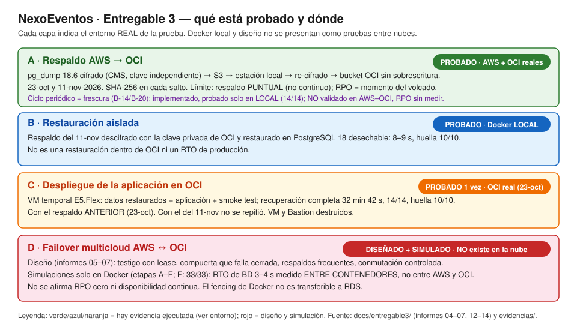
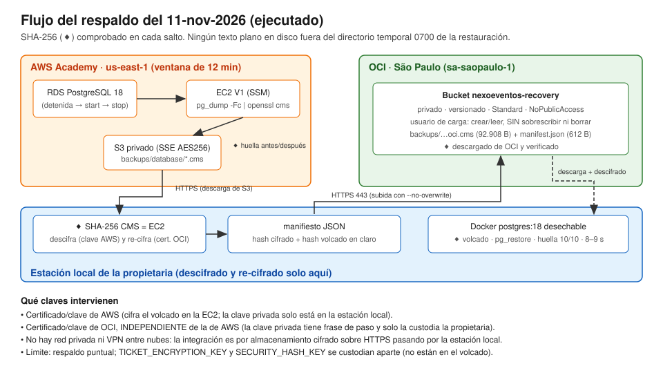
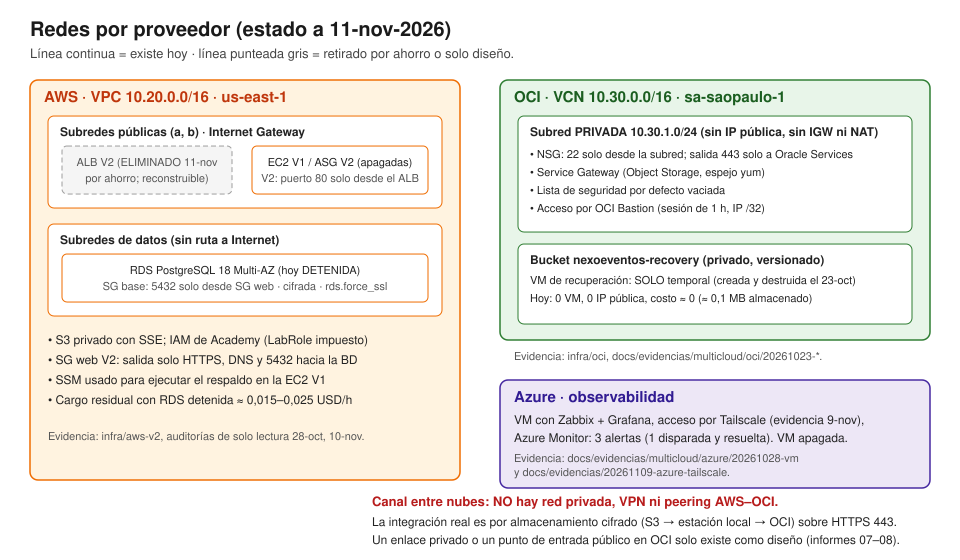

# NexoEventos · Entregable 3 — Informe técnico consolidado (borrador, 11-nov-2026)

> **Fechas clave:** RDS se reinicia sola hacia el **18-nov-2026 ~16:52 UTC** (detenida el 11-nov 16:52:03 UTC) · AWS Academy expira ≈ **26-nov-2026** (se pierden S3, instantáneas de RDS, AMI y secretos de AWS) · Fecha de entrega: **sin confirmar**.
> **Convención de este informe:** cada afirmación indica **dónde se probó**: **[AWS]** real · **[OCI]** real · **[Azure]** real · **[Docker]** laboratorio local · **[Diseño]** no ejecutado. Nada de **[Docker]** o **[Diseño]** se presenta como prueba entre nubes.
> Es un **borrador para revisión**: no es la nota; la «autoevaluación» de la §2 es la lectura honesta de la evidencia frente a la rúbrica.

## 1. Resumen ejecutivo
NexoEventos (React + FastAPI + PostgreSQL 18) corre en AWS Academy (V1: EC2 + RDS; V2: ALB + Auto Scaling + RDS Multi-AZ), con recuperación en OCI y observabilidad en Azure. El Entregable 3 se centró en proteger los datos antes de que expire Academy y en una integración real AWS–OCI sin sobredeclarar.
Lo logrado, **ejecutado y verificado**: (1) respaldo PostgreSQL cifrado de RDS, transferido a OCI con clave independiente, íntegro (SHA-256 en cada salto) y **restaurado** con huella de datos idéntica en 10/10 claves; (2) despliegue de la aplicación en una VM temporal de OCI (23-oct); (3) reducción del gasto con ALB eliminado y RDS detenida, con instantánea previa; (4) un laboratorio Docker que estudió la protección de reservas confirmadas y la conmutación, con **límites declarados**.
Lo que **no** existe: failover real entre AWS y OCI, red privada entre nubes, respaldos programados **validados en la nube** (hay un ciclo periódico implementado y probado solo en local, ver §9) ni RPO cero. Desde el 11-nov hay además componentes **locales** de failover (lease con control de concurrencia, compuerta de escritura apagada por defecto, cambio de DNS preparado, orquestador simulado y verificador de recursos residuales), probados **solo en simulación y en pruebas locales**: **el failover AWS–OCI NO está validado en la nube** (ver §8 y `20-procedimientos-cloud-pendientes.md`).

## 2. Matriz de los 14 criterios (rúbrica original, 20 puntos)
Fuente: `rúbrica proyecto_qod3szrctm (1).xlsx` (hoja «Rúbrica»; 4 niveles Excelente / Bueno / En proceso / Deficiente). Los pesos son los de la columna «Puntaje». **Autoevaluación** = nivel que sostiene hoy la evidencia (no es una nota).
| # | Criterio | Peso | Evidencia principal | Autoevaluación | Falta para el siguiente nivel | Costo |
|---|---|---|---|---|---|---|
| 1 | Análisis del problema y requerimientos | 1,0 | Informes E1/E2, §3 de este informe | Excelente (defendible) | Añadir RTO/RPO **medidos** | 0 |
| 2 | Diseño de arquitectura cloud | 2,0 | Diagramas E2 (`docs/entregable2/diagramas/`), diagramas 01–03 de este informe | Bueno | Diagrama final y coherencia con lo realmente probado | 0 |
| 3 | Redes VPC/VCN | 2,0 | VPC AWS, VCN OCI, Azure (§5, diagrama 03) | Bueno | Declarar que no hay red privada entre nubes; capturas | 0 |
| 4 | Cómputo, almacenamiento y BD | 1,5 | RDS Multi-AZ, EC2, S3, bucket OCI, VM OCI temporal | Excelente | — | 0 |
| 5 | Seguridad cloud | 2,5 | Cifrado CMS dual, IAM mínimo, SG/NSG, TLS, prueba de no-sobrescritura (§7) | Bueno (alto) | CloudTrail sin trail; `verify-full` probado en V2 (4-nov), no verificado en V1; capturas | 0 |
| 6 | Alta disponibilidad y escalabilidad | 1,5 | V2 ALB+ASG+Multi-AZ probado (6-nov 15/15; escalado; failover Multi-AZ ≈ 14 s) | Bueno | HA entre nubes: componentes locales probados **[Local/Simulado]**; **NO validada en la nube**; ALB hoy eliminado | 0 / O2 |
| 7 | Monitoreo y observabilidad | 1,0 | CloudWatch (alarmas V2), Zabbix/Grafana y Azure Monitor | Bueno | Capturas B3/B4/A9; alarmas V2 retiradas por ahorro | 0 |
| 8 | Infrastructure as Code | 1,5 | Terraform 6 raíces; destroy dirigido con plan guardado (11-nov) | Excelente | — | 0 |
| 9 | Backup, RTO/RPO y recuperación | 1,5 | Estrategia + recuperación probada en OCI (32 min 42 s) y local (8–9 s) | Excelente (defendible) | RPO real = intervalo manual; ciclo periódico implementado y probado solo en local (14/14), **sin RPO medido en la nube** | 0 / O1, O3 |
| 10 | Arquitectura AWS–OCI / multicloud | 1,5 | Respaldo AWS→OCI real, seguro y verificable; despliegue en OCI (23-oct) | Bueno (integración funcional limitada) | Integración «viva»: lease/compuerta/DNS/orquestador solo **[Local/Simulado]**; failover AWS–OCI **no validado en la nube** | 0 / O1–O2 |
| 11 | Costos y optimización | 0,5 | §9 | Bueno | Saldo real (captura de Academy) | 0 |
| 12 | Pruebas técnicas | 1,0 | §10 | Bueno | Matriz única con enlaces, conectividad AWS↔OCI | 0 |
| 13 | Documentación técnica | 0,5 | Este informe + 14 informes + evidencias | Bueno | Versión final en Word/PDF con diagramas | 0 |
| 14 | Sustentación y defensa técnica | 0,5 | `16-guion-defensa-entregable3.md` | En proceso | Ensayo y demo local | 0 |
Suma de pesos: 20,0.

## 3. Análisis del problema y requisitos (criterio 1)
Empresa: venta de entradas con reservas confirmadas y validación por QR. Requisitos funcionales: catálogo, reserva con inventario por asiento/zona, entradas con QR, roles (incluidos organizador y operador). No funcionales: integridad (sin sobreventa ni reservas duplicadas), confidencialidad (cifrado en reposo y tránsito, claves de entradas), disponibilidad, recuperación fuera de AWS, costo acotado al crédito de Academy (50 USD). Restricciones: Academy expira ≈ 26-nov, `LabRole` impuesto, sin Cost Explorer, sin cuenta de pago.
**Objetivos de continuidad medidos (no metas):** recuperación completa en OCI 32 min 42 s **[OCI]**; restauración de datos 8–9 s **[Docker]**, 24 s en la VM de OCI **[OCI]**; conmutación de BD 3–4,4 s **[Docker, entre contenedores]**. Metas del equipo («RTO ≤ 10 s», «RPO ≈ 0», «cuatro nubes») **no** son requisitos de la rúbrica y **no** se afirman como logradas.

## 4. Arquitectura (criterio 2)
- **V1:** EC2 + RDS Single-AZ. **V2:** ALB + Auto Scaling 2–3 instancias en 2 zonas + RDS Multi-AZ (`infra/aws-v2`). **[AWS]**
- **Recuperación:** bucket privado versionado y VM temporal en OCI (`infra/oci`). **[OCI]**
- **Observabilidad:** Zabbix + Grafana + Azure Monitor (`infra/azure`). **[Azure]**
- **Failover multicloud (diseño, simulación y componentes locales):** lease con comparación y cambio atómicos, compuerta de escritura que falla cerrada (apagada por defecto), cambio de DNS preparado y orquestador simulado (informes 05–07, 19 y 20). **[Diseño]**, **[Docker]** y **[Local/Simulado]**; **no validado en la nube**.
Justificación de la decisión central: **no** trasladar la replicación síncrona entre nubes: cada COMMIT esperaría el viaje de ida y vuelta (OCI está en São Paulo; latencia estimada 100–130 ms **no verificada**), y el fencing de Docker no es transferible a RDS. Se eligió recuperación entre nubes con respaldos cifrados y conmutación controlada.

## 5. Redes (criterio 3)
AWS: VPC 10.20.0.0/16, subredes públicas y 2 de datos sin ruta a Internet, SG web (V2: 80 solo desde el SG del ALB) y SG de base (5432 desde web). OCI: VCN 10.30.0.0/16, subred privada 10.30.1.0/24 sin IP pública, Service Gateway, NSG, Bastion. Azure: VM de observabilidad por Tailscale. **Entre nubes: no hay VPN ni peering**; el canal es HTTPS 443 a Object Storage/S3 pasando por la estación local. Evidencia: `infra/*`, `docs/evidencias/multicloud/*`.

## 6. Cómputo, almacenamiento y base de datos (criterio 4)
RDS PostgreSQL 18.3 Multi-AZ `db.t3.micro` 20 GiB cifrada (hoy detenida, 5 instantáneas manuales); EC2 `t3.small` (V1, detenida); S3 con SSE AES256; Object Storage Standard en OCI (≈ 0,1 MB por respaldo). Integración probada: la aplicación sobre RDS **[AWS]**; sobre PostgreSQL restaurado **[OCI, 23-oct]**.

## 7. Seguridad (criterio 5)
- **Cifrado:** reposo (RDS, EBS, S3 SSE, CMS AES-256 con clave de AWS y otra **independiente** de OCI); tránsito (HTTPS, `rds.force_ssl`). **[AWS][OCI]**
- **Mínimo privilegio:** usuario de OCI solo crear/leer/inspeccionar; **prueba negativa 11-nov: reintentar subir el mismo objeto fue rechazado** **[OCI]** (`evidencias/oci-subida-respaldo-rds-20261111.txt`). Roles PostgreSQL separados. En AWS, `LabRole` impuesto por Academy.
- **Protección de credenciales:** claves privadas fuera del repositorio; script de auditoría con enmascarado y autorización por SHA-256 (`scripts/multicloud/auditar-*`); copia cifrada de evidencias verificada (hash `a4e57061…e454`).
- **Límites:** CloudTrail solo como historial (sin trail). **V2 conecta a RDS con** `sslmode=verify-full` **y CA fijada: TLS 1.3 y, con otra CA, la conexión es rechazada [AWS, 4-nov]**, evidencia `docs/evidencias/20261104-fase-c-d-v2/resultado.md`; no se probó por separado un nombre de host distinto y el estado de V1 no está verificado. El respaldo no contiene `TICKET_ENCRYPTION_KEY` ni `SECURITY_HASH_KEY` (custodia aparte).

## 8. Alta disponibilidad, escalabilidad, monitoreo e IaC (criterios 6, 7, 8)
- **HA y escalado [AWS]:** V2 con 2 instancias en 2 zonas, reparto 49 %/51 %, 15/15 pruebas funcionales (6-nov, `docs/evidencias/20261106-prueba-real-v2/`); escalado 2→3→2 (alarma a 8 min 6 s); failover Multi-AZ forzado ≈ 14 s con huella idéntica; fallos controlados A–D. **El ALB fue eliminado el 11-nov por ahorro** (reconstruible con un plan de 8 creaciones); estas pruebas son evidencia histórica.
- **HA entre nubes: no existe.** Simulado en Docker: RTO de BD 3,1–4,4 s, **0 reservas confirmadas perdidas en modo protegido** (≈ 7 500) frente a **328 perdidas en modo asíncrono con retraso inducido**; **no es RPO cero** y **no es disponibilidad continua**.
- **Componentes locales de failover (B-10…B-13, B-17) [Local/Simulado; NO validados en la nube]:** lease con escrituras condicionales (22 pruebas, incluidas 8 procesos reales compitiendo y simulaciones con deriva de reloj: sin solapes con margen ≥ ρ·ttl, y con solapes si el margen es menor); compuerta de escritura **desactivada por defecto** que rechaza escrituras sin lease en HTTP, en la base de datos y justo antes del COMMIT (26 pruebas; 6 más garantizan que ningún despliegue la activa; backend completo 151/151); cambio de DNS preparado y **no ejecutado** (14 pruebas con DuckDNS simulado); orquestador de 7 etapas con idempotencia y cancelación segura (19 pruebas, 400 escenarios aleatorios sin doble escritor); verificador de residuos de solo lectura (27 pruebas; consulta real de OCI el 11-nov: 0 recursos; AWS no verificable porque el laboratorio no estaba activo). **Límite:** si un sitio no aplica la compuerta, el lease no lo detiene (el orquestador solo lo detecta); AWS y OCI no comparten base de datos, así que no hay vallado por época en los datos. Evidencias: informe 19 §8 y `evidencias/prueba-local-*`.
- **Monitoreo [AWS][Azure]:** CloudWatch (alarmas V2, hoy retiradas), Zabbix/Grafana, Azure Monitor con 3 alertas (1 disparada y resuelta en 17 min 54 s).
- **IaC:** Terraform (6 raíces), comprobaciones de seguridad de IaC, y el 11-nov un `destroy` dirigido con **plan guardado, revisado y aplicado** (0 altas, 0 cambios, 8 bajas) **[AWS]**.

## 9. Backup, RTO/RPO y recuperación (criterio 9)
| Prueba | Entorno | Resultado |
|---|---|---|
| Instantánea manual RDS `nexoeventos-pre-parada-20261111` | [AWS] | `available`, 20 GiB, cifrada; 5 manuales |
| Respaldo `pg_dump -Fc` cifrado (11-nov 16:46 UTC) | [AWS] | 92.911 B; SHA-256 EC2 = local; PGDMP; huella antes = después |
| Transferencia a OCI sin sobrescritura | [OCI] | 92.908 B; descargado y verificado |
| Restauración aislada del respaldo del 11-nov | [Docker local] | catálogo 119 líneas; huella 10/10; 8–9 s (también ejecutada por la propietaria con su clave de OCI) |
| Recuperación completa en OCI con el respaldo del 23-oct | [OCI] | 32 min 42 s, 14/14, huella 10/10; restauración 24 s; VM destruida |
| Ciclo de respaldo periódico + frescura (B-14, B-20: `scripts/multicloud/backup_cycle.py`, `backup_freshness.py`, unidades `deploy/systemd/nexoeventos-backup.*`) | [Local/Simulado] | 14/14 pruebas con servidor HTTP falso y claves desechables: cifrado CMS, sin texto plano en disco, sin sobrescritura (412), reintentos, URL del PAR nunca impresa, alarma de frescura. **No ejecutado en AWS ni OCI; las unidades systemd no están instaladas; RPO medido: ninguno** |
**Límites:** respaldo **puntual** en la nube (RPO = momento del volcado); el ciclo periódico (cada 30 min por diseño) **solo está probado en local**: su RPO real se medirá en ≥ 3 ciclos con la prueba C-04 (pendiente, requiere ventana AWS y PAR de OCI); el respaldo del 11-nov no se restauró en una VM de OCI; las instantáneas son solo de Academy.

## 10. Pruebas técnicas (criterio 12)
| Tipo | Prueba | Entorno | Resultado |
|---|---|---|---|
| Funcional | Flujo V1/V2 | [AWS] | 37/37; 15/15 (6-nov) |
| Carga | ≤ 50 usuarios | [AWS] | medida hasta 50 usuarios; ≥ 100 es proyección (no medida) |
| HA | Escalado, autohealing, failover Multi-AZ | [AWS] | 2→3→2; ≈ 14 s |
| Seguridad | No sobrescribir en OCI; filtro de secretos | [OCI][local] | rechazado; 9/9 y 16/16 |
| Recuperación | Respaldo → OCI → restauración | [AWS][OCI][Docker] | §9 |
| Monitoreo | Alerta Azure | [Azure] | disparada y resuelta |
| Multicloud simulado | Replicación lógica, fencing, testigo, sincronía | [Docker] | A+E 8/8, B 13/13, C 10/10, D 5/5, F 33/33, F4R 5/5 |
| Respaldo periódico y frescura (B-14, B-20) | Cifrado, sin sobrescritura, reintentos, frescura | [Local/Simulado] | 14/14 (`scripts/multicloud/test_backup_cycle.py`); integrada en `scripts/check-local.sh` y en un job de CI propio (B-19), sin credenciales ni Internet; **no validado en AWS–OCI** |
| Failover local (B-10…B-13, B-17) | Lease, compuerta de escritura, DNS, orquestador y verificador de residuos; «cero cambios por defecto» | [Local/Simulado] | 22 + 26 + 6 + 14 + 19 + 27 pruebas; backend 151/151; **NO validado en la nube** |
Las corridas fallidas y sus correcciones se conservan (`docs/entregable3/evidencias/repl-*`): transparencia, no ocultar defectos.

## 11. Costos y optimización (criterio 11)
| Concepto | Costo estimado (tarifas públicas; sin Cost Explorer) |
|---|---|
| Consumo de Academy a ~10-nov (declarado por la propietaria) | 21,70 de 50 USD; saldo **sin verificar hoy** |
| ALB + RDS Multi-AZ + EC2 V1 | ≈ 0,11 USD/h (≈ 2,6 USD/día) |
| Tras eliminar el ALB (−0,04) y detener RDS (−0,035) | ≈ 0,015–0,025 USD/h residual (≈ 6–10 USD hasta el 26-nov) |
| Ventana del respaldo (12 min, RDS + EC2) | ≈ 0,02 USD |
| VM temporal OCI 23-oct (E5.Flex ≈ 1 h 10 min) | ≈ 0,06 USD (crédito del Free Trial) |
| OCI hoy | ≈ 0 (sin VM, ≈ 0,1 MB) |
**Optimizaciones aplicadas:** apagar entre ventanas; `destroy` dirigido del ALB con plan guardado; instantánea previa y parada de RDS con control del reinicio de 7 días; retención de 7 días en logs; respaldos de ~0,1 MB; OCI sin recursos de pago. **Propuestas:** una sola ventana corta para capturas; usar siempre el calendario de crédito; mantener `outputs/` fuera de Git; reconstruir V2 solo para demostraciones.

## 12. Documentación y evidencias (criterio 13)
Informes 00–20 en `docs/entregable3/`; evidencias con manifiesto SHA-256 (≈ 610 archivos, verificado) en `docs/entregable3/evidencias/`; evidencias de E2 en `docs/evidencias/`. Copia cifrada local verificada; **la segunda copia fuera del equipo sigue pendiente**.

## 13. Limitaciones y riesgos que se declaran
1. Sin failover real AWS↔OCI; Docker no es producción entre nubes. 2. Respaldo puntual, no continuo. 3. Claves de aplicación custodiadas aparte (no en el volcado). 4. Clave privada de OCI con una sola custodia. 5. Reinicio automático de RDS ≈ 18-nov 16:52 UTC. 6. Expiración de Academy ≈ 26-nov. 7. Saldo de crédito sin verificar. 8. El ALB está eliminado: V2 no se puede encender sin reconstruirlo. 9. La VM de OCI del 23-oct usó el respaldo anterior. 10. **El failover AWS–OCI NO está validado en la nube**: lo construido es local y simulado; falta la autoprueba real del almacén del lease, el cambio de DNS real y un simulacro real (procedimientos en `20-procedimientos-cloud-pendientes.md`). 11. El cambio de la compuerta no se ha desplegado en ninguna instancia de AWS ni de OCI.

## 14. Acciones que más puntos aportan por menor costo
Ver la lista priorizada al final de la respuesta que acompaña a este informe y `14-matriz-cumplimiento-y-plan-minimo.md` §4.
