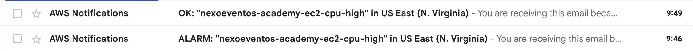

# P2 — Detección REAL de CPU alta en AWS V1 (4-nov-2026, saneado)

**Estado: COMPLETADA.** Alarma activada por datos reales de CPU (sin `set-alarm-state`), recuperada automáticamente, y **ambos correos recibidos** (confirmación de la usuaria + captura recortada, ver sección C). Carga **sintética** (`yes > /dev/null` ×2) en una sola instancia; no equivale a tráfico real.

Horas en **hora de Perú (UTC−5)** salvo indicación.

## Precondiciones (verificadas antes de generar carga)
Sesión válida; EC2 `running` (comprobaciones `ok/ok`), SSM `Online`; RDS `stopped`; alarma `ec2-cpu-high` en `OK` con acciones habilitadas (1/1) y 1 suscripción confirmada, 0 pendientes; 0 alarmas en `ALARM`; créditos de CPU 576 (modo `unlimited`), excedentes 0. Temporizador de Academy confirmado por la usuaria: 03:26 restantes. Crédito de referencia (declarado por la usuaria, no verificable por API): 9,60 de 50 usados.

## Paso 0 y prueba de autoparada (SSM)
- `systemd 252`, `yes` y `nice` presentes, 2 CPU, unidad libre.
- Prueba de autoparada (09:37:59): 1 proceso `yes` con `RuntimeMaxSec=10`; durante la prueba 1 proceso y unidad `active`; tras el límite **0 procesos y unidad `inactive`**. Autoparada **comprobada**.

## Carga principal
Unidad transitoria `nexo-p2-cpu`, 2 procesos `yes`, `RuntimeMaxSec=1500`, `Nice=19`, `MemoryMax=64M`, salida a `/dev/null`.

| Hora | Evento |
|---|---|
| 09:40:03 | T0: inicio de la carga (alineada con el límite de 5 min); unidad `active`, 2 procesos |
| 09:46:40 | CloudWatch: `OK` → `ALARM` **por métrica** (≈ 6 min 37 s tras T0) |
| 09:46:40 | Acción SNS: «Successfully executed action» |
| 09:47:16 | Parada manual por SSM (`systemctl stop`): 0 procesos `yes`, unidad `inactive`. Duración real de la carga ≈ 7 min 13 s (muy por debajo del tope de 25 min) |
| 09:49:40 | CloudWatch: `ALARM` → `OK` automático (≈ 2 min 24 s tras la parada) |
| 09:49:40 | Acción SNS: «Successfully executed action» (acción de OK) |

## Métricas reales (CPUUtilization, periodos de 5 min)
| Periodo (inicio) | Promedio | Máximo | CPUCreditBalance (mín.) | Excedente |
|---|---|---|---|---|
| 09:30 | 1,0 % | 1,0 % | 576,0 | 0 |
| 09:35 | 2,6 % | 8,6 % | 576,0 | 0 |
| 09:40 | **93,9 %** | 100 % | 575,1 | 0 |
| 09:45 | 50,2 % (cierre; la carga paró a las 09:47) | 100 % | 567,2 | 0 |

Motivo registrado por CloudWatch en la transición a ALARM: «2 datapoints [97,83 …; 93,90 …] were greater than the threshold (80.0)». En P1 el motivo era un cambio manual; aquí es una **superación real del umbral**. Consumo de créditos ≈ 9; sin excedentes: **sin coste adicional por créditos**.

## Observaciones y límites (importante)
- **El segundo datapoint (97,83 %) corresponde al periodo de las 09:45 aún abierto** (≈ 1,5 min de datos al evaluar); al cerrar quedó en 50,2 %. La alarma evaluó datos parciales del periodo en curso, por eso se activó en ≈ 6,6 min, **antes de la estimación de 11–15 min del plan** (estimación demasiado pesimista). No es un error: es cómo CloudWatch evalúa, pero conviene no presentar «2 periodos completos de 5 min».
- Las marcas de tiempo del motivo (`14:36`, `14:41`) no coinciden con los límites de periodo observados con `get-metric-data` (09:40 y 09:45 Perú = 14:40/14:45 UTC); **no se ha explicado la diferencia** y no se interpreta aquí. Los valores sí coinciden con la métrica real.
- Recuperación a OK rápida (2 min 24 s) por la misma razón (se evaluó un punto parcial de 62,5 % del periodo 09:45).
- No se probó la autoparada de 25 min de la carga principal (se paró a mano a los ≈ 7 min); sí se probó el mecanismo `RuntimeMaxSec` con la prueba de 10 s.
- Carga en 1 instancia, sin tráfico de usuarios; no valida capacidad ni rendimiento.
- No hubo `set-alarm-state`, ni publicación directa en SNS, ni Terraform, ni cambios en EC2/RDS/V2, ni aborto.

## Estado final (09:50 Perú)
Alarma `OK` (acciones 1/1, habilitadas); 0 alarmas en `ALARM`; EC2 `running` (comprobaciones `ok/ok`); SSM `Online`; RDS `stopped`; sin procesos `yes` ni unidades de la prueba.

## Estado de la evidencia
| Aspecto | Estado |
|---|---|
| Carga real, métrica de CPU, transición automática a ALARM, SNS ejecutado, parada, recuperación a OK, estado final | **Verificado en CloudWatch / SSM / EC2 / RDS por el agente** |
| Recepción de los correos ALARM (09:46) y OK (09:49) | **Confirmada por la usuaria** y **captura guardada** (sección C) |

## C. Recepción de correo (separada de las métricas de CPU)
Las secciones anteriores (métricas, historial, acciones SNS) son evidencia **técnica verificada en CloudWatch/SSM**. Esta sección es la prueba de **recepción**: la usuaria confirmó haber recibido ambos correos y aportó una captura de su bandeja, de la que se conservó **solo un recorte con las dos filas relevantes** (remitente, asunto y hora legibles; sin barra lateral, cuenta, avatar ni otros correos):

- `AWS Notifications` — «ALARM: "nexoeventos-academy-ec2-cpu-high" in US East (N. Virginia)» — **9:46**
- `AWS Notifications` — «OK: "nexoeventos-academy-ec2-cpu-high" in US East (N. Virginia)» — **9:49**

Coinciden con las transiciones del historial de CloudWatch (09:46:40 y 09:49:40, hora de Perú). El original no se modificó (la captura original está en la carpeta de descargas de la usuaria; recorte hecho sobre una copia). La captura no muestra el contenido del mensaje, solo la bandeja.
