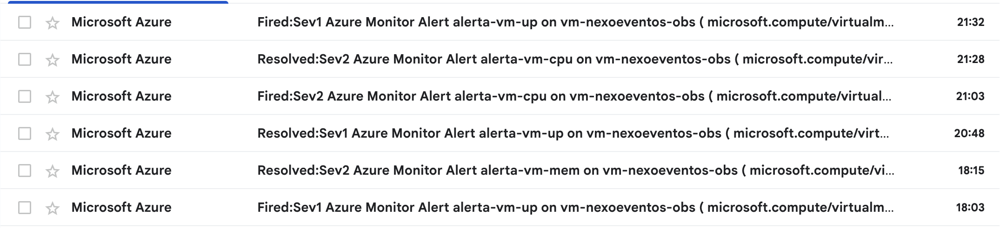

# Ventana de Azure 2 (4-nov-2026, 20:37–21:33 Perú = 5-nov 01:37–02:33 UTC) — resultado (saneado; correos confirmados y archivados; capturas de Grafana pendientes)

Horas en UTC (Perú = UTC−5). VM `vm-nexoeventos-obs` (D2s_v4). Sin Terraform, sin AWS/OCI, sin cambio de discos. **Correos: confirmados por la usuaria y archivados (sección «Correos recibidos»). Capturas de Grafana: pendientes.**

## Prechequeos (aprobados)
IP actual de la operadora = NSG `admin-https` = NSG `admin-ssh` = NSG original guardado = inventario de Ansible (origen del UFW; el UFW se leyó en la copia del disco el 5-nov: 22/443 solo desde esa IP); VM `deallocated`; disco original intacto, instantánea `Succeeded`, discos de reversión/trabajo `Unattached`, 3 bloqueos; `alerta-vm-cpu` = CPU media > 80 %, ventana 15 min, evaluación cada 5 min (umbrales sin modificar); apagado remoto de Azure movido a encendido + 150 min (04:09 UTC) y vigilante local `--minutes 150` (04:08:01Z); coste máximo 150 min × 0,108 USD/h ≈ 0,27 USD ≤ 0,30.

## Línea de tiempo
| UTC (Perú) | Hecho |
|---|---|
| 01:37:58 (20:37:58) | `az vm start`; `running` 01:38:14 |
| 01:43 | Grafana por HTTPS: `/api/health` → base de datos `ok`, versión 13.2.4; login 200; puertos 3000/5432/10050/10051 **cerrados** desde fuera |
| 01:38–01:47 | SSH bloqueado: la clave `nexoeventos_azure` tiene frase de contraseña y el agente estaba vacío; la usuaria la cargó con `ssh-add` (la frase no se solicitó ni se vio) |
| 01:47:21 (20:47:21) | SSH OK (huella verificada con `known_hosts`, `StrictHostKeyChecking=yes`, clave del agente). **Carga**: `systemd-run` transitorio, 2 procesos `yes`, `RuntimeMaxSec=1500` (25 min) |
| 01:48:13 (20:48:13) | **`alerta-vm-up`: Fired → Resolved** (10 min 15 s tras encender) |
| ~01:51 | CPU ≈ 99,5 % de forma sostenida (`metrica-cpu-vm.txt`: 24 minutos > 80 %; 2 % en reposo) |
| 02:03:35 (21:03:35) | **`alerta-vm-cpu` (Sev2) → Fired** (16 min 14 s tras el inicio de la carga; el 28-oct fueron 17 min 54 s) |
| 02:12:23 (21:12:23) | La carga **termina sola** (`journal`: «reached runtime time limit»); 0 procesos `yes`, unidad `inactive` |
| 02:28:33 (21:28:33) | **`alerta-vm-cpu` → Resolved** (16 min 10 s tras el fin de la carga) |
| 02:29:49 (21:29:49) | `az vm deallocate`; `deallocated` 02:30:25 |
| 02:32:11 (21:32:11) | **`alerta-vm-up`: Resolved → Fired** (2 min 22 s tras la orden) |
| 02:33 | Apagado automático restaurado a 17:38 UTC, vigilante cancelado, verificación `--expect vm-off` correcta |

## Observación 3 — alerta real de CPU y correo
**Técnico verificado:** `alerta-vm-cpu` disparada y resuelta por datos reales de CPU (sin forzar estado; `alertas-api.json`, `metrica-cpu-vm.txt`), con el grupo de acciones `ag-nexoeventos-obs` ligado y el receptor `Enabled` en el momento del disparo (a diferencia del 28-oct). **Correo: PENDIENTE de la confirmación de la usuaria** (se esperan «Fired» ≈ 21:03 Perú y «Resolved» ≈ 21:28). Estado: **parcial; se cierra al confirmar el correo**.

## Observación 5 — Grafana
**Verificado por el agente:** Grafana accesible por HTTPS desde la IP permitida con la VM encendida y servicios activos (`nginx`, `grafana-server`, `zabbix-server`, `zabbix-agent2`, `postgresql`, `ufw`). Datos reales de CPU en Azure Monitor durante la carga (`metrica-cpu-vm.txt`). **Capturas de los paneles: PENDIENTES** (las toma la usuaria con inicio de sesión propio, hora visible); no se han aportado a este repositorio. Estado: **parcial/pendiente**.

## Observación 6 — `alerta-vm-up`
Segunda observación real de las **dos transiciones**: `Fired → Resolved` al encender (01:48:13Z) y `Resolved → Fired` al desasignar (02:32:11Z), igual que el 4-nov (22:57:09Z y 23:03:09Z). **Reproducible**: la regla se dispara con un apagado planificado (no distingue voluntario de caída). Correos de `alerta-vm-up`: **pendientes de confirmación**. Estado: **parcial; se cierra al confirmar los correos**.

## Estado final
VM `deallocated`; NSG `admin-https` idéntica a la original; apagado automático Enabled 17:38 UTC; vigilante cancelado; 15 recursos en el grupo (12 + instantánea + 2 discos), 2 grupos, 3 bloqueos intactos; **disco original: solo cambió `LastOwnershipUpdateTime`** (sello de la plataforma que se actualiza al encender/desasignar la VM); tamaño, SKU, seguridad, cifrado, ID y creación iguales; el UFW no se modificó (verificado en vivo antes de apagar: 22/443 solo desde la IP de la operadora). Alerta `alerta-vm-up` queda **Fired** mientras la VM esté desasignada. Zabbix muestra 4 problemas abiertos (sondas de AWS V1 con la RDS detenida, entre otros; no se investigaron). `zabbix-server` (10051) escucha en todas las interfaces, bloqueado por NSG/UFW (endurecimiento pendiente conocido).

## Coste
VM encendida 01:37:58–02:30:25 ≈ 52,5 min × 0,108 USD/h ≈ **0,095 USD** (tarifa pública, sin verificar con facturación; ≤ 0,30). Siguen facturando: disco original, IP estática, Log Analytics y los 3 discos/instantánea de respaldo (≈ 0,33–0,43 USD/día mientras existan).

## Correos recibidos (confirmados por la usuaria el 4-nov-2026 y archivados)

La usuaria confirmó visualmente en Gmail (bandeja principal, no spam) los cuatro correos de la ventana: **20:48** `Resolved:Sev1 … alerta-vm-up`, **21:03** `Fired:Sev2 … alerta-vm-cpu`, **21:28** `Resolved:Sev2 … alerta-vm-cpu` y **21:32** `Fired:Sev1 … alerta-vm-up` (hora de Perú; coinciden con las transiciones de la API: 01:48:13Z, 02:03:35Z, 02:28:33Z y 02:32:11Z). El recorte archivado (`correos-azure-monitor.png`; sin barra lateral, cuenta ni avatar) incluye además dos correos de la ventana anterior: **18:03** `Fired:Sev1 alerta-vm-up` (23:03:09Z) y **18:15** `Resolved:Sev2 alerta-vm-mem` (23:15:45Z). El original sigue en la carpeta de documentos de la usuaria, sin cambios (SHA-256 verificado). **No archivados / no confirmados:** los correos de las 17:50 (`alerta-vm-mem` Fired) y 17:57 (`alerta-vm-up` Resolved) del 4-nov. Solo se ve la bandeja (asuntos y horas), no el contenido de los mensajes.
