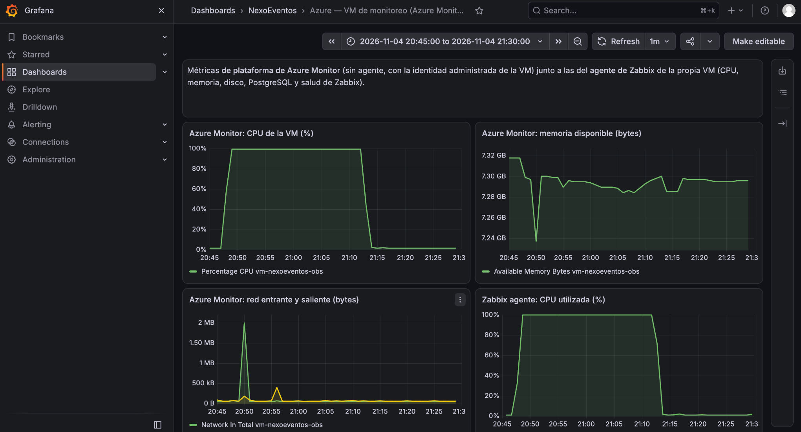

# Ventana corta de Grafana histórico (5-nov-2026, 11:08–11:17 Perú = 16:08–16:17 UTC) — resultado (saneado)

**Estado: ventana ejecutada, Azure apagado y CAPTURA ARCHIVADA; la observación 5 se cierra con límites declarados (sección «Captura archivada»).**

## Prechequeos y protecciones
VM `deallocated`; IP actual = NSG actual = NSG original = origen del UFW (inventario de Ansible); disco original sin cambios (salvo el sello de propiedad), instantánea `Succeeded`, 2 discos `Unattached`, 3 bloqueos; apagado remoto de Azure a las 16:40 UTC y vigilante local `--minutes 30` (16:38:51Z); coste máximo 30 min × 0,108 USD/h ≈ 0,054 USD ≤ 0,06.

## Línea de tiempo (UTC; Perú = UTC−5)
| UTC (Perú) | Hecho |
|---|---|
| 16:09:00 (11:09:00) | `az vm start` (solo `vm-nexoeventos-obs`) |
| 16:09:33 (11:09:33) | **Grafana responde por HTTPS** (`/api/health`: base de datos `ok`), 53 s tras la orden; se entregaron a la usuaria las URL de «Azure — VM de monitoreo» (`nexo-azure-vm`) y del resumen (`nexo-resumen`) con el rango absoluto 01:45–02:30 UTC del 5-nov (20:45–21:30 Perú del 4-nov) |
| 16:16:32 (11:16:32) | La usuaria avisa que tomó la captura; `az vm deallocate`; `deallocated` a las 16:17:09 |
| 16:17 | Apagado automático restaurado (Enabled 17:38 UTC), vigilante cancelado (0 procesos), NSG `admin-https` idéntica a la original, `azure-verify-clean.sh --expect vm-off` correcto, 15 recursos, 2 grupos, 3 bloqueos |

## Evidencia de la observación 5
- **Declaración de la usuaria:** obtuvo una captura real del dashboard «Azure — VM de monitoreo» con CPU de Azure Monitor ≈ 100 %, memoria, red y CPU de Zabbix, para el rango 4-nov 20:45–21:30 (Perú).
- **Archivo:** **no se encontró ninguna captura de Grafana** en el Escritorio, Documentos, Capturas ni Descargas, ni en el portapapeles (los únicos archivos recientes son los correos de Gmail ya archivados y una miniatura de 76×128 px sin relación). **No se archiva ni se afirma evidencia visual hasta que el archivo exista.**
- **Qué se verificó por el agente:** Grafana accesible y sano con la VM encendida; las métricas de Azure Monitor de la ventana existen y están archivadas aparte (`metrica-cpu-vm.txt`: CPU 2 % → 99–100 % entre 01:48 y 02:12Z → 2 %).
- **Cómo cerrarla:** guardar la captura (y la del resumen, si existe) en una carpeta del Mac, indicar su nombre/ubicación; se copiará (sin tocar el original) a esta carpeta, se comprobará su legibilidad y se cerrará la observación si muestra los paneles con datos del rango.

## Coste
VM encendida 16:09:00–16:17:09 ≈ 8,2 min × 0,108 USD/h ≈ **0,015 USD** (tarifa pública, sin verificar con facturación). Siguen facturando: disco original, IP estática, Log Analytics, instantánea y 2 discos de respaldo (≈ 0,33–0,43 USD/día).

## Captura archivada (actualización 5-nov-2026, 11:2x Perú)

- **Qué es:** captura real del dashboard **«Azure — VM de monitoreo (Azure Monitor y agente de Zabbix)»** (Grafana 13.2.4 en la VM de Azure), tomada por la usuaria el 5-nov (≈ 11:10–11:16 Perú) con el rango absoluto **2026-11-04 20:45:00 a 21:30:00** (hora de Perú, visible en el selector de tiempo). Datos **históricos recuperados después de la prueba** (no en vivo durante la carga). Procedencia: la usuaria la compartió en otra herramienta durante la ventana y la **recuperó** de allí; el archivo original está en su carpeta de descargas (SHA-256 del original completo `fbc38be0ee1207a2…`, sin cambios).
- **Qué se archivó:** un **recorte** (2040×1100) **sin la barra del navegador** (la URL contenía la IP pública de la VM y las pestañas mostraban datos personales); se conserva el contenido de Grafana tal cual. El original completo permanece solo en el Mac de la usuaria.
- **Qué muestra (verificado visualmente):** «Azure Monitor: CPU de la VM (%)» sube de ≈ 2 % a **100 %** hacia las **20:49** y baja a ≈ 1 % hacia las **21:13**; «Azure Monitor: memoria disponible (bytes)» entre **7,24 y 7,32 GB**; «Azure Monitor: red entrante y saliente» con dos picos (≈ 2 MB a las 20:50 y ≈ 0,4 MB a las 20:56); «**Zabbix agente: CPU utilizada (%)**» con el mismo comportamiento (≈ 100 % de 20:49 a 21:12).
- **Coherencia con la evidencia independiente:** coincide con `metrica-cpu-vm.txt` (01:47Z 1,6 % → 01:48Z 58 % → 01:49Z 99,5 % → 02:13Z 44 % → 02:14Z 2,3 %; es decir 20:47–21:14 Perú) y con `metrica-memoria-vm.txt` (mínimo 6 902 MiB = 7,24 GB; máximo 6 979 MiB = 7,32 GB), obtenidas por separado de Azure Monitor.
- **Límites declarados:** (1) solo se ve la parte superior del dashboard: **no** están capturados el panel de memoria del agente de Zabbix, los valores/s del servidor de Zabbix ni el resumen multicloud (`nexo-resumen`); (2) son datos históricos recuperados, no una captura en directo; (3) la memoria de Zabbix y los servicios (PostgreSQL, salud de Zabbix) no se muestran en esta imagen.
