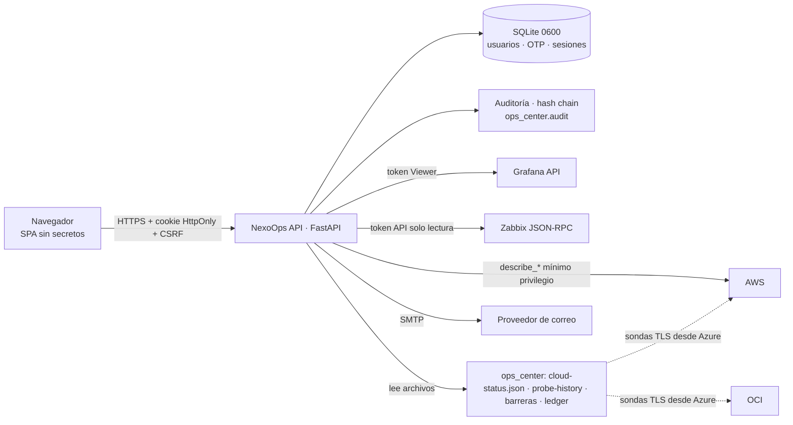

# NexoOps — Centro Inteligente de Operaciones Multicloud

Portal de un único `SUPER_ADMIN_TI` (columna `role` lista para ampliar). Código: `nexoops/`. Rama/worktree aislados: `nexoops` en `../NexoEventos-nexoops`.
Reutiliza `ops_center` (auditoría con cadena de hashes, instantánea del recolector T4, barreras y solicitudes de recuperación) **en solo lectura**; no toca T5, T6, Terraform ni evidencias.

## Arquitectura



## Ejecución local (desarrollo)

```bash
export PYTHONPATH=. NEXOOPS_ENV=dev NEXOOPS_COOKIE_SECURE=0 NEXOOPS_MAIL_MODE=outbox NEXOOPS_OTP_SECRET=<≥32 caracteres> NEXOOPS_DATA_DIR=work/nexoops OPS_CENTER_STATE_DIR=work/ops-center
python -m nexoops create-admin      # pide correo y contraseña (≥12) por terminal
python -m nexoops serve --port 8088
```
`outbox` (solo dev) deja el OTP en `work/nexoops/dev-outbox.txt` (0600); **no es envío de correo**. En producción: `NEXOOPS_MAIL_MODE=smtp` + `NEXOOPS_SMTP_HOST/PORT/USER/PASSWORD/FROM`, y `python -m nexoops send-test-mail` para probar con el proveedor real.
Integraciones: `GRAFANA_URL`, `GRAFANA_TOKEN` (cuenta de servicio Viewer), `NEXOOPS_GRAFANA_EMBED=1` (requiere `allow_embedding` en Grafana), `ZABBIX_URL`, `ZABBIX_TOKEN`, `NEXOOPS_AWS_REGION`, `NEXOOPS_AWS_ASG_NAMES`, `NEXOOPS_TARGETS_FILE`.
Tests: `PYTHONPATH=. python -m pytest nexoops/tests -q` (usa argon2-cffi, fastapi, httpx de `backend/requirements`).

## Seguridad implementada
Argon2id · OTP 6 dígitos (`secrets`), verificador HMAC-SHA256, 5 min, un solo uso, 5 intentos, 3 reenvíos con enfriamiento de 60 s · bloqueo tras 5 fallos por correo o IP · usuario inexistente cuesta lo mismo que uno válido y devuelve el mismo mensaje ·
sesión con token aleatorio (solo se guarda su SHA-256), inactividad 30 min / máximo 8 h, logout y revocación · cookies HttpOnly + SameSite=Strict + Secure (obligatorio fuera de dev) · CSRF por cabecera + comprobación de Origin · CSP estricta, sin `innerHTML` ·
OTP, contraseñas y tokens nunca en logs/auditoría (prueba automatizada) · acciones solo de lista blanca, con límite de frecuencia, confirmación y auditoría (usuario, rol, UTC, operación, recurso, resultado, request_id, execution_id, evidencia).

## Inventario honesto
| Función | Estado |
|---|---|
| Login + OTP por correo, sesiones, CSRF, auditoría | **Real, probada localmente** (33 pruebas automatizadas en total) |
| Envío de correo por SMTP | **Implementado, NO probado** con un proveedor real |
| Diseño (Overview, Infra, Monitoreo, Incidentes, Recuperación, Auditoría, Config, AI) | **Real**, verificado en el navegador con datos de demostración rotulados `simulado` |
| Estado AWS/OCI/Azure (instantánea del recolector T4) | **Real si el recolector corre**; si no, «No verificado» |
| Vista de recuperación (barreras, ledger, fencing, copias, RTO) | **Real**, lee `ops_center`; failover/failback reales **bloqueados** |
| Grafana (listar dashboards, paneles, rangos, enlaces abrir/editar, iframe condicionado) | **Implementado, probado con cliente simulado**; sin probar contra el Grafana de Azure |
| Zabbix (hosts, problemas, historial/recuperación) | **Implementado, probado con cliente simulado**; sin probar contra el Zabbix de Azure |
| AWS (EC2, ASG, ALB, RDS, alarmas, actividades ASG) | **Implementado, probado con cliente simulado**; no se ejecutó contra AWS |
| Consulta directa a OCI con SDK | **Pendiente** (OCI se ve por sondas) |
| Reinicio controlado | Solo **solicitud bloqueada** (no hay segunda persona para aprobar; no se simula) |
| NexoOps AI | **Diagnóstico determinista** (hechos/hipótesis/recomendaciones); **modelo de IA pendiente** |
| Despliegue en Azure (nginx, systemd, TLS) | **Pendiente** |
| Capturas guardadas en archivo | **Pendientes** (vistas verificadas en el navegador integrado) |

## Guion de exposición (4 min)
1. Login: contraseña → código por correo; mostrar que sin el código `/api/overview` da 401.
2. Overview: cada métrica con fuente, hora y «actualizado/desactualizado»; sin recolector aparece «No verificado».
3. Cloud Health + Infraestructura: AWS/OCI/Azure y qué viene de sondas reales.
4. Monitoreo: dashboards Grafana por rango, enlaces Abrir/Editar; problemas y hosts de Zabbix.
5. Recuperación: barreras, fencing, epoch; el failover real está bloqueado por diseño.
6. Incidentes: solicitud de reinicio que queda bloqueada hasta aprobación independiente.
7. Auditoría: cadena de hashes íntegra con request_id/execution_id.
8. NexoOps AI: hechos vs hipótesis vs recomendaciones; IA generativa declarada pendiente.
